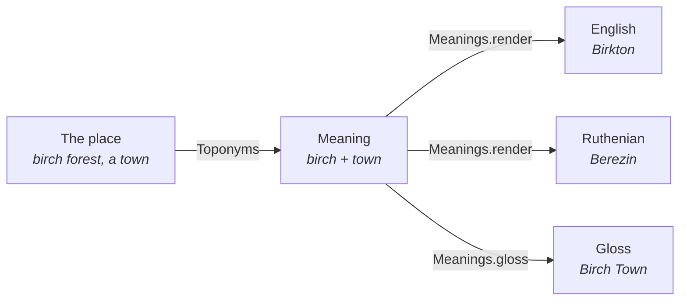
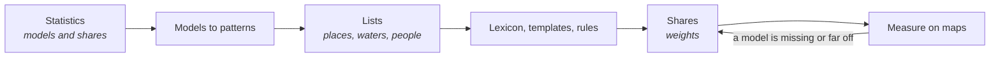

# Semantic names

A burg, state, province, river or lake is named in two steps. First the generator decides what the name **means**, such as "birch town" or "Eadric's farm", from what the map holds at that place. Then the culture's name base **says it its own way**: Birkton in English, Berezin in Ruthenian. The first result is stored as `meaning`, the second as `name`.

Since the meaning is kept apart from any language, a name can be shown in any other name base, and labels can show what names mean.

- Writing a name base's words is covered by the [Names wiki page](../wiki/Names.md#teaching-a-base-its-words).
- Building a base from historical statistics is covered [below](#preparing-a-name-base).
- Field by field data is in the [data model](../architecture/data-model.md#name-meanings).
- The design history is in the [PRD](../prd/semantic-names.md). Where the two differ, this page describes the code.



## Terms

| Term        | What it is                                                                         | Example                             |
| ----------- | ---------------------------------------------------------------------------------- | ----------------------------------- |
| Concept     | A word of a closed vocabulary. Its English word is its id                          | `town`, `black`, `ford`             |
| Proper root | A name with no concept behind it: a person, a river, another burg. Marked with `~` | `~Eadric`                           |
| Pattern     | The shape of a meaning: which slots it has                                         | `owner-generic`                     |
| Meaning     | A pattern with its slots filled, and the base it was coined in                     | `owner-generic: ~Eadric, farm`      |
| Gloss       | A meaning read in plain English                                                    | Eadric's Farm                       |
| Form        | How a name base writes a concept inside a name. Not a dictionary word              | `+ton`, `^sk`, `novo+`              |
| Template    | How a name base lays a pattern out                                                 | `{root}s{generic}`                  |
| Sound rule  | A regex rewrite a base applies where parts meet                                    | `ts+sk` becomes `tsk`               |
| Rendering   | Meaning plus name base gives a name                                                | `new, town` in English gives Newton |

Concepts come in five kinds:

| Kind         | What it is                 | Examples                        |
| ------------ | -------------------------- | ------------------------------- |
| `settlement` | What a burg is by its size | city, town, village, hamlet     |
| `generic`    | What stands at a place     | ford, hill, wood, harbour, keep |
| `modifier`   | What the place is like     | new, black, oak, wolf, king     |
| `numeral`    | How many there are         | three, seven                    |
| `land`       | What a state is            | land, realm, march, isles       |

## Elements

| Element                             | Code                                                                                            | Persisted state                    |
| ----------------------------------- | ----------------------------------------------------------------------------------------------- | ---------------------------------- |
| Concepts, their fit and weight      | [data/name-concepts.ts](../../src/data/name-concepts.ts)                                        | nothing                            |
| Shared templates, weights and rules | [data/name-rules.ts](../../src/data/name-rules.ts)                                              | nothing                            |
| Name bases, one per file            | [data/name-bases/](../../src/data/name-bases/)                                                  | `.map` record 31                   |
| Picking a meaning                   | `Toponyms` ([toponyms-generator.ts](../../src/model/society/names/toponyms-generator.ts))       | `meaning` and `name` on the entity |
| Rendering and gloss                 | `Meanings` ([meanings.ts](../../src/model/society/names/meanings.ts))                           | nothing                            |
| A base's forms and templates        | `Lexicon` ([lexicon.ts](../../src/model/society/names/lexicon.ts))                              | nothing                            |
| Sound rules                         | `SoundRules` ([sound-rules.ts](../../src/model/society/names/sound-rules.ts))                   | nothing                            |
| Foreign roots                       | `Appropriation` ([appropriation.ts](../../src/model/society/names/appropriation.ts))            | nothing                            |
| The written form of base data       | `NameNotation` ([notation.ts](../../src/model/society/names/notation.ts))                       | nothing                            |
| Markov names and personal names     | `Names` ([names-generator.ts](../../src/model/society/names/names-generator.ts))                | nothing                            |
| Gloss in the interface language     | `localGloss` ([name-display.ts](../../src/renderers/labels/name-display.ts))                    | nothing                            |
| Name in other bases                 | `NameTranslations` ([name-translations.ts](../../src/controllers/society/name-translations.ts)) | nothing                            |
| Types                               | [types/names.ts](../../src/types/names.ts)                                                      |                                    |

## Patterns

Nine patterns, fixed, because every name base must be able to render every one. The names below are real output and change when a base's data changes.

| Pattern            | Slots                         | Gloss         | English     | Ruthenian       | Used for                     |
| ------------------ | ----------------------------- | ------------- | ----------- | --------------- | ---------------------------- |
| `simplex`          | root                          | Aldwick       | Aldwick     | Aldvik          | river, lake                  |
| `feature`          | generic                       | The Ford      | Ford        | Brod            | burg                         |
| `modifier-generic` | modifier, generic             | New Town      | Newton      | Novgorod        | burg, river, lake, island    |
| `owner-generic`    | root, generic                 | Eadric's Town | Eadricswick | Eadrikov        | burg, lake, island           |
| `generic-of`       | generic, root                 | Mouth of Exe  | Exmouth     | Ekseskoye Ustye | burg                         |
| `compound`         | modifier, generic, settlement | Red Hill City | Redhill     | Chervonoholmye  | burg                         |
| `relative`         | modifier, root                | New Barton    | New Barton  | Novyi Barton    | burg, colony province        |
| `root-land`        | root, generic                 | Land of Frank | Frankland   | Frankia         | state, province, continent   |
| `modifier-land`    | modifier, generic             | East Realm    | East Realm  | Vostochnia      | state, province, continent   |

A numeral stands in the modifier slot: `modifier-generic: three, tower` gives Three Towers and Tri Vezhi.

## What gets a meaning

| Entity   | Named in                                 | Base it is coined in                         | What it says                                                                                    |
| -------- | ---------------------------------------- | -------------------------------------------- | ----------------------------------------------------------------------------------------------- |
| Capital  | `Burgs.generate`                         | its culture's                                | as a burg; it is always a `city`                                                                |
| Burg     | `Burgs.specify`, once its group is known | its culture's                                | always a meaning, see below                                                                     |
| State    | `States.generate`                        | its culture's                                | a land around a root or a modifier, never a bare name                                           |
| Province | `Provinces.generate`                     | the local culture's; a colony's, its state's | its burg's meaning, or a land as a state is; a colony is new + its state's or a province's name |
| River    | `Rivers.specify`, before burgs           | the culture's at its mouth                   | half are proper names, off the base's list of waters; half say what the water looks like        |
| Lake     | `Features.defineNames`, before burgs     | the culture's on its shore                   | as a river, or after a person                                                                   |
| Island   | `Features.defineNames`, before burgs     | the culture's on its first cell              | an island like something, or someone's; a continent is named as a state is                      |

Rivers and lakes are named before burgs so a burg can be named after them. States are named after capitals, so capitals are named first; the states take their names once they have expanded. A religion that needs a burg's name before the burg has one names it on the spot (`Toponyms.nameOf`); that name says nothing of the burg's size.

Seas, routes, markers and religions have no meanings.

### Lands and islands

A state, a province not named after its burg and a continent are lands, and an island is an island: none of them is named like a town. `Toponyms.coinLand` draws `root-land` or `modifier-land` by the base's weights and ends the name in a land word of the base, the state suffixes:

- **The root** is a person (`FOUNDED`, 40%) or a people. A people's name is a stem, the start of a place name cut before the ending that makes it a town (`Names.getStem`): Heibach gives Heib. A stem closes in consonants the base's names close in, so Waldbach gives Wald, not Waldb. One state in five takes the person or the river its capital is named after.
- **The suffix** is a form of a land concept. `land` leads, and holds most of a base's suffixes: German -land; French -ogne, -agne, -aine; Finnish -maa; Korean -ryeo, -ra. `realm` (-reich, -guk), `march` (-mark), `domain` and `country` (-gau) add some by the land's size; `coast` and `isles` ask for the place. A suffix that stands after a name only is a template of `root-land`, which may leave the land word out: `{root}ien` gives Frankien, and there is no Altien. A land word with only standalone forms (Regnum, Marca) is skipped, so no state is the Kingdom of Regnum. Such words stay for names translated from other bases.
- **Size leans on the name** (`LAND_SITES`, `BIG_DESCRIBED`). A big land, one of a kingdom's or an empire's area, is more often a `realm` and seldom a `march`, `domain` or `country`, and is named after a person or a people: a describing word tells what the capital stands by, which suits a duchy. A small land leans the other way, and a province is small. States are therefore named once they have expanded (`States.getLandSize`). A name is never changed when a state grows or shrinks. A word of one size goes on the line of that size, not on `land`, or it ends any land's name.
- **A long name is drawn again** (`LAND_LENGTH`, 10 letters in a word), a few times, and the shortest is kept. A state named after a long river needs no land word: Platvliet, not Platvlietsland. A person's or a people's name never stands alone.
- **No two lands share a name.** A new state or province repeats no state, province or burg; a province may take its own burg's name (`BURG_NAMED`, 35%), if no land has it.
- **No suffix ends a town.** A base's land suffixes are kept apart from its settlement endings, and a test checks it.

## How a burg's meaning is picked

`Toponyms.burg(burg)` does this:

1. **Read the site.** `getSite` turns the map into tags with a strength: `port`, `coast`, `lake`, `island`, `stream`, `river`, `mouth`, `hill`, `mountain`, `plain`, `forest`, `marsh`, `desert`, `cold`, `hot`, `ore`, `big`, `small`, `capital`, a side of the map, and `nomadic`. The culture type raises its own tags: Naval the coast, Highland the hills.
2. **Find what the name can build on.** The settlement type from the burg's group, a landmark the place stands out for, the lie of the land, the river or lake it stands by, and a named burg of the same culture nearby.
3. **Draw a pattern** by the base's weights, from the patterns the place supports. No river or lake nearby means no `generic-of`; no neighbour means no `relative`.
4. **Fill the slots.** A concept is drawn by how well it fits the site times how common it is in real names. Commonness counts squared, so a few words such as `new`, `old` and `ford` name many places and most words few, as in real names.
5. **Render and check.** The name must be free on the map, within the base's length, and say the whole meaning. If not, other forms of the same meaning are tried, then another meaning, up to 12 times. A burg nothing fits takes a generated proper name.

Three rules shape the result:

- **Most names end in what the burg is.** In 85% of draws (`settled`; English sets 65%) the generic slot is the burg's settlement type. So `birch` gives Bircham for a city, Birkton for a town, Birchton for a village and Birchrest for a hamlet. The rest are named for what stands there: a ford, a hill, a wood.
- **A concept never contradicts the place.** `harbour` asks for the `port` tag, `mouth` for a river mouth or a confluence, `mine` for ore. A concept with no tag fits anywhere, but weakly.
- **A good made at the place is favoured**, where its name is a concept: a burg on salt is likelier to be a salt town.

The burg group maps to a settlement concept by name: `capital` and `city` to `city`, `town`, `village`, `hamlet`, `fort`, `monastery` to `abbey`, `caravanserai` to `camp`, `trading_post` to `market`. A custom group goes by its size limits (`settlementOf`).

## How a meaning becomes a name

`Meanings.render(meaning, baseId)` does this:

1. **Adapt foreign roots.** A root coined in another base is brought to this base's sounds: `~Eadric` is Eadrik in Ruthenian and Eadarico in Japanese. A base's own roots stand as coined.
2. **Draw a template** for the pattern by its weight: `{modifier}{generic}` or `{modifier} {generic}`. A template may leave out what the burg is by its group, as `{root}` does for a town named after its river; a land may go unsaid too, as in `{root}ia`. It never leaves out a name or what stands at the place.
3. **Draw a form for each concept** by weight, from the forms that may stand where the template puts them. A suffix needs a stem or a proper name before it, a describing word takes the gender of its noun, and a place word that describes another joins it: Fordhall, never Ford Hall.
4. **Join the parts** with `+` between and run the sound rules: `exe+mouth` becomes Exmouth. Every word then takes a capital, but joining words such as de, di, sur and of between two others: Pont-sur-Moselle, Puebla de Sanabria.
5. **Shorten a name that is too long**: shorter forms, then roots clipped at a syllable (`Names.cut`: three letters at least, closing as the base's names do), then no modifier. Another place's name, as in New Barton, is never clipped. Each word may be as long as the base allows, the whole name twice that.

A part that repeats the one before it, Harlan-land or Barley-ley, makes a name that is not whole, and so does a root clipped to less than two thirds, Ana of Anahita: generation draws another. A name is never an ending alone: where giving up the modifier would leave Ni of a Swahili pine hamlet, the long name stays.

Every draw is seeded by the base, the pattern, the tokens and the salt. The same meaning and base give the same name on every call, in every session.

**Salt** re-rolls the draw. `new, town` in Ruthenian is Novgorod with no salt and Novogorod with salt 2. Generation sets a salt only when the first rendering will not do: it is taken, too short or cut.

### Where forms come from

A base can render any concept. `Lexicon.formsOf` takes the first source that has the concept:

1. The base's own lexicon.
2. The lexicon of the base it `extends`.
3. The shared lexicon, which holds only `land: +ia`.
4. Forms coined from the base's place names: its commonest endings for settlements and places, and words off its Markov chain for the rest. They depend on the base's place names and sound rules alone, so writing a concept moves no other's coined forms.

English and Ruthenian are written in full, against counts of their historical place names. Human Generic extends English and rewrites what makes it high fantasy, see [below](#human-generic). Every other real-world base writes its real place-name words and, where describing words agree, a grammar, for every place and describing word that names often draw: `new, town` is Neuenheim in German, Neuville in French, Castiglione Nuovo in Italian, Nowabad in Persian, Mji Mpya in Swahili. Halfling extends English the same way. The other fourteen fantasy bases write an invented tongue for the same concepts. Some are written after published word lists: Sindarin and Quenya (Eldamo), Valyrian and Dothraki (the Language Creation wiki of Peterson's languages), Dovahzul (UESP), Orc (the Black Speech, with fan-made words) and Celestial (Dee's Enochian). A base says in its `description` what it is made of. A Sindarin describing word is softened after its noun, Caras Galen; a Valyrian one agrees with it, Zobrior Blenon; Dothraki puts the noun first, Vaes Sash. Dwarven takes Tolkien's words where he left them. The famous places and persons of the tales are left out. What a base leaves out is coined from its place names: the commonest endings of the corpus for a settlement, a word off its Markov chain for the rest. A base the user adds starts with no words, so its names sound native but mean nothing a speaker would know until its Lexicon tab is written. A base that writes two thirds of the places is a real language: generation draws only concepts it writes (`Lexicon.spoken`), so that no coined word stands among real ones. Its coined forms serve names translated from other bases alone. Those seven, Dwarven, Giant and Goblin are over that share too; the other fantasy bases stay under it on purpose, since a coined word fits an invented tongue. No word is coined that the base has written or coined already, as far as its corpus has short words to spare. A coined form is stable: the same concept always gets the same form in a base.

## Name and meaning are independent

`name` and `meaning` are separate fields and neither overwrites the other. The user may type any name, so a name can differ from what its meaning renders to. Nothing re-renders a name silently. These actions offer the new name and wait for a yes:

| The user changes            | Offer                                      | Code                 |
| --------------------------- | ------------------------------------------ | -------------------- |
| A burg's or state's culture | the same meaning in the new culture's base | `Toponyms.nameIn`    |
| A culture's name base       | the same for all its unlocked burgs        | `Toponyms.nameIn`    |
| A burg's group              | the same meaning ending in the new group, drawn the nearest to the old name | `Toponyms.regrouped` |

A meaning records why the name was given and is not checked again: a town keeps "harbour" in its name after its port is removed.

A name with no meaning, from an old map or typed by hand, is treated as a proper name of its culture's base (`Meanings.simplex`). It can still be shown in other bases, where only its sounds are adapted.

## Where the user sees it

- **Burg, state, province, river and lake editors**: the gloss under the name, and a button that lists the name in every name base, with one click to take any of them.
- **Regenerate name** in those editors coins a new meaning, not just a new name.
- **Options → Personal names**: founders are generated, picked from the base's list as they are, or as each base sets.
- **Tools → Namesbase**: the Namesbases Overview lists the bases; the Namesbase Editor edits one on the tabs Names, Lexicon, Patterns and Rules, beside examples seeded so that an edit shows on them (`Toponyms.sample`).

## Using it in code

```ts
const { name, meaning } = Toponyms.burg(burg); // coin a meaning that fits the place, and its name
Meanings.render(meaning, "ruthenian"); // the same meaning in another base
Meanings.gloss(meaning); // "Birch Town"
localGloss(meaning); // the gloss in the interface language
Meanings.simplex(burg.name, baseId); // a meaning for a name that has none
Toponyms.nameIn(burg, cultureId, origin); // its name in a culture's base; undefined when it would not change
```

| To                                   | Do                                                                                                                                                                                                                                                                                                                                    |
| ------------------------------------ | ------------------------------------------------------------------------------------------------------------------------------------------------------------------------------------------------------------------------------------------------------------------------------------------------------------------------------------- |
| Find why a place got its name        | Read its `meaning`: the pattern and tokens say what was picked. The editor shows the same as a gloss                                                                                                                                                                                                                                  |
| Add a concept                        | Add it to its kind in `name-concepts.ts` with the tags it `fits` and a `weight` from 1 to 10, which counts squared: a 10 is drawn a hundred times as readily as a 1. Add its label to `CONCEPT_LABELS` in `data/id-labels.ts`. Write its forms in `english.ts` and `ruthenian.ts`; a test fails without them. Other bases coin a form |
| Make a concept depend on the map     | Give it a tag in `fits`. For a new tag, add it to `SiteTag` and set it in `Toponyms.getSite`                                                                                                                                                                                                                                          |
| Change how often a pattern is coined | `DEFAULT_WEIGHTS` in `name-rules.ts` for all bases, or `patterns.<pattern>.weight` in one base. 0 turns it off                                                                                                                                                                                                                        |
| Teach a base real words              | Follow [Preparing a name base](#preparing-a-name-base); the notation is on the [wiki page](../wiki/Names.md#teaching-a-base-its-words)                                                                                                                                                                                                |
| Add a pattern                        | `Pattern` type, `SLOTS` in `meanings.ts`, `DEFAULT_TEMPLATES` and `DEFAULT_WEIGHTS` in `name-rules.ts`, `Meanings.gloss` and `localGloss`, and a branch in `Toponyms` that fills it                                                                                                                                                   |
| Give another entity a meaning        | Add `meaning?: Meaning` to it, name it through `Toponyms`, and show the gloss and `NameTranslations.open` in its editor                                                                                                                                                                                                               |

## Preparing a name base

A base with real words is prepared against how the language really forms its place names. Ruthenian ([ruthenian.ts](../../src/data/name-bases/ruthenian.ts)) was prepared this way, against a count of Old Rus' place names of the 10th to 14th centuries by word-formation model, and is the example below. English ([english.ts](../../src/data/name-bases/english.ts)) followed, against counts of medieval English place names; where it taught something more, the step says so.



### 1. Collect the statistics

Find a study that counts the language's place names of the period by how they are formed. For each model write down its share, its sub-types with their shares, and two or three real names. Note also what differs by the size of a settlement, how rivers are named, and how often a place is named after a woman.

Without the numbers a base gets the models its author remembers, not the ones the language uses.

Where no study counts the models, count them: a list of the places of the period, sorted by ending, gives the shares of the endings, the commonest whole names and the share of one-word names. English was set against such a count of the 14,300 places of Domesday Book in their modern spelling, with published figures for what a list cannot show: how many names hold a person's name, and how many of those a woman's.

### 2. Say each model with a pattern

The nine patterns are fixed, so a model becomes a pattern, a template and the forms of the base:

| Model in the statistics            | Example            | Pattern            | Written as                                            |
| ---------------------------------- | ------------------ | ------------------ | ----------------------------------------------------- |
| Possessive suffix on a person      | Kiev, Yaroslavl    | `owner-generic`    | `{root}{generic}`, settlement forms `^ov`, `^j`       |
| A founder's kin                    | Miloslavichi       | `owner-generic`    | `{root}{generic}`, village forms `^ichi`, `^ovichi`   |
| Suffix on a river's name           | Polotsk, Pinsk     | `generic-of`       | `{root}sk`                                            |
| A river's name as it is            | Moskva, Voronezh   | `generic-of`       | `{root}`                                              |
| A common word, also in the plural  | Brod, Luki         | `feature`          | words under the concept: `ford: Brod`, `meadow: Luki` |
| Prefix and suffix on a common word | Zalesye, Podgorye  | `feature`          | words under the concept: `wood: Zalesye`              |
| Describing word and noun in one    | Novgorod, Belgorod | `modifier-generic` | `{modifier}{generic}`, forms `nov*`, `+gorod`         |
| The same with a suffix of its own  | Beloberezhye       | `compound`         | `{modifier}{generic}'ye`, a rule for the join         |
| Two words                          | Novyi Torg         | `modifier-generic` | `{modifier} {generic}`                                |
| Told apart from a namesake         | Nizhniy Novgorod   | `relative`         | `{modifier} {root}`, `{root} {modifier}`              |

A model that cannot be written is first a question to the engine: can a template or a form be allowed more, for every base? A river's name as it is and a template's own suffix came this way. A model that still cannot be said is left out and noted, never forced into a pattern it does not fit. Ruthenian leaves out verb and noun names and names of a people in -ane.

Before writing a model as whole words, render a few meanings and see what the generator builds unaided. It puts a landscape word before a settlement ending by itself, `heath, town`, so English Morton, Clifton and Marston need only the combining forms `mor+`, `clif+` and `mars+` on the concept's line.

### 3. Fill the lists

- **Places**: real place names, spelled as the lexicon is. They feed the Markov chain and the forms coined for unwritten concepts. A word off the chain that puts three letters together as no name of the list does is walked anew, so a foreign name on the list lets foreign sounds in.
- **Waters**: rivers and lakes that sound native, are known and are short; Ruthenian keeps to 8 letters. Set `mode: "pick"` where the chain makes rough names of them.
- **People**: male and female names, in full. The lists name more than founders, so a list is never cut to change how often something is drawn. A share has a setting, see step 5.

### 4. Write the lexicon, templates and rules

The notation is on the [wiki page](../wiki/Names.md#teaching-a-base-its-words). The statistics say what to write:

- The endings a settlement of each size takes go to `city`, `town`, `village` and `hamlet`, weighted by their sub-shares.
- A word the statistics name as its own model goes under its concept as a word, as Zalesye does under `wood`.
- A rule is written for what real names do where parts meet: `yaroslav+j` becomes Yaroslavl, `bereg+'ye` becomes berezhye.
- A rule also keeps a model where real names have it. English `-ing-` cuts the founder to a syllable, `edwin+ing+ton` to Eddington, and stands only before the endings it has in real names; before any other the name takes `s`.
- A name too long is a rule's business before the engine clips it: `fishwater+bridge` becomes Fishwater Bridge.

### 5. Set the shares

| What the statistics give                   | Setting                            |
| ------------------------------------------ | ---------------------------------- |
| How common a model is                      | `patterns.<pattern>.weight`        |
| How a pattern is laid out                  | the weight after a template        |
| Which ending or word                       | the weight after a form            |
| Names that end in what the burg is         | `settled`                          |
| Women among the people places are named by | `patterns["owner-generic"].female` |

A weight is how often a pattern is tried, not its share of names. Ruthenian tries `feature` with a weight of 45 and gets 15% of names from it, since there are few such names and they are soon taken. So the shares are measured, not computed.

### 6. Measure on generated maps

Write a temporary scenario test beside the generator and delete it afterwards:

1. Generate several maps; six gave 5,400 burgs.
2. Set every culture's base to the one under review, then name rivers and after them burgs.
3. Keep the set of taken names per culture. One set for a map with a single base runs out of short names and hides the real shares.
4. Dump every name with its meaning and sort the names into the models of the statistics, by pattern and ending.

Then read fifty names of each model. Wrong agreement, doubled suffixes and clipped names show in the names, not in the shares. Look also at the longest names and at how many burgs fell back to a proper name; under 1% is fine.

```bash
CI=1 npm run test:scenarios -- toponyms
```

### 7. Tune, then stop

The base should resemble the statistics, not match them. It is done when every model appears and the large ones stand in the right order; two or three rounds of weights are enough. Ruthenian was left at this reading:

| Model             | Historical | Generated |
| ----------------- | ---------- | --------- |
| Suffix            | 55–70%     | 57%       |
| Two stems in one  | 10–15%     | 20%       |
| No affix          | 8–12%      | 12%       |
| Prefix and suffix | 5–10%      | 4%        |
| Two words         | 3–5%       | 6%        |

English, by choice with far fewer names in -ton and more fantasy endings (-haven, -hold, -crest, -watch) and owners' names (Alfred's Keep) than the count has:

| Share of names             | Domesday count | Generated |
| -------------------------- | -------------- | --------- |
| -ton, -ington              | 27%            | 8%        |
| -ley                       | 6%             | 7%        |
| -ham, -ingham              | 6%             | 6%        |
| -by                        | 4%             | 5%        |
| -ford                      | 4%             | 2%        |
| -field                     | 2%             | 2%        |
| Norse endings              | 7%             | 6%        |
| One word alone             | 3%             | 2%        |
| More than one word         | 23%            | 19%       |
| A person's name, of all    | 20–40%         | 27%       |
| A woman's, of those        | 5%             | 5%        |
| A river's name in the name | 2%             | 2%        |
| Fantasy ending or owner    | none           | 19%       |

#### Human Generic

Human Generic ([human-generic.ts](../../src/data/name-bases/human-generic.ts)) is English as high fantasy tells it, after the naming of Tolkien's Men and Martin's Westeros, with no statistics behind it. It extends English, so animals, trees, trades and numerals keep English's forms, and writes its own:

- **Describing words that stand apart or join**: `black`, `grey`, `iron`, so Black Keep and Greyhaven both happen. English writes them `black+`, start only.
- **Seats and fantasy endings**: cities in -haven, -gate, -hold, -fall and Landing; towns in Watch, Rest, Hold and Hall; forts in Keep, Hold, Castle; vales, hollows and dells.
- **Possessives**: `{root}'s {generic}` for founders, and words such as Storm's and Winter's.
- **Lands, not founders**: `modifier-land` outweighs `root-land` (Westlands, Iron Marches, Stormshire).
- **People and rivers picked as they are**, from its own lists.

| Share of names | Generated |
| -------------- | --------- |
| Two words      | 47%       |
| Possessive     | 17%       |
| -ton, -ham     | 5%        |

A gap the base cannot close is a question to the generator. Fords and fields were ten times too rare, and New, North and Old drowned among 300 rarer words, until the generator counted commonness squared, read low woodland as fields too, and let a ford stand on a large river.

### 8. Test what must not break

Test what a rule makes of a join, agreement, and forms that are drawn often. Do not test shares, exact sets of forms or forms drawn seldom: such tests fail by chance and on every change of weights.

## Rules to keep

- **Rendering is pure.** `Meanings` never draws from `Math.random`. A change that breaks this makes saved maps show other names in the translations list and on labels.
- **Burgs, rivers, lakes and generated states are named on a random sequence of their own**, seeded by the map seed and the entity's id. Naming one does not shift the draws of another or of the rest of the generation.
- **The same seed gives the same names**, and a scenario test checks it. Reordering the draws in `Toponyms` keeps that true but changes the names every existing seed gives.
- **Names do not repeat** among burgs, among states and among rivers.
- **A state takes only a land word its base has written.** A coined one would name a state like a town.
- **Loading a map never coins meanings.** An old map keeps its names as they are; its name bases and culture bases are converted once in `migrateLegacyNameBases`.
- **A base is loaded before anything is named in it.** Naming is synchronous and loads nothing: the bases the cultures use are loaded by the pipelines, on map load and where a culture takes another base. What offers every base calls `Names.loadAll` as it opens, and so does `regenerateMap` before it erases the old map: a wait amid the generation would paint the map empty.
- **A shipped base the user left as it is saves by its id alone**, so it follows later data updates. Stored names do not change; new renderings do.

## Tests

| File                                                               | Covers                                                                                                      |
| ------------------------------------------------------------------ | ----------------------------------------------------------------------------------------------------------- |
| `meanings.test.ts`                                                 | gloss, rendering in every base, forms, agreement, numerals, shortening                                      |
| `toponyms-generator.scenarios.test.ts`                             | a generated map: every burg has a meaning, no repeats, concepts fit their place, same seed gives same names |
| `names-generator.test.ts`                                          | base data: ids, rules that compile, the vocabulary written in English and Ruthenian, save and restore       |
| `notation.test.ts`, `sound-rules.test.ts`, `appropriation.test.ts` | the written form, the rules, foreign roots                                                                  |

```bash
npx vitest run src/model/society/names
```
