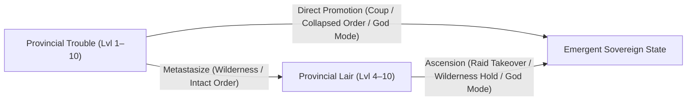
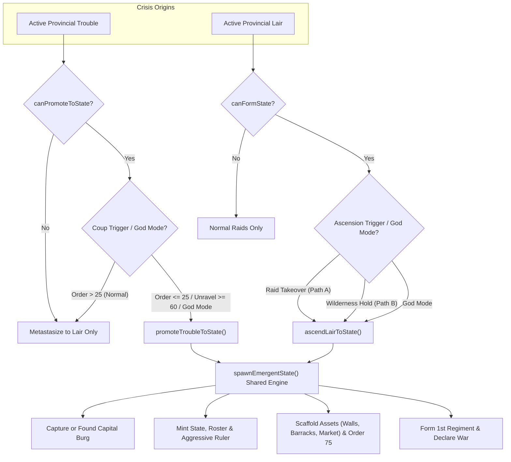

# Plan — Emergent Sovereign Realms: Trouble Promotion & Lair Ascension

Updated: 2026-10-29. Status: **planned**.

Companions: [living-world.md](living-world.md), [unified-figures.md](unified-figures.md), [openconquest-old-world-rosters.md](openconquest-old-world-rosters.md), [culture-traits.md](culture-traits.md).

---

## 1. Executive Summary

In the Living World simulation, provincial crises currently follow a linear path that stops at entrenched lairs:

$$\text{Provincial Trouble (Lvl 1–10)} \xrightarrow{\text{seasons / unchecked}} \text{Fortified Lair (Lvl 4–10)} \xrightarrow{\text{military / delves}} \text{Dismantled / Smite}$$

To make the political map truly dynamic, both **Provincial Troubles** and **Entrenched Lairs** should be capable of giving birth to **new sovereign states** (`pack.states`):

1. **Direct Trouble $\rightarrow$ State Promotion (`promoteTroubleToState`)**:
   Factional, revolutionary, and political troubles (exiled lords, demagogues, class uprisings, corrupt governors, secret societies, fanatical cults) do not always retreat into the wilderness to build a dungeon camp. When provincial order collapses or a crisis boils over inside a settlement, they can **stage an immediate coup or revolution**, seizing the province and proclaiming a breakaway realm on the spot.
2. **Lair $\rightarrow$ State Ascension (`ascendLairToState`)**:
   When a trouble first metastasizes into an outlaw or warlord **Lair** (or spawns in the wilds) and is left unchecked, its master grows in power through seasonal raids and eventually **ascends into a sovereign polity**—either by capturing a vulnerable settlement during a raid or by fortifying its wilderness stronghold into a permanent capital.

---

## 2. Core Decisions & Rules

1. **Polity-Capable Archetypes Only**:
   - **Lairs (15 of 20)**: Only organized, sentient, or culturally cohesive lairs can form states (warlords, mutinous garrisons, bandits, cults, cabals, outcasts, hordes, fiendish/undead courts). Mindless beasts, aberrant swarms, environmental blights, and solitary hermits remain purely martial/delve hazards.
   - **Troubles (19 of 37)**: Only factional, political, insurgent, cultic, or warband troubles can directly promote into states. Environmental, economic, plague, infrastructure, and mindless monster troubles (`flooding`, `recurrent_sickness`, `no_workers`, `inaccessible`, `monsters`, `relic_golems`, etc.) cannot form governments directly—though if left unchecked, they can still metastasize into lairs.
2. **Opportunistic Capital Acquisition**:
   Emergent rulers are pragmatic opportunists. Whether promoting from a Trouble or ascending from a Lair, the new state secures its capital via two paths:
   - **Path A (Settlement Takeover / Coup)**: Seizes an existing vulnerable burg in the province (or a raid target stripped of defenses/order) as its capital.
   - **Path B (Wilderness Hold Proclamation)**: If no burg exists in the province (or the faction is entrenched at a remote site), founds a brand-new settlement directly on `trouble.cell` / `lair.cell`.
3. **Initial Aggression**:
   Every emergent realm starts with an aggressive AI posture driven by ruler alignment, vices (`cruel`, `ambitious`, `wrathful`), high expansionism ($0.8$), immediate `"Enemy"` diplomatic status with its former sovereign, and active mutual claims/grudges.
4. **Viable Resource & Capacity Foundation**:
   Emergent realms receive adequate starting capacity generation (`M`/`W`/`S`), core province order ($75$), foundational fortress/civic assets (`stone_walls`, `barracks`, `market`/`forge`), a free garrison waiver, and a $150$ gold war chest so their starting army does not trigger instant capacity deficits or unravel spirals.
5. **Standard Living World Rules After Birth**:
   Once founded, the state is a first-class `pack.states` polity—mustering from its assigned roster, constructing buildings, developing provinces, declaring wars, and facing rebellions.

---

## 3. Archetype Classifications & State Profiles

### 3.1. Lair Archetypes (`src/data/living-lairs.ts`)

Of the 20 generic fantasy Lair archetypes, **15 are State-Capable**:

| Lair ID | Archetype Name | State Capable? | Conquest Roster (`rosterId`) | Polity Form / Suffix | Default Alignment |
| :--- | :--- | :---: | :--- | :--- | :--- |
| `aspiring_warlord` | Aspiring Warlord | **Yes** | Local / `steppe` / `chivalric` | Despotate, Warband, Horde | Chaotic / Evil |
| `ancient_fort` | Ruined Keep | **Yes** | Local / `empire` | Iron Barony, Freehold | Lawful Evil / Neutral |
| `renegade_outpost` | Mutinous Garrison | **Yes** | Local / `renaissance` | Renegade Junta, Free Legion | Chaotic Neutral / Evil |
| `bandit_camp` | Bandit Camp | **Yes** | `tribal` / `default` | Outlaw Confederacy, Brotherhood | Chaotic Evil |
| `splinter_group` | Bitter Exiles | **Yes** | Local culture roster | Partisan League, Exile Council | Neutral / Vengeful |
| `thieves_stronghold` | Syndicate Stronghold | **Yes** | `skaven` / `dark_elf` / local | Shadow Syndicate, Under-Cartel | Lawful Evil |
| `marauder_warcamp` | Marauder Warcamp | **Yes** | `orc` | Orc Warcamp, Blood-Horde | Chaotic Evil |
| `ancient_evil` | Ancient Evil | **Yes** | `tomb_kings` / `vampire` | Necropolis, Barrow-Lichdom | Neutral Evil |
| `school_of_dark_sorcery` | Cabal of Dark Sorcery | **Yes** | `vampire` / `renaissance` | Cabal, Magocracy | Neutral Evil |
| `corrupt_monastery` | Corrupt Monastery | **Yes** | `chaos` / `vampire` | Dread Cloister, Sacrificial Fane | Chaotic Evil |
| `cult_shrine` | Blood-Cult Shrine | **Yes** | `chaos` / `demon` | Blood-Covenant, Dark Theocracy | Chaotic Evil |
| `demonic_master` | Infernal Fane | **Yes** | `demon` | Infernal Dominion, Hell-Fief | Lawful Evil |
| `magical_gate` | Planar Rift | **Yes** | `demon` / `elemental` | Rift-Kingdom, Gate-Hold | Chaotic Evil |
| `dwarven_outcasts` | Exiled Clan Hold | **Yes** | `infernal_dwarf` / `dwarf` | Outcast Thanehood, Iron-Hold | Lawful Neutral / Evil |
| `malevolent_creed` | Xenophobic Enclave | **Yes** | `dark_elf` / `wood_elf` | Purist Dominion, Isolated Reach | Neutral Evil |
| `monster_nest` | Monster Nest | **No** | *None (Beast Hazard)* | — | — |
| `blight_infestation` | Eldritch Blight-Hive | **No** | *None (Aberrant Hazard)* | — | — |
| `cursed_earth` | Accursed Grove | **No** | *None (Blight Hazard)* | — | — |
| `vicious_humanoids` | Savage Humanoid Warband| **No** | *None (Roaming Predators)* | — | — |
| `mad_wizard` | Renegade Tower | **No** | *None (Solitary Recluse)* | — | — |

### 3.2. Trouble Archetypes (`src/data/living-troubles.ts`)

Of the 37 Trouble archetypes, **19 are State-Promotable** (`canPromoteToState: true`). Each maps to a state profile and draws its founding army template from its paired state-capable Lair archetype:

| Trouble ID | Trouble Name | Promotable? | Paired Lair / Army Template | Emergent Polity Flavor |
| :--- | :--- | :---: | :--- | :--- |
| `exiled_lord` | Exiled Lord | **Yes** | `aspiring_warlord` | Pretender Barony, Restorationist Host |
| `conquering_heirs` | Conquering Heirs | **Yes** | `ancient_fort` | Irredentist Principality, Old Dynasty |
| `disputed_possession` | Disputed Possession | **Yes** | `aspiring_warlord` | Claimant Marches, Contested Fief |
| `corrupt_leadership` | Corrupt Leadership | **Yes** | `renegade_outpost` | Breakaway Satrapy, Oligarchic Junta |
| `mercenary_populace` | Mercenary Populace | **Yes** | `renegade_outpost` | Free Company, Mercenary Republic |
| `demagogue` | Zealous Demagogue | **Yes** | `splinter_group` | Revolutionary Tribune, Popular Commune |
| `class_hatred` | Class Hatred | **Yes** | `splinter_group` | Peasant Commonwealth, Leveller League |
| `recalcitrant_locals` | Recalcitrant Locals | **Yes** | `splinter_group` | Free Cantons, Rebel Confederacy |
| `disunity` | Factional Disunity | **Yes** | `splinter_group` | Splinter Clan-State, Rival Houses |
| `cultural_feuding` | Cultural Feuding | **Yes** | `malevolent_creed` | Kinship Enclave, Separatist Realm |
| `xenophobia` | Insular Xenophobia | **Yes** | `malevolent_creed` | Nativist Dominion, Closed Marches |
| `secret_society` | Secret Society | **Yes** | `thieves_stronghold` | Shadow Directorate, Veiled Syndicate |
| `bad_reputation` | Bad Reputation | **Yes** | `thieves_stronghold` | Smuggler Free-Port, Rogue Cartel |
| `riotous_thugs` | Riotous Thugs | **Yes** | `bandit_camp` | Ganglord Despotate, Street-King's Hold |
| `brigand_raiders` | Brigand Reavers | **Yes** | `bandit_camp` | Outlaw Barony, Reaver Hold |
| `covetous_polity` | Covetous Neighbors | **Yes** | `aspiring_warlord` | Borderland Warband, Marcher Host |
| `outland_raiders` | Outland Raiders | **Yes** | `marauder_warcamp` | Outland Horde, Nomad Khanate |
| `sinister_cult` | Sinister Cult | **Yes** | `cult_shrine` | Dark Theocracy, Blood-Covenant |
| `doomsday_cult` | Doomsday Cult | **Yes** | `demonic_master` | Apocalyptic Covenant, Hell-Sect |
| `dark_wizards` / `murderous_heirs` / `angry_dead` / *18 others* | Environmental, Economic, Plague, Blight, Beast & Ruin Hazards | **No** | *Metastasize to Lair only* | — |

---

## 4. Trigger Mechanisms & Escalation Paths

### 4.1. Track 1: Direct Trouble $\rightarrow$ State Promotion (`promoteTroubleToState`)

When a Trouble with `canPromoteToState: true` festers in `stepProvinces()`, it evaluates whether to **directly seize the province as a State** or **metastasize into a Lair**:

1. **Organic Coup / Revolution Trigger**:
   Checked in `stepProvinces()` when `trouble.seasonsUnchecked >= 3` or `trouble.level >= 5`:
   - **Condition**:
     - `trouble.level >= 7` (or `trouble.seasonsUnchecked >= 5`), **AND**
     - Either province public order has collapsed (`pSim.order <= 25`) **OR** the owning state is in deep turmoil (`sSim.unravel >= 60` or `sSim.warExhaustion >= 60`).
   - **Roll**: If the escalation roll succeeds while those coup conditions hold, instead of calling `metastasizeTroubleToLair()`, the simulation calls **`promoteTroubleToState(provinceId)`**!
2. **Botched Crackdown Trigger (`resolveTrouble` Critical Backfire)**:
   - If a state attempts `resolveTrouble()` against a promotable Trouble of `level >= 6` in a low-order province (`pSim.order <= 30`) and rolls a natural $1$ (or fails the DC by $\ge 10$), the failed crackdown sparks an immediate uprising: `promoteTroubleToState(provinceId)`.
3. **Fallback to Lair**:
   - If the province's public order is still intact ($> 25$) when a Trouble escalates, the central authority still holds the town halls—so the dissidents are driven into the hills/ruins and metastasize into a **Provincial Lair** (`metastasizeTroubleToLair(provinceId)`) as before.

### 4.2. Track 2: Lair $\rightarrow$ State Ascension (`ascendLairToState`)

#### Lair Threat & Veteran Growth
1. **Level Escalation**: Each successful seasonal raid that sacks a building or pillages a settlement increases `lair.level` by $+1$ (capped at $10$).
2. **Host Growth**: On level increase, an additional unit block from `raidUnits` is added to `lair.defenders` (up to $8$ units).

#### Path A: Opportunistic Raid Coup (`raid_takeover`)
When a state-capable lair (`canFormState: true`) wins a raid battle against a settlement in `tickLairRaid()`:
- **Prerequisites**:
  - `lair.level >= 7` OR `lair.seasonsActive >= 6`.
  - The target settlement is vulnerable:
    - Province public order $\le 20$, OR
    - Settlement has $0$ walls, OR
    - All standing buildings in the burg have been sacked.
  - Target is not the sovereign capital of a multi-province state ($\ge 3$ provinces).
- **Outcome**:
  - Instead of plundering and riding back to camp, the raiders occupy the settlement and execute `ascendLairToState(provinceId, targetBurgId)`.

#### Path B: Entrenched Wilderness Sovereignty (`wilderness_proclamation`)
When a state-capable lair remains unchallenged in `stepProvinces()` / `stepLairs()`:
- **Prerequisites**:
  - `lair.seasonsActive >= 8` AND `lair.level >= 8`.
  - Either the province has no burgs, OR `pSim.order <= 15`, OR the owning state has `unravel >= 50` / `warExhaustion >= 50`.
- **Outcome**:
  - If the province has a non-capital burg and `pSim.order <= 15`, the lair seizes it; otherwise it founds a new stronghold burg on `lair.cell` and executes `ascendLairToState(provinceId, capitalBurgId)`.

---

## 5. Unified State Genesis & Resource Viability Engine

Both `promoteTroubleToState(provinceId, burgId?)` and `ascendLairToState(provinceId, burgId?)` feed into a shared **`spawnEmergentState()`** pipeline so every newborn state is structurally sound, aggressive, and self-sustaining:

### 5.1. Capital & Territory
1. **Capital Selection (Opportunistic)**:
   - Uses the captured `burgId` (or the province's primary non-capital burg if promoting from a Trouble in a settled province).
   - If no eligible burg exists in the province, **founds a new Burg** in `pack.burgs` on `lair.cell` / `trouble.cell` with a generated name, initial population ($1.5\text{–}3.0$ thousand), and `capital = 1`.
2. **State Creation (`pack.states`)**:
   - Mints a new `State` with a tailored name (e.g., *"The Iron Barony of Blackspire"*, *"Gorgar's Blood-Horde"*, *"Free Commune of Oakhaven"*), thematic color, `rosterId` from the archetype profile, and `expansionism = 0.8`.
3. **Territory Transfer**:
   - Transfers the province's cells (or the capital burg's hinterland cells) to the new state via `transferCells()` and updates `province.state = newStateId`.

### 5.2. Resource & Capacity Scaffolding (Built to Last)
To prevent the new state from collapsing under the capacity load of its founding army:
1. **Core Province Order & Stability**:
   - Resets `pSim.order = 75` (revolutionary fervor or iron martial law) and `pSim.stability = 3`.
   - Clears both `pSim.trouble = null` and `pSim.lair = null`.
2. **Foundational Capital Assets**:
   - Grants the capital burg a viable starting infrastructure in `bSim.buildings` (synced to burg flags):
     - **Fortification**: `stone_walls` (grants wall defense + `freeGarrisonUnits` waiver).
     - **Martial**: `barracks` ($+2\text{ M}$ capacity generation).
     - **Economic/Civic**: `market` or `forge` ($+1\text{ W}$, $+1\text{ S}$ capacity generation).
3. **Treasury & Meters**:
   - Initializes `state.treasury = 150`, `sSim.unravel = 0`, `sSim.warExhaustion = 0`, and `bSim.unrest = 0`.
4. **Founding 1st Regiment**:
   - **From Lair**: Merges surviving `lair.defenders` + `lair.raidUnits` into the new state's 1st Regiment stationed at the capital.
   - **From Trouble**: Instantiates the paired archetype's unit templates (scaled to `trouble.level`) into the 1st Regiment stationed at the capital.
   - Reconciles unit blocks and ensures `m.load <= m.gen` and `s.load <= s.gen` after `recomputeStateCapacity(newStateId)`.

### 5.3. Ruler Figure, AI Aggression & Diplomacy
1. **Founding Ruler (`pack.history.figures`)**:
   - Mints a named `ruler` figure with the archetype's alignment (`evil` / `chaotic`) and guaranteed aggressive traits (`ambitious`, `brave`, `cruel`, `wrathful`) so `traitBias` weights `conquer` and `muster` agendas heavily.
2. **Immediate War & Casus Belli**:
   - Sets mutual `"Enemy"` diplomacy between the emergent state and the former owner.
   - Records a **Claim** and a high-weight **Grudge** (`"conquest"`, weight $60$) on the former owner, plus a reciprocal grudge on the emergent state so both sides actively fight.

---

## 6. Architecture & Implementation Slices

### Slice Breakdown

| Slice | Scope | Key Files | Description & Acceptance |
| :---: | :--- | :--- | :--- |
| **Slice 1** | **Trouble & Lair State Profiles** | `src/data/living-lairs.ts` `src/data/living-troubles.ts` `src/types/living.ts` | Add `canFormState`, `stateRosterId`, `stateForm`, and alignment metadata to `LairDef` (15 capable, 5 incapable) and `canPromoteToState`, `stateLairId`, and `stateForm` to `TroubleDef` (19 promotable, 18 non-promotable). Unit tests for catalog invariants. |
| **Slice 2** | **Lair Threat & Raid Escalation** | `src/model/physical/living-generator.ts` `src/data/living-lairs.ts` | Successful lair raids increment `lair.level` (up to 10) and reinforce `lair.defenders` up to 8 units. |
| **Slice 3** | **Shared Emergent State Engine (`spawnEmergentState`)** | `src/model/physical/living-generator.ts` | Implement `promoteTroubleToState()` and `ascendLairToState()` backed by `spawnEmergentState()`: capital burg seizure or wilderness burg creation, cell transfer, founding assets (`stone_walls`, `barracks`, `market`), order/stability reset, 1st regiment creation, aggressive ruler minting, and war declaration. |
| **Slice 4** | **Simulation Triggers (Trouble Coups & Lair Ascensions)** | `src/model/physical/living-generator.ts` | Wire organic Trouble promotion into `stepProvinces()` / `resolveTrouble()` backfires, and Lair Path A (raid coup) & Path B (entrenched wilderness hold) into `tickLairRaid()` / `stepLairs()`. |
| **Slice 5** | **UI Inspector & God-Mode Controls** | `src/controllers/living-hud.ts` `src/controllers/living-hud.css` | Add **"Promote to State"** button to eligible Trouble cards and **"Ascend Lair"** button to eligible Lair cards in the HUD inspector, plus state-capability badges. |
| **Slice 6** | **Chronicle, Verification & Docs** | `src/model/physical/living-generator.test.ts` `docs/wiki/Living-World.md` | Unit tests covering Trouble $\rightarrow$ State promotion, Lair $\rightarrow$ State ascension (both burg capture and wilderness founding), capacity balance (`load <= gen`), save/load round-trip, and wiki updates. |

---

## 7. Verification & Invariants

1. **Capacity Viability Invariant**:
   Immediately after `promoteTroubleToState()` or `ascendLairToState()`, the newborn state's capacity ledger MUST satisfy `m.load <= m.gen` and `s.load <= s.gen` so it does not immediately enter an unravel spiral.
2. **Eligibility Guard**:
   Ineligible troubles (`canPromoteToState === false`, e.g. `flooding`, `monsters`) and ineligible lairs (`canFormState === false`, e.g. `monster_nest`, `cursed_earth`) MUST return `null`/`false` if passed to promotion/ascension methods.
3. **Pack & Marker Consistency**:
   All transferred cells have `pack.cells.state[c] === newState.i`; the capital burg has `burg.state === newState.i` and `burg.capital === 1`; any dungeon marker on `lair.cell` is hidden upon ascension.
4. **Determinism**:
   Given the same starting `pack` and `seed`, both direct Trouble promotions and Lair ascensions occur on identical ticks and produce identical states, rulers, armies, and chronicle entries.
