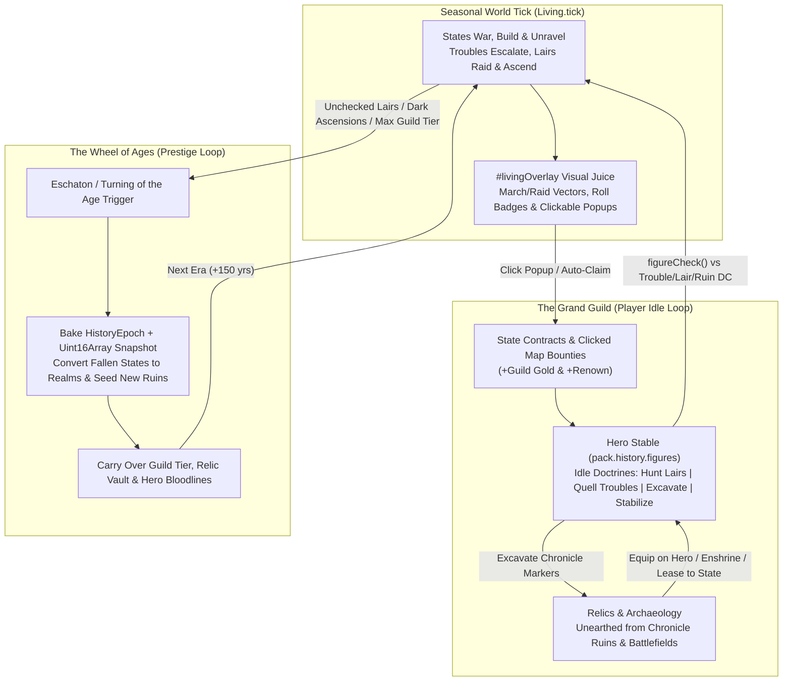

# Plan — Living Idle Game: The Grand Guild, Relics, Map Juice & The Wheel of Ages

Updated: 2026-10-30. Status: **planned**.

Companions: [living-world.md](living-world.md), [unified-figures.md](unified-figures.md),
[lair-ascension.md](lair-ascension.md), [history-epochs.md](history-epochs.md),
[history-fall-markers.md](history-fall-markers.md), [culture-traits.md](culture-traits.md).

---

## 1. Executive Summary & Scope

The Living World simulation (`src/model/physical/living-generator.ts`), Unified Figures roster
(`pack.history.figures`), and Emergent Sovereign Realms (`lair-ascension.md`) provide a deterministic
seasonal world where rulers age, states pursue agendas, provincial troubles fester into lairs, and
unchecked lairs or rebellions birth new kingdoms.

However, the user experience in `src/controllers/living-hud.ts` currently plays like a **passive
simulation viewer with debug buttons**: the user clicks `Play 1×` or `Play 4×`, reads a scrolling
text log, and occasionally clicks free, infinite "God Mode" buttons in a side panel.

This plan transforms the Living World into an **interactive fantasy idle game** built around four
interlocking pillars:

1. **The Grand Guild (Core Player Identity)**: You command an independent, cross-border **Adventurers'
   Guild / Grand Order**. Instead of free debug buttons, you earn **Guild Gold** and **Renown** from
   state contracts and map bounties to recruit, equip, and auto-dispatch named `HistoricalFigure`
   heroes (`adventurer`, `specialist`, `agent`, `general`) against Troubles, Lairs, and Ruin sites.
2. **On-Map Visual Juice & Clickable Popups (`#livingOverlay`)**: Watching the map tick becomes
   tactile and active-idle friendly. Animated SVG vectors show marching armies, raiding lairs, and
   questing heroes; floating badges show `1d20` roll outcomes and sacks; clickable map popups
   (Urgent Bounties, Raid Intercepts, Exposed Caches, 2-Choice Petitions) reward attentive players
   while gracefully auto-resolving when left idle.
3. **Relics & Archaeology (History $\leftrightarrow$ Living Bridge)**: Heroes excavate `chronicle`
   ruins, battlefields, and dungeons left behind by `pack.history.realms` and past wars to unearth
   procedurally named **Historical Relics** (*Crown of the Vhælen Empire*, *Standard of General
   Kael*). Relics can be equipped on Heroes, enshrined in the Guild Vault for global idle buffs, or
   leased to State Rulers to prop up empires.
4. **The Wheel of Ages (Cataclysm & Epoch Prestige Loop)**: When the world's **Eschaton Clock** fills
   (or the Guild reaches max tier and triggers a Turning of the Age), a Cataclysm sweeps the map.
   The current political map is baked into `pack.history.epochs` and `pack.history.snapshots` (so
   the Legends Time Slider can scrub through every played age), fallen empires become `pack.history.realms`
   with fresh Relic-stocked ruins at their capitals, the calendar leaps forward into a new Era, and
   your **Guild Hall, Relic Vault, and Hero Bloodlines** carry over into the next age.

> **Scope Assumption**: This plan assumes `lair-ascension.md` and the `unified-figures.md` spine are
> complete, and targets **standard fantasy FMG** for the MVP. Astral Cartographer integration
> (re-skinning the Guild as a *Starfarers' League*, Ruins as *Precursor Derelicts*, and an *Astral
> Ascension* age transition) is deferred to a post-MVP follow-on plan.



---

## 2. Pillar 1: The Grand Guild & Hero Stable

### 2.1. Guild State & Economy

The Guild lives on `pack.history.living.guild` (`GuildState`) so it persists automatically inside
record 53 of `.map` files:

- **Guild Gold (`gold`)**:
  - **Sources**: State bounty payouts when a Guild figure resolves a Trouble (`15 + level × 5` gold)
    or clears a Lair (`30 + level × 10` gold), ruin excavation salvage (`20–60` gold), passive Guild
    Chapterhouse dues (`+2` gold/season per chapter), and clicking active-idle map popups (`+25%`
    bonus).
  - **Sinks**: Recruiting new Figures (`40 + tier × 20` gold), upgrading Guild Hall Tier, establishing
    regional Chapterhouses in burgs, and funding covert/political Guild Operations.
- **Guild Renown (`renown`)**:
  - **Sources**: Heroic deeds (`+5` per Trouble quelled, `+15` per Lair purged, `+20` per Ruin
    excavated, `+30` for stopping a Lair/Trouble from ascending or defeating an emergent dark state).
  - **Progression (`tier: 1..5`)**: Crossing Renown thresholds (`0 / 50 / 150 / 350 / 700`) promotes
    the Guild Hall tier, expanding the maximum Hero Roster cap (`3 → 4 → 6 → 8 → 10` active heroes)
    and unlocking Guild Vault relic slots (`1 → 2 → 3 → 4 → 5`).

| Guild Tier | Title | Renown Required | Gold Cost | Max Heroes | Relic Vault Slots | Passive Bonus |
| :---: | :--- | :---: | :---: | :---: | :---: | :--- |
| **1** | Wayfarers' Lodge | 0 | 0 | 3 | 1 | Base contract vision |
| **2** | Chartered Company | 50 | 100 | 4 | 2 | `+1` to all Guild `figureCheck` rolls |
| **3** | Grand Adventurers' Guild | 150 | 250 | 6 | 3 | Missions complete `1` season faster (min 1) |
| **4** | Sovereign Order | 350 | 500 | 8 | 4 | `+2` to all Guild `figureCheck` rolls; can lease Relics |
| **5** | Immortal Conclave | 700 | 1000 | 10 | 5 | Unlocks *Turn the Wheel of Ages* prestige action |

### 2.2. The Hero Stable & Idle Doctrines

Guild heroes are standard `HistoricalFigure` entries in `pack.history.figures` referenced by
`guild.roster: number[]`.

1. **Recruitment Pool ("The Tavern / Seekers")**:
   - Each year (Spring), 2–3 candidate figures from across the map's cultures (plus any free
     specialists or exiled figures) appear in `guild.candidates: number[]`.
   - Each candidate displays their **Specialty/Role** (`adventurer`, `sage`, `guardsmen`, `merchant`,
     `prophet`, `magistrate`, `assassin`, `diplomat`), **Alignment**, **Virtues/Vices**, and
     **Skills (`m`, `w`, `s`, `c`)**.
2. **Idle Doctrines (Hands-Off Automation)**:
   - To make the game play smoothly at `Play 1×` / `Play 4×`, each hero (or the Guild as a whole) has
     an `IdleDoctrine`:
     - `auto_bounties`: Automatically dispatches idle heroes to the highest-odds Trouble or Lair matching their primary pool/specialty.
     - `auto_lairs`: Prioritizes entrenched Lairs (`ProvinceLair`) and emergent warlord states before they can raid or ascend.
     - `auto_excavate`: Prioritizes unexcavated `chronicle` ruins, battlefields, and dungeons to farm Relics.
     - `auto_patron`: Only accepts contracts inside your **Favored State** (`guild.favoredStateId`), acting as that realm's guardian order.
     - `manual`: Waits at the Guild Hall for player click-dispatch.
3. **Mission Execution (`ActiveGuildMission`)**:
   - Dispatched heroes move to the target `cell` and tick `progress / required` (`1–2` seasons).
   - Upon completion, resolution uses the unified roll from `unified-figures.md`:
     $$\text{Roll} = 1\text{d}20 + \text{figure.skills}[\text{pool}] + \text{relicBonus} + \text{guildTierBonus} + (\text{virtues} - \text{vices}) \ge \text{DC}$$
   - **Success**: Grants XP (`+25`), Guild Gold, Renown, and resolves the Trouble / Lair / Excavation.
   - **Failure / Fumble**: Inflicts a `1–2` season recovery cooldown (`cooldownUntilTick`); a natural
     `1` (or failing by $\ge 8$) rolls a survival save (`DC 12`) to avoid injury (gaining a vice) or
     heroic death in the chronicle.
4. **Aging, Retirement & Mentorship**:
   - Heroes age 1 year every 4 seasons. At `age >= 55`, the player can click **Retire & Mentor** (or
     it triggers automatically on death if Guild Tier $\ge 2$): the veteran retires to the Legends
     hall, passing their equipped Relic and `+1` skill point in their highest pool to a newly minted
     **Protege** figure.

### 2.3. Guild Operations vs. Sandbox God Mode

In `src/controllers/living-hud.ts`, the Inspector's intervention section gains a toggle:
**`[Guild Mode | Sandbox God Mode]`**.

- **Sandbox God Mode**: Preserves all existing instant, zero-cost interventions (`spark`, `smite`,
  `war`, `pacify`, `complete`, `spawn-trouble`, `spawn-lair`, `promote-trouble`, `ascend-lair`) for
  worldbuilders and testing.
- **Guild Mode (Default)**: Replaces free cheats with resource- and hero-driven **Guild Operations**:

| Operation | Cost / Requirement | Effect |
| :--- | :--- | :--- |
| **Dispatch Hero** | 1 Idle Hero (free) | Assigns the hero to quell the selected Trouble, delve the Lair, or excavate the Ruin |
| **Rush Asset Charter** | `50 Gold` + Merchant/Sage | Immediately completes the burg's current building construction (`completeAsset`) |
| **Pacify & Mediate** | `40 Gold` + Prophet/Magistrate | Clears burg unrest (`pacifyBurg`) and grants `+10` province order |
| **Incite Uprising** | `75 Gold` + Assassin/Rebel | Sparks a rebellion (`sparkRebellion`) or promotes a political Trouble into a coup (`promoteTroubleToState`) |
| **Assassinate Ruler** | `100 Gold` + Assassin (`C` check vs `DC 15`) | Slays the target state's ruler (`smiteRuler`) and triggers succession |
| **War Broker** | `80 Gold` + Envoy (`C`/`S` check) | Provokes a border war (`forceWar`) or brokers a truce between warring states |

---

## 3. Pillar 2: On-Map Visual Juice & Clickable Popups (`#livingOverlay`)

To make the map itself the game board while the simulation runs, a transient overlay renderer
(`src/renderers/draw-living-overlay.ts`) draws three visual elements over the SVG map whenever the
Living HUD is open:

### 3.1. Clickable Map Popups (`LivingPopup`)

When notable events occur during `Living.tick()`, the simulation queues up to `6` concurrent on-map
popups anchored to their cell's `[x, y]` coordinates. Each popup displays a countdown ring (`3`
seasons / ~10 seconds at `1×`) and auto-resolves with default AI behavior if ignored, or grants an
**Active-Idle Bonus** if clicked:

| Popup Kind | Icon / Badge | Trigger | Click Action / Bonus |
| :--- | :---: | :--- | :--- |
| `bounty_trouble` | 📜 `!` | A Trouble spawns or escalates to Lv $\ge 4$ | Opens 1-click Hero Dispatch card; grants **+25% Bonus Gold** on completion |
| `bounty_lair` | 🏰 `⚔` | A Lair spawns or reaches `raidPending = true` | Intercepts the raid before it strikes a burg; **+10 Bonus Renown** |
| `ascension_warning` | 👑 `⚠️` | A Trouble/Lair is 1 season from `promoteTroubleToState` / `ascendLairToState` | Allows emergency Guild intervention to crush (or sponsor!) the newborn state |
| `relic_exposed` | 💎 `✨` | A battle, siege, or flood uncovers an ancient site | Instant free excavation roll (`+15–40 Gold` or a discovered Relic) |
| `guild_petition` | ⚖️ `?` | Every ~4–6 seasons from a ruler or burg | Opens a **2-Choice Dilemma Toast** (see Section 3.2) |

### 3.2. Interactive 2-Choice Dilemma Petitions

When a `guild_petition` popup is clicked (or auto-prompted if the user enables *Pause on Petitions*),
a compact card appears with two mutually exclusive choices that trade Guild resources against world
state:

- **Example 1 — *The Desperate Siege***:
  *"[Burg] is besieged by raiders from [Lair]! The burgesses offer their ancient vault key if the Guild holds the walls."*
  - **Option A — Deploy Emergency Vanguard** (`-40 Gold`): Repels the raid, `+15 Renown`, `50%` chance to unearth a Relic.
  - **Option B — Demand War Profiteering Tolls** (`+60 Gold`): Burg takes `+20 Unrest`, `-10` Renown.
- **Example 2 — *The Pretender's Bribe***:
  *"An Exiled Lord in [Province] seeks Guild recognition to stage a coup against [State]."*
  - **Option A — Back the Coup** (`-50 Gold`): Triggers `promoteTroubleToState(provinceId)`; the newborn state becomes your Guild's ally (`+100 Gold` tribute over 4 seasons).
  - **Option B — Betray to the Crown** (`+50 Gold`): Quells the trouble immediately (`quellTrouble`) and improves relations with `[State]`.

### 3.3. Animated Vectors & Floating Outcome Badges

1. **Animated SVG Vectors (`<g id="livingVectors">`)**:
   - **Hero Quest Lines**: Gold dashed arc from the Hero's current cell to their mission target cell, with a hero token badge at the midpoint showing `progress / required`.
   - **Lair Raid Lines**: Crimson pulsing dashed line from any `raidPending` Lair cell to its targeted settlement.
   - **War / Invasion Arrows**: State-colored arrow from an attacking state's mustering cell to its `conquer` / `reclaim` target burg.
2. **Floating Outcome Badges**:
   - Ephemeral CSS-animated `<div class="livingFloatBadge">` elements positioned over the screen coordinates of the cell that fade upward over `1.8s`:
     - `🎲 19 vs DC 15 — Trouble Quelled! (+35g)`
     - `⚔️ Battle of Oakhaven! (Attacker Victory)`
     - `💀 Lair Vanquished! (+20 Renown)`
     - `👑 Iron Barony Ascends!`

---

## 4. Pillar 3: Relics & Archaeology

### 4.1. Excavating the Map's History

The history generator (`src/model/physical/history-generator.ts`) and marker generator already place
`ruins`, `battlefields`, `dungeons`, `necropolises`, and `sacred-*` markers across the map—many tagged
with `chronicle: true` and linked to a specific `pack.history.realms` fallen empire or
`pack.history.events` battle.

1. **Excavation Sites**:
   - Any marker of type `ruins`, `battlefields`, `dungeons`, `necropolises`, `statues`, or `libraries`
     not yet in `guild.excavatedMarkers` can be targeted by an `excavate` Guild mission (`DC = 13 + tier`).
   - Chronicle markers (`marker.chronicle === true`) guarantee a **Named Historical Relic** on success;
     non-chronicle wilderness ruins yield either a Relic (`50%`) or a treasure cache (`40–80 Gold`).
2. **Deterministic Historical Naming**:
   - When excavating a marker at `cell`, the generator looks up the nearest `Realm` in
     `pack.history.realms` (or a `battle` / `collapse` event in `pack.history.events`, or a dead
     `HistoricalFigure`) to mint a lore-accurate `HistoricalRelic`:

| Relic Category | Source Marker / History Link | Example Generated Name | Primary Stat & Passive Effect |
| :--- | :--- | :--- | :--- |
| `regalia` | Fallen `Realm` capital ruin | *Crown of the Vhælen Emperors* | `+2 S` · If leased to a State: `+2 S` gen & `-2` unravel/season |
| `weapon` | Chronicle `battlefields` / slain general | *Greataxe of General Kael* | `+2 M` · Hero gains `+2` on `clear_lair` & survival saves |
| `tome` | `libraries` / `necropolises` / `schism` | *Codex of the Ashen Schism* | `+2 C` · Hero gains `+50% XP` and `+2` vs `corruption`/`ignorance` |
| `charter` | Sacked `burg` ruin / `goldenAge` event | *Golden Charter of Old Oakhaven* | `+2 W` · `+25% Guild Gold` from contracts; State gains `+2 W` gen |
| `idol` | Cleared Lv 7+ `ProvinceLair` | *Blood-Idol of the Dread Cloister* | `+1 M, +1 C` · Cursed: `+3` delve bonus, but adds `+1` vice risk on fumble |

### 4.2. Equipping, Enshrining, and Leasing Relics

Every discovered `HistoricalRelic` lives in `guild.relics: HistoricalRelic[]` and has a `holder`
assignment:

1. **Equipped on a Guild Hero (`{ kind: "figure", id: figureId }`)**:
   - Adds the Relic's `bonuses` (`m`, `w`, `s`, `c`) directly to `figureCheck()` rolls and survival
     saves. Each hero can carry `1` Relic.
2. **Enshrined in the Guild Vault (`{ kind: "vault" }`)**:
   - Up to `guild.tier` Relics can sit in the Guild Vault, applying passive idle multipliers to the
     whole Guild (`+10%` contract gold per `w` point, `+10%` renown per `s` point, `+10%` XP per `c`
     point, `+1` global delve roll per `m` point).
3. **Leased to a Sovereign State (`{ kind: "state", id: stateId }`)**:
   - Grants the Relic's `m`/`w`/`s`/`c` bonuses directly to that state's `CapacityLedger` generation
     (`gen`) and reduces its `unravel` clock by `-1` per season, while paying the Guild `10 Gold` per
     season in lease tribute!
   - **Risk**: If that state's capital burg is conquered or sacked while holding a leased Relic, the
     Relic drops into a new `ruins` marker at the capital cell (requiring a new excavation or heist
     to recover!).

---

## 5. Pillar 4: "The Wheel of Ages" Prestige Loop

In a long-running idle simulation, a single superpower eventually conquers most of the map or a wave
of emergent warlord states turns the continent into chaos. **The Wheel of Ages** turns that endpoint
into a repeatable **Prestige / Era Reset** that feeds directly into FMG's `HistoryEpoch` and
`LegendsOverview` time slider.

### 5.1. The Eschaton Clock & Age Triggers

`living.eschaton` (`0..100`) tracks how close the current Era is to a world-shaping culmination:

- **Passive Escalation**:
  - `+1` per season for each active Level $\ge 8$ Lair on the map.
  - `+2` per season when an evil/apocalyptic emergent state (e.g., from `doomsday_cult`,
    `demonic_master`, `ancient_evil`, `magical_gate`) conquers a burg.
  - `+5` whenever a major state (`>= 4` provinces) collapses or fractures.
- **Guild Control**:
  - Purging Lairs and stabilizing realms reduces `eschaton` (`-5` per Lair cleared), letting the
    player prolong a golden age.
  - Once `eschaton >= 100` **OR** `guild.tier >= 5`, the **Turn the Wheel of Ages** button in the HUD
    illuminates.

### 5.2. Executing `Living.turnAge()` (The Epoch Bake)

When triggered, `Living.turnAge()` transforms the live world into historical sediment and boots the
next Era in four deterministic steps:

1. **Bake the Completed Epoch Snapshot (`pack.history.epochs` & `snapshots`)**:
   - Clones `Uint16Array.from(pack.cells.state)` into `pack.history.snapshots`.
   - Records a new `HistoryEpoch` spanning `[eraStartYear, currentYear]` with `EpochPolity` entries
     for every state that existed in the era.
   - Result: Opening the **Legends Browser** (`src/controllers/history-overview.ts`) immediately lets
     the player drag the **Year Slider** back through every Age they played!
2. **Convert Fallen Empires to `pack.history.realms` & Seed New Ruins**:
   - Any overextended empire (`unravel >= 50` or toppled by the Cataclysm) is retired into
     `pack.history.realms` (`Realm` record with its emblem `coa`, `founded`, `fallen`, `center`, and
     `successors`).
   - Places a new `chronicle: true` `ruins` marker at each fallen capital cell, pre-seeded with a
     **Tier-2 Relic** named after that fallen empire or its last ruler.
3. **Reshape the Political Map for the New Era**:
   - Advances `options.map.lore.calendar.year` by `+150` years and names the new `Era` (e.g., *"The
     Second Age of Ash"*, *"The Era of the Guild Compact"*).
   - Fractures giant empires (`> 3` provinces) along provincial/cultural lines into smaller successor
     kingdoms and Free Burgs (`burg.state = 0`), resets `unravel = 0` and `warExhaustion = 0`, and
     crowns fresh young rulers in `pack.history.figures`.
4. **Prestige Carryover (`guild.ageCount += 1`)**:
   - **Kept**: `guild.tier`, `guild.relics` (all Vault and Hero-equipped Relics survive!), and
     `guild.chapterBurgIds`.
   - **Legacy Bloodlines**: Living Guild heroes pass into legend (`death = currentYear`), and each
     hero of Level $\ge 3$ spawns a **Descendant / Scion** in the new Era's starting Guild roster who
     inherits `+1` permanent base skill point per prestige age (`legacyTier`) and their ancestor's
     signature virtue.

---

## 6. Data Model (`src/types/living.ts`)

All new state lives inside `pack.history.living` (`LivingWorldState`), preserving full `.map`
serialization in Record 53 with zero schema breaking changes:

```ts
export type IdleDoctrine =
  | "auto_bounties"
  | "auto_lairs"
  | "auto_excavate"
  | "auto_patron"
  | "manual";

export type GuildMissionKind = "trouble" | "lair" | "excavate" | "pacify";

export interface ActiveGuildMission {
  id: number;
  kind: GuildMissionKind;
  figureId: number;
  targetCell: number;
  provinceId?: number;
  burgId?: number;
  markerId?: number;
  pool: "m" | "w" | "s" | "c";
  dc: number;
  progress: number;
  required: number;
  rewardGold: number;
  rewardRenown: number;
}

export type RelicCategory = "regalia" | "weapon" | "tome" | "charter" | "idol";

export type RelicHolder =
  | { kind: "vault" }
  | { kind: "figure"; id: number }
  | { kind: "state"; id: number }
  | { kind: "ruin"; markerId: number; cell: number };

export interface HistoricalRelic {
  id: number;
  name: string;
  category: RelicCategory;
  lore: string;
  originYear: number;
  originRealmId?: number;
  originFigureId?: number;
  bonuses: { m?: number; w?: number; s?: number; c?: number };
  cursed?: boolean;
  holder: RelicHolder;
}

export type LivingPopupKind =
  | "bounty_trouble"
  | "bounty_lair"
  | "ascension_warning"
  | "relic_exposed"
  | "guild_petition";

export interface LivingPopup {
  id: number;
  kind: LivingPopupKind;
  cell: number;
  title: string;
  subtitle: string;
  expiresAtTick: number;
  stateId?: number;
  provinceId?: number;
  burgId?: number;
  markerId?: number;
  rewardGold?: number;
  petitionId?: string;
}

export interface GuildState {
  tier: number;                  // 1..5
  gold: number;
  renown: number;
  ageCount: number;              // number of Wheel of Ages prestige resets completed
  sandboxGodMode: boolean;       // false = Guild Operations; true = classic free God Mode
  doctrine: IdleDoctrine;
  favoredStateId?: number;
  hqBurgId?: number;
  chapterBurgIds: number[];
  roster: number[];              // active Guild HistoricalFigure ids
  candidates: number[];          // tavern recruitment pool (figure ids)
  missions: ActiveGuildMission[];
  relics: HistoricalRelic[];
  excavatedMarkers: number[];    // marker.i values already excavated
  popups: LivingPopup[];
}
```

And on `LivingWorldState`:

```ts
export interface LivingWorldState {
  // ...existing fields...
  eschaton?: number;             // 0..100 Age Finale meter
  guild?: GuildState;            // initialized lazily via Living.getGuild()
}
```

---

## 7. Implementation Slices

Each slice is independently shippable, tested with Vitest, and keeps old `.map` saves working via
lazy defaults.

| Slice | Scope | Key Modules | Description & Acceptance |
| :---: | :--- | :--- | :--- |
| **Slice 1** | **On-Map Visual Juice & Clickable Popups (`#livingOverlay`)** | `src/renderers/draw-living-overlay.ts`<br>`src/controllers/living-hud.ts`<br>`src/types/living.ts` | Add transient SVG/HTML overlay when Living HUD is open: animated vectors for raids/wars/quests, floating outcome badges on tick (`🎲 roll`, sacks, ascensions), and clickable `LivingPopup` pins (`bounty_trouble`, `bounty_lair`, `ascension_warning`, `relic_exposed`) that grant bonus Gold/Renown when clicked before expiry. |
| **Slice 2** | **The Grand Guild Spine & Hero Dispatch** | `src/model/physical/living-generator.ts`<br>`src/controllers/living-hud.ts`<br>`src/types/living.ts` | Add `GuildState` (`gold`, `renown`, `tier`, `roster`, `candidates`, `missions`, `doctrine`). Expand HUD with the **Guild Bar** (Gold, Renown, Tier, Hero portrait chips, Idle Doctrine selector, `[Guild Mode \| Sandbox God Mode]` toggle). Heroes auto-dispatch or click-dispatch to Troubles/Lairs using `figureCheck()`, earn XP/Gold/Renown, and retire/mentor at old age. |
| **Slice 3** | **Relics & Ruin Excavation** | `src/data/living-relics.ts`<br>`src/model/physical/living-generator.ts`<br>`src/controllers/living-hud.ts` | Add `excavate` mission targeting `ruins`, `battlefields`, `dungeons`, `necropolises`, and `libraries`. Generate lore-linked `HistoricalRelic` items named after `pack.history.realms`, events, and dead figures. Support equipping Relics on Heroes, enshrining in the Guild Vault, and leasing to State Rulers (adding to `CapacityLedger.gen` and dropping to a ruin if the capital falls). |
| **Slice 4** | **Guild Petitions & Timed Map Dilemmas** | `src/data/living-petitions.ts`<br>`src/model/physical/living-generator.ts`<br>`src/controllers/living-hud.ts` | Add 12+ two-choice `guild_petition` dilemmas anchored to active map crises (sieges, coups, trouble crackdowns, succession disputes, cursed relics). Clicking a petition popup opens a compact 2-button decision card that trades Guild Gold/Renown against world outcomes (`promoteTroubleToState`, `quellTrouble`, unrest, state treasury). |
| **Slice 5** | **The Wheel of Ages (Eschaton & Epoch Prestige)** | `src/model/physical/living-generator.ts`<br>`src/controllers/living-hud.ts`<br>`docs/wiki/Living-World.md` | Track `living.eschaton` (`0..100`). Implement `Living.turnAge()`: bake current borders into `pack.history.snapshots` + `pack.history.epochs`, archive fallen empires into `pack.history.realms`, spawn `chronicle: true` Relic ruins at fallen capitals, advance calendar by `+150` years, shatter giant empires into successor states, and carry over Guild Tier, Relic Vault, and Hero Scion bloodlines. |
| **Follow-On** | **Astral Cartographer Idle Overhaul** *(Post-MVP)* | `src/controllers/living-hud.ts`<br>`src/data/astral-living.ts` | When `isAstralView()` is active, translate the Guild into the *Starfarers' League*, Ruins into *Precursor Derelicts / Anomalies*, Lairs into *Pirate Stations / Hive Fleets*, and add an *Astral Ascension* final age transition. |

---

## 8. Verification & Invariants

1. **Determinism**:
   Given the same `pack`, `seed`, and sequence of ticks/clicks, `Living.tick()`, `figureCheck()`,
   Relic generation, and `Living.turnAge()` MUST produce identical states, relics, and chronicle
   events via `Living.rng` streams.
2. **Serialization & Backwards Compatibility**:
   `guild` and `eschaton` are optional fields on `LivingWorldState` (Record 53). Maps saved without
   them initialize lazily on first access; no new `.map` record slots are introduced except the
   standard `pack.history.snapshots` records (54+) already used by `Epochs` when `turnAge()` bakes
   an epoch.
3. **Layering Constraint (FMG 2.0)**:
   `living-generator.ts` MUST NOT touch DOM or SVG elements. It mutates `pack` and
   `pack.history.living` (`guild`, `popups`, `missions`), while `draw-living-overlay.ts` and
   `living-hud.ts` render those states idempotently.
4. **Sandbox Preservation**:
   Toggling `guild.sandboxGodMode = true` in the HUD MUST restore immediate, zero-cost access to all
   God Mode interventions so cartographers and testers are never gated by idle currencies.
