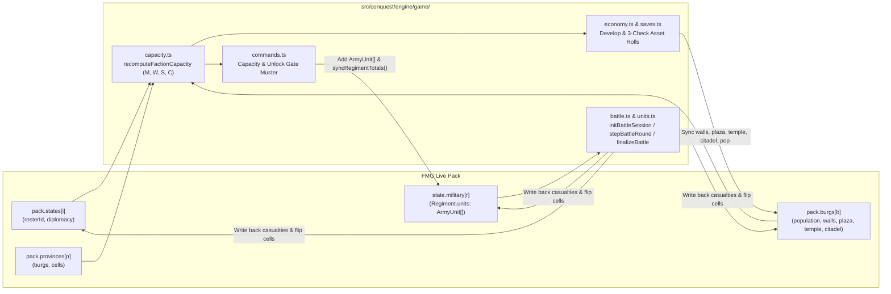

# Plan — Living World: Autonomous Diorama & Seasonal Simulation

Updated: 2026-10-27. Status: **planned**. Companions: the retroactive history in
[history-generation.md](history-generation.md), the layered political epochs and time slider in
[history-epochs.md](history-epochs.md), the cultural/figure personality matrices in
[culture-traits.md](culture-traits.md), the domain capacity & asset rules in
[openconquest-domain-assets.md](openconquest-domain-assets.md), and the unified roster/battle
pipeline in [openconquest-military-integration.md](openconquest-military-integration.md).

## The idea

Azgaar's Fantasy Map Generator creates rich, editable worlds with states, provinces, burgs,
cultures, religions, regiments, and chronicles — but once generated, the world is frozen in time.

**Living World** is an optional simulation mode that turns any FMG map into an autonomous,
tickable diorama (inspired by *Galimulator*, *Total War*, and all-AI *Civilization* observer
games). Rulers and generals have personalities, states pursue visible agendas and hold grudges,
armies muster and march, free burgs resist foreign conquerors, and conquered lands seethe with
unrest. The user can step or play the simulation season by season while retaining **full standard
FMG control** — opening the States, Burgs, Regiments, Diplomacy, or Battle editors at any moment
to tweak the world or intervene as a sandbox deity.

---

## Core architecture

### 1. Native `pack`-first simulation

Rather than maintaining a separate shadow game state that drifts out of sync with FMG's editors,
the Living World engine (`src/generators/living-generator.ts`) reads and mutates the live `pack`
directly on each tick:

| Domain | Live `pack` source of truth | Reconciled via |
|---|---|---|
| Territory & Borders | `pack.cells.state`, `pack.cells.province`, `pack.provinces` | `States.setCells()`, `Burgs.specify()`, `Provinces` |
| States & Diplomacy | `pack.states[i]`, `states[i].diplomacy`, `states[i].campaigns` | `States.collectStatistics()`, `States.collectTaxes()` |
| Burgs & Features | `pack.burgs[i]` (`state`, `capital`, `population`, `walls`, `plaza`, `temple`, `citadel`) | `Burgs` & `drawBurgIcons()` |
| Armies & Garrisons | `pack.states[i].military` (`Regiment.units: ArmyUnit[]`, `rosterId`) | `syncRegimentTotals()`, `moveRegiment()`, `drawMilitary()` |
| Rulers, Generals & Rebels | `pack.history.figures` (`HistoricalFigure` with `death === undefined`) | `Chronicle` & `LegendsOverview` |
| Chronicle & Time Slider | `pack.history.events`, `pack.history.epochs`, `pack.history.snapshots` | `LegendsOverview`, `HistoricalView` |

Because the simulation mutates `pack` in place:
- Every standard FMG editor (`StatesEditor`, `BurgsEditor`, `RegimentEditor`, `ProvincesEditor`,
  `DiplomacyEditor`, `MilitaryOverview`, `LegendsOverview`) works without adapters.
- If the user paints borders, edits a burg's walls, adds a regiment, or changes diplomacy mid-sim,
  the very next tick respects those changes as ground truth.
- Saving a `.map` file automatically persists the world's current state, history, and simulation
  metadata.

### 2. Seasonal time scale (`1 Tick = 1 Season`)

- Each tick advances **1 Season**: `Spring` (0) $\rightarrow$ `Summer` (1) $\rightarrow$
  `Autumn` (2) $\rightarrow$ `Winter` (3).
- Every 4 ticks (entering `Spring`) increments `options.map.lore.calendar.year += 1`.
- **Seasonal rhythm**:
  - **Spring / Summer / Autumn**: Prime campaigning, frontier colonization, and muster seasons.
  - **Winter**: Harsh campaigning penalty (attrition/stall in cold biomes), focus on internal
    development, asset construction checks, tax/capacity reconciliation, and ruler aging/succession
    checks.
- Every $N$ years (configurable, e.g., every 10 or 25 years, or after a major empire collapse), the
  engine captures a `Uint16Array` border snapshot into `pack.history.snapshots` and appends a
  `HistoryEpoch` so the existing **Legends Time Slider** (`src/controllers/historical-view.ts`) can
  scrub through centuries of simulated history.

### 3. Hybrid territory movement

- **Province & Burg flips (State vs. State Wars)**: Wars target border provinces or burgs. When a
  province capital (or standalone burg) falls in a Conquest battle, the province's cells and burgs
  transfer cleanly via `States.setCells()`, keeping province boundaries intact and readable.
- **Cell-by-cell frontier drift (Wildlands & Free Burgs)**: States running a `colonize` agenda
  absorb adjacent habitable wildland cells (`cells.state === 0`) along rivers, roads, and coasts
  using FMG's terrain/culture cost weights. When expansion reaches a **Free Burg**
  (`burg.state === 0`), it triggers the Free Burg integration or resistance flow (see Pillar 4).

---

## Pillar 1: Rulers, Generals, Rebels & Personalities

Living characters are stored directly in `pack.history.figures` (`src/types/history.ts`) as active
`HistoricalFigure` entries (`death === undefined`):

- **Roles**:
  - `ruler`: One active monarch/leader per valid state (`state.i > 0 && !state.removed`).
  - `general`: Command figures assigned to lead a state's field regiments (`Regiment.leaderId?: number`).
  - `rebel`: Spawned when a restive province or conquered Free Burg erupts into revolt.
- **Traits & Cultural Doctrine**:
  - Every figure carries 1–3 Virtues and Vices from `src/data/culture-traits.ts` (`VIRTUES`,
    `VICES`, rolled via `rollFigureTraits()`).
  - Combined with the state's cultural alignment (`culture.alignment`: `Order/Chaos`, `Good/Evil`)
    and cultural values (`culture.values`: e.g., `militarism`, `commerce`, `piety`, `tradition`),
    traits weight how a state chooses its next agenda and how a general fights:
    - *Martial / Ambitious (`brave`, `ambitious`, `wrathful`, `militarism`)*: Favors `conquer`,
      `reclaim`, `muster`; selects aggressive battle stances (`charge`, `press`).
    - *Civic / Mercantile (`just`, `temperate`, `diligent`, `commerce`)*: Favors `develop`,
      `build`, `colonize`; prioritizes `market` and `walls` assets.
    - *Pious / Traditional (`zealous`, `pious`, `tradition`)*: Favors `pacify` (religious/cultural
      assimilation) and `temple` / `custom` assets; harsher toward foreign-faith Free Burgs.
    - *Decadent / Cruel (`greedy`, `cruel`, `slothful`, `cowardly`)*: Increases occupation unrest,
      drains stability (`S`), and risks succession crises.
- **Aging, Death & Succession**:
  - Once per year (Winter $\rightarrow$ Spring transition), living figures age by 1 year.
  - Past age 50, mortality probability rises each year (or a figure can be slain in battle).
  - On a ruler's death, the engine logs a `succession` / `coronation` event in `pack.history.events`
    and spawns a successor in the ruling dynasty (`figure.dynasty`).
  - **Succession Crisis**: If the state's Stability (`S`) is in deficit or the new ruler has
    destabilizing vices, the state takes a hit to province Order and advances its `unravel` clock,
    potentially sparking a pretender or provincial rebellion.

---

## Pillar 2: State Agendas, Clocks & Grudge/Claim Memory

Each active state maintains a lightweight simulation record (`StatePolitySim`) with a single
active **Agenda** (visible in the HUD/inspector as a progress clock `progress / target`) plus
background pressure clocks:

### 1. Agenda catalog

| Agenda | Target | Resolution per Season | Completion Effect |
|---|---|---|---|
| `muster` | Provincial Regiment / Burg | Recruits roster units via Conquest capacity & unlock gates | Regiment reaches target strength (`Regiment.units` updated) |
| `develop` | Owned Province / Settlement | Spends province Stability (`4`) & commits Wealth (`2 W` for 4 seasons) | Advances province development tier (+1 W & +1 S to region) & grows settlement population |
| `build` | Owned Burg / Province | Rolls Conquest 3-check (`M`, `W`, `S`) via `rollValueCheck()` | Completes AER asset (`walls1..3`, `market1..3`, `temple1..3`, `barracks1..3`, customs) & updates `Burg` flags |
| `colonize` | Adjacent Wildlands / Free Burg | Claims 1–3 adjacent `cells.state === 0` cells; checks Free Burgs | Expands border; annexes friendly Free Burg or triggers assault on resisting Free Burg |
| `conquer` | Rival State's Border Province / Burg | Marches regiment to target cell; resolves Conquest battle | Flips province/burg via `States.setCells()`, applies occupation unrest, records grudge on loser |
| `reclaim` | Lost Core / Grudge Target | Priority war to recover a `ClaimRecord` or avenge a `GrudgeRecord` | Restores core province with reduced unrest, clears claim/grudge, logs historic triumph |
| `pacify` | Restive Burg / Province (`unrest > 0`) | Stations garrison / dispatches envoy or priests to quell unrest | Accelerates `unrest` decay by `-2` per season; chance to convert burg religion/culture |

### 2. Grudge & Claim memory

States do not declare war at random; they remember their history:

- **Claims (`ClaimRecord`)**: Whenever a state loses a province or burg it previously held, it
  records a claim (`{ targetBurgId, provinceId, lostYear, formerOwner }`). Reclaiming lost homeland
  is the highest-priority war trigger (`reclaim` agenda).
- **Grudges (`GrudgeRecord`)**: Recorded when a rival state (or a resisting Free Burg) inflicts a
  humiliation:
  - `conquest`: Took a province or capital (`weight: 40`).
  - `sacked`: Razed or looted a burg (`weight: 30`).
  - `slain_ruler` / `slain_general`: Killed a state's ruler or general in battle (`weight: 35`).
  - `repulsed`: A Free Burg or rival defeated an invasion force (`weight: 20`).
- When selecting a military target, AI scoring weights neighbors by `grudgeWeight + claimBonus`,
  and the resulting war in `pack.history.events` is named after the casus belli (e.g., *"The War of
  the Norseland Reclamation"* or *"The Vengeance for King Alaric"*).

### 3. The Unravel / Rebellion clock

Each state tracks an `unravel` clock (`0` to `100`):
- **Increases** each season when:
  - State Stability capacity (`S`) is in deficit (`load > gen`).
  - Conquered burgs/provinces have active `unrest > 0`.
  - War exhaustion is high after losing battles or a ruler dies in a succession crisis.
- **Decreases** each season when at peace with surplus Stability (`S`) and `unrest === 0`.
- **Trigger (`unravel >= 100`)**: The most restive province or conquered Free Burg breaks away! It
  spawns a `rebel` figure (`pack.history.figures`), raises a rebel regiment from the local
  culture's roster, and either restores a Free Burg (`burg.state = 0`), defects to a kin neighbor
  (`burg.culture === neighbor.culture`), or founds a new secessionist `State` (`independence` event).

---

## Pillar 3: Conquest-Powered Resolution (Battles, Development, Muster)

The simulation reuses the OpenConquest engine (`src/conquest/`) directly on FMG's data structures:



### 1. Battle resolution (`src/conquest/engine/game/battle.ts` & `units.ts`)

- **Combatants**:
  - **Attacker**: One or more field regiments (`Regiment.units: ArmyUnit[]`) belonging to the
    attacking state. If `regiment.units` is empty on a legacy map, `reconcileRegimentBlocks()`
    populates it first.
  - **Defender**: Any defending field regiment at the target cell/province **plus** the settlement's
    standing garrison generated via `garrisonUnits(roster, unitTypes, burg.walls)` (for state
    capitals) or `minorGarrisonUnits(roster, unitTypes, tier, burg.walls)` (for minor burgs and
    resisting Free Burgs).
- **Modifiers & Tactical Stances**:
  - `walls`: `burg?.walls ?? 0` (grants fortification defense multiplier and requires `assault: true`).
  - `attackerCrossedRiver`: `Boolean(pack.cells.r[cell])`.
  - `attackerLordMult` / `defenderLordMult`: Derived from the commanding general/ruler's Virtues and
    Vices (`brave`, `disciplined`, `tactician` vs. `rash`, `cowardly`), which also select per-round
    `BattleTacticalOrder` stances (`balanced`, `charge`, `press`, `skirmish`, `brace`, `withdraw`).
- **Execution & Write-Back**:
  - Runs `initBattleSession()` $\rightarrow$ `stepBattleRound()` loop $\rightarrow$ `finalizeBattle()`
    using the simulation's seeded PRNG (or opens `BattleScreen` if the user enables *"Interactive
    Battles"* for watched states).
  - Surviving unit counts write straight back to `regiment.units` via `syncRegimentTotals(regiment, unitTypes)`.
  - Wiped-out regiments are removed; a battlefield marker (`pack.markers`) and `battle` event
    (`pack.history.events`) are created at the battle cell.

### 2. Development & Asset construction (`capacity.ts`, `economy.ts`, `saves.ts`)

- **Domain Capacity Pools (`M`, `W`, `S`, `C`)**:
  - Each state computes its Military (`M`), Wealth (`W`), Stability (`S`), and Culture/Magic (`C`)
    generation and upkeep load using the rules in `src/conquest/engine/game/capacity.ts`:
    - **Region Base Capacity (`M`, `W`, `S`)**: W and S are a property of the *region/province*
      population, not a tally of its burgs (`REGION_TIER_STEPS: 100k, 200k, 400k, 800k, 1600k`).
      Every held province grants `+1 M` levy base and `+regionTier W & S`. Individual burg base tiers
      generate zero base capacity—burgs are settlement centers, not duplicate tax bases.
    - **Earned Development**: Only deliberate and organic development points *earned* by the
      province/settlements add `+1 W` and `+1 S` each (`developmentBonus`), capped by regional
      habitability (`floor(habitability / 20)`).
    - **Standing Buildings**: Assets (`sim.buildings[burgId]: string[]`) add their `effects.capacity`
      and load their `effects.upkeep`.
    - **Regiment Load**: Field regiments load `unitLoad()` against the state's pools (with
      `barracks1..3` granting `freeGarrisonUnits` waivers).
- **Province Stability Stock & Settlement Development (`develop` agenda)**:
  - **Earning Stability**: A province holding a friendly garrison is orderly and working, accruing
    `+1 stability` per season (`stabilityPerGarrison = 1`).
  - **Spending Stability to Develop**: Development is a deliberate purchase paid in accumulated
    province stability (`developStabilityCost = 4`). A province without `4` stability cannot start
    development.
  - **Execution**: The state commits `2 W` capacity per season for `4 seasons` (`developWPerTurn = 2`,
    `developTurns = 4`). Upon completion:
    - Increments the province's earned development points by `+1` (adding `+1 W` and `+1 S` to the
      region's output).
    - Grows the designated settlement's `burg.population` by `5–15%`, promoting its tier and icon
      if a threshold is crossed.
- **Organic Growth**:
  - An orderly, garrisoned province (`order >= 60`) that has room under its habitability cap can
    organically develop its smallest settlement every 6 seasons, awarding `+3 stability`
    (`stabilityPerGrowth = 3`) back to the province.
- **Asset Construction (`build` agenda)**:
  - States select an available building/custom from `currentContent().content.buildings` (e.g.,
    `walls1..3`, `market1..3`, `temple1..3`, `barracks1..3`, `militia1..3`, `school1..3`, cultural
    customs, or resource extractors on cells with `pack.cells.good`).
  - Checked against Conquest's `capacityRefusal()` (must have free capacity for the asset's upkeep)
    and chain prerequisites (`walls2` requires `walls1`).
  - Each season rolls Conquest's 3-check (`M`, `W`, `S`) value save (`rollValueCheck()` in
    `saves.ts`: `1d20 + valueModifier(pool)` vs. `DC = 12 + |benefit/upkeep| - pityBonus`).
  - **Bidirectional Sync with FMG `Burg`**:
    - Completing `walls1`, `walls2`, `walls3` sets `burg.walls = 1` (and `burg.citadel = 1` at tier
      2–3), updating both `BattleModifiers.walls` and MFCG city previews.
    - Completing `market1..3` sets `burg.plaza = 1`.
    - Completing `temple1..3` sets `burg.temple = 1`.
    - If a user manually toggles `burg.walls`, `burg.plaza`, `burg.temple`, or `burg.citadel` in the
      FMG Burg Editor, the engine reconciles `sim.buildings[burgId]` to match on the next tick.

### 3. Muster of troops (`commands.ts`)

- When a state runs a `muster` agenda (or reinforces before a `conquer`/`reclaim` war):
  1. Resolves the state's roster (`state.rosterId` via `currentContent()`).
  2. Checks `unlockGates()` for candidate unit types:
     - Trade goods (`requiresGood` matched against `pack.cells.good` in the state's territory).
     - Fortification tier (`requiresWallTier` matched against the mustering burg's wall tier).
     - Required structures (`barracks`, `school`, `temple`, etc.).
  3. Checks `capacityRefusal()` against the state's free `M`, `W`, `S` capacity (accounting for
     `barracks` free garrison slots) and per-regiment unit caps (`roster.caps[unitId]`,
     `maxUnitsPerArmy = 20`).
  4. Appends `{ type: unitTypeId, count: type.men, exp: 0 }` to an existing under-strength
     `Regiment` (or creates a new provincial `Regiment` at a major burg if all regiments are full),
     calls `syncRegimentTotals()`, and refreshes the `#armies` map layer.

---

## Pillar 4: Free Burgs, Resistance & Post-Conquest Unrest

When FMG's **Free Burgs** option leaves independent settlements (`burg.state === 0`) in unclaimed
wildlands (`cells.state === 0`), expanding states cannot simply paint over all of them for free.

### 1. Cultural & religious kinship check

When a state (`state.i`) reaches a Free Burg (`burg.state === 0`) during a `colonize` agenda:
- Let `stateCulture = state.culture`.
- Let `stateReligion = pack.cells.religion[state.center] || (state.capital ? pack.cells.religion[pack.burgs[state.capital].cell] : 0)`.
- Let `burgCulture = burg.culture`.
- Let `burgReligion = pack.cells.religion[burg.cell]`.
- **Shared Identity Condition**:
  $$\text{isKinOrCoReligionist} = (\text{burgCulture} > 0 \land \text{burgCulture} === \text{stateCulture}) \lor (\text{stateReligion} > 0 \land \text{burgReligion} === \text{stateReligion})$$

### 2. Peaceful integration vs. armed resistance

- **Case A — Shares Culture OR Religion (`isKinOrCoReligionist === true`)**:
  - The Free Burg welcomes annexation as kin or co-religionists.
  - `burg.state` and its surrounding hinterland cells flip to `state.i` via `States.setCells()`.
  - **Zero unrest** (`unrest = 0`).
  - Logs a peaceful integration event in the chronicle/news ticker (*"The free town of [Burg]
    willingly joined [State] through shared [culture/faith]."*).
- **Case B — Shares Neither Culture Nor Religion (`isKinOrCoReligionist === false`)**:
  - **The Free Burg resists!**
  - The engine resolves a defense roster for the burg's culture via
    `inferRosterForCulture(pack.cultures[burg.culture])` and generates its militia garrison via
    `minorGarrisonUnits(roster, unitTypes, tier, burg.walls)`.
  - To annex the burg, the state must commit a field `Regiment` with favorable or acceptable odds
    (`estimateOdds()`) and fight a Conquest assault battle (`assault: Boolean(burg.walls)`):
    - **If the Free Burg wins**: The assault is repulsed! The burg remains independent
      (`burg.state = 0`), the attacking regiment takes casualties, a battle marker is placed, and
      the state records a `repulsed` **Grudge** against the Free Burg (prompting it to muster more
      troops and return later).
    - **If the State wins**: The burg and its hinterland cells are annexed by force (`burg.state = state.i`),
      casualties are applied to the attacking regiment, a battle/subjugation event is logged, and
      the burg receives **Occupation Unrest**.

### 3. Post-conquest unrest & assimilation

Whenever a resisting Free Burg (or an enemy state's burg of foreign culture and religion) is
conquered by force:
- **Initial Unrest**: Assigned `unrest = 8` to `16` seasons (2–4 years), scaled by the burg's
  population tier and increased if the conqueror's alignment is ruthless/evil.
- **Seasonal Effects while `unrest > 0`**:
  - **Stability & Order Drain**: Each restive burg applies `-1 S` (Stability load) and reduces its
    province's Order by `15 * (unrest / 12)`.
  - **Suppressed Output**: The burg generates `0 W` (Wealth) for its conqueror until `unrest <= 4`.
  - **Rebellion Pressure**: Adds `+3` to `+6` per season to the owning state's `unravel` clock.
- **Decay & Pacification**:
  - Natural decay: `-1` unrest per season.
  - **Garrisoned**: `-1` additional decay per season if a friendly `Regiment` is stationed at the
    burg's cell.
  - **Religious / Cultural Pacification**: `-1` additional decay per season if the burg has a
    standing `temple` asset or the state runs a `pacify` agenda; upon reaching `unrest === 0`, the
    burg has a chance to adopt `stateReligion` (or `stateCulture` after prolonged rule).
- **Revolt**:
  - If the state's `unravel` clock hits `100` while a conquered burg still has `unrest > 0`, that
    burg spearheads a rebellion: it spawns a `rebel` figure (`pack.history.figures`), raises a
    militia regiment from its native `burg.culture` roster, and breaks away as a Free Burg again
    (or rejoins its former homeland state).

---

## Data model & persistence

All simulation state lives in `src/types/living.ts` and attaches to `pack.history.living` so it
serializes inside **Record 53** (`pack.history` JSON) without changing `.map` line numbering or
breaking existing saves:

```ts
export type SeasonId = 0 | 1 | 2 | 3; // 0: Spring, 1: Summer, 2: Autumn, 3: Winter

export type AgendaKind =
  | "muster"
  | "develop"
  | "build"
  | "colonize"
  | "conquer"
  | "reclaim"
  | "pacify";

export interface StateAgenda {
  kind: AgendaKind;
  label: string;
  targetStateId?: number;
  targetProvinceId?: number;
  targetBurgId?: number;
  targetCell?: number;
  buildingId?: string;
  progress: number;
  required: number;
}

export interface GrudgeRecord {
  id: number;
  againstStateId?: number; // undefined if against a Free Burg
  targetBurgId?: number;
  reason: "conquest" | "sacked" | "slain_ruler" | "slain_general" | "repulsed";
  year: number;
  weight: number; // decays slowly or cleared when avenged
  summary: string;
}

export interface ClaimRecord {
  provinceId?: number;
  burgId: number;
  lostYear: number;
  heldByStateId: number;
}

export interface ProvinceSimState {
  provinceId: number;
  order: number;                 // 0..100 public order (garrison keeps it held)
  stability: number;             // accumulated stability points (used to purchase development)
  development: number;           // earned development points (+1 W & +1 S each)
  developmentProgress?: {
    settlementId: number;
    turnsLeft: number;
  } | null;
}

export interface BurgSimState {
  burgId: number;
  development: number;           // earned development points allocated to this burg
  buildings: string[];           // standing Conquest asset IDs (e.g. ["walls1", "market1"])
  construction?: {
    buildingId: string;
    checks: { m: boolean; w: boolean; s: boolean };
    pityBonus: number;
  } | null;
  unrest: number;                // remaining seasons of post-conquest occupation unrest
  conqueredBy?: number;          // stateId that conquered this burg
  originalCulture?: number;
  originalReligion?: number;
}

export interface StatePolitySim {
  stateId: number;
  rulerId?: number;              // -> pack.history.figures
  agenda: StateAgenda | null;
  unravel: number;               // 0..100 rebellion/collapse pressure clock
  warExhaustion: number;         // 0..100
  capacity: {
    m: { gen: number; load: number };
    w: { gen: number; load: number };
    s: { gen: number; load: number };
    c: { gen: number; load: number };
  };
  claims: ClaimRecord[];
  grudges: GrudgeRecord[];
}

export interface LivingNewsItem {
  tick: number;
  year: number;
  season: SeasonId;
  kind: "war" | "battle" | "conquest" | "resist" | "revolt" | "succession" | "build" | "colonize";
  text: string;
  cell?: number;
  stateId?: number;
  burgId?: number;
}

export interface LivingWorldState {
  enabled: boolean;
  tick: number;                  // total elapsed seasons
  season: SeasonId;              // 0..3
  seed: string;
  snapshotIntervalYears: number; // default: 10
  promptOnPlayerBattles: boolean;
  states: Record<number, StatePolitySim>;
  provinces: Record<number, ProvinceSimState>;
  burgs: Record<number, BurgSimState>;
  recentNews: LivingNewsItem[];  // ring buffer of last 50 seasonal ticker items
}
```

`History` in `src/types/history.ts` gains `living?: LivingWorldState`. Old `.map` files without
`living` load unchanged and initialize `LivingWorldState` lazily the first time the user opens or
steps the Living World HUD.

---

## UI & diorama controls

1. **Living World HUD Bar (`src/controllers/living-hud.ts`)**:
   - Compact, draggable top/bottom bar toggled from the FMG Tools menu (or a dedicated play/clock
     button next to the Legends browser).
   - **Controls**:
     - `Pause` / `Step +1 Season` / `Step +1 Year` / `Play (1×, 4×)`
     - **Date Badge**: e.g., `Spring, 1024 After the Founding` (clicking opens `LegendsOverview`
       and its time slider).
     - **Live News Ticker**: Displays the latest seasonal headlines (`[1024 Summer] Free Burg of
       Oakford repulsed the 2nd Norseland Regiment!`, `[1024 Autumn] Queen Lyra the Bold of Estia
       completed Stone Walls in Estia.`). Clicking any headline pans/zooms the map to its cell.
2. **State & Burg Inspector Panel**:
   - Clicking a state or burg while the HUD is open shows a compact diorama card (with quick buttons
     to open FMG's full `StatesEditor`, `BurgsEditor`, or `RegimentsOverview`):
     - **Ruler & Traits**: Name, age, dynasty, Virtues/Vices badges.
     - **Capacity Bar**: Live `M` / `W` / `S` / `C` pools (`gen / load`).
     - **Active Agenda & Unravel Clock**: Progress bar for current goal (`Reclaiming Eastmarch: 3/4`)
       and Stability/Unravel meter.
     - **Claims & Grudges**: List of active casus belli and restive burgs (`unrest` countdown).
   - **Sandbox / God-Mode Interventions**:
     - *Spark Rebellion*, *Smite Ruler (Trigger Succession)*, *Add Grudge / Force War*,
       *Pacify Unrest*, *Complete Asset*.
3. **Map Visual Feedback**:
   - Reuses existing FMG layers (`states`, `provinces`, `burgs`, `military`, `markers`) so borders,
     regiments, and battle markers move live on the canvas each season.

---

## Testing & invariants

**Invariants**
- **Pack Consistency**: After any number of `Living.tick()` calls, every cell with `cells.state > 0`
  points to a valid, non-removed `pack.states[s]`; every `burg.state` matches `cells.state[burg.cell]`;
  every regiment in `state.military` has `reg.a === sum(reg.units.count)` via `syncRegimentTotals()`.
- **Free Burg Kinship Rule**: A Free Burg (`burg.state === 0`) annexed via `colonize` without a
  battle MUST share `burg.culture === state.culture` or `cells.religion[burg.cell] === stateReligion`.
  Any Free Burg sharing neither MUST trigger a Conquest battle against `minorGarrisonUnits()` and,
  if conquered, receive `unrest > 0`.
- **Unrest Lifecycle**: A burg with `unrest > 0` decays each season (faster when garrisoned or
  pacified) and contributes to state `unravel` while `S` is strained.
- **Determinism**: Given the same starting `pack` and `seed`, stepping $N$ seasons produces
  identical borders, battles, unit counts, and chronicle events.
- **Save Round-Trip**: Saving and reloading a `.map` file mid-simulation preserves `pack.history.living`,
  active agendas, unrest counters, grudges, and epoch snapshots.

---

## Build order

| # | Slice | Size | Key Modules | Acceptance Criteria |
|---|---|---|---|---|
| **1** ✅ | **Data Model, Initialization & Seasonal Tick Skeleton** | Medium | `src/types/living.ts`<br>`src/types/history.ts`<br>`src/generators/living-generator.ts` | **Completed**: `Living.init()` populates `LivingWorldState` from any `pack` (rulers in `pack.history.figures`, `BurgSimState` from burg flags, `StatePolitySim` capacity pools); `Living.tick()` advances seasons/years deterministically |
| **2** ✅ | **Conquest Capacity, Development, Assets & Muster** | Medium | `src/generators/living-generator.ts`<br>`src/conquest/engine/game/capacity.ts`<br>`src/conquest/engine/game/saves.ts`<br>`src/conquest/engine/game/commands.ts` | **Completed**: provinces accrue stability via garrisons (`+1/season`) and spend `4` stability plus `2 W`/season to `develop` up to the habitability cap (`+1 W` & `+1 S` per point, settlement pop `+5–15%`); `build` rolls one 3-check value save per season (`assetCheckDifficulties`/`valueModifier`) and syncs `walls`, `plaza`, `temple`, `citadel` back to `pack.burgs`; `muster` appends roster `ArmyUnit` blocks under capacity, goods, wall-tier and building-unlock gates |
| **3** ✅ | **Free Burgs Resistance, Conquest Battles & Unrest** | Large | `src/generators/living-generator.ts`<br>`src/conquest/engine/game/battle.ts`<br>`src/conquest/engine/game/units.ts` | **Completed**: frontier colonization annexes kin/co-religionist Free Burgs peacefully; resisting Free Burgs are fought with `minorGarrisonUnits` garrisons in seeded Conquest battles, annexing on victory and recording a `repulsed` grudge on defeat; post-conquest `unrest` drains province order and suppresses output; `conquer`/`reclaim` agendas declare state-vs-state wars and record claims |
| **4** ✅ | **Rulers, Grudges, Claims, Unravel & Rebellions** | Medium | `src/generators/living-generator.ts`<br>`src/data/culture-traits.ts` | **Completed**: rulers age and succeed on a seeded lifespan, with trait- or capacity-driven succession crises; ruler virtues, vices and culture values reweight `reclaim`/`colonize`/`conquer`/`pacify` agendas; wars, repulses and breakaways record weighted `GrudgeRecord`/`ClaimRecord` entries and drive casus belli; a full `unravel` clock raises a `rebel` figure and militia, restoring a Free Burg, rejoining the former owner, defecting to kin or founding a secessionist state; pacified burgs may assimilate culture/religion; `snapshotIntervalYears` epochs feed the Legends time slider |
| **5** ✅ | **Living World HUD, Inspector & God-Mode Actions** | Medium | `src/controllers/living-hud.ts`<br>`src/generators/living-generator.ts`<br>`src/components/options/tabs/tools-tab.ts` | **Completed**: the Tools menu opens a draggable HUD bar with Pause / Step Season / Step Year / Play 1× / Play 4× controls, a date badge that opens the Legends browser, and a clickable news ticker that zooms to the dispatch cell; clicking a state or burg on the map fills a diorama inspector with its ruler and traits, live `M`/`W`/`S`/`C` capacity, agenda progress, unravel/exhaustion meters, claims, grudges and restive burgs; god-mode buttons spark rebellions, smite rulers, force wars, pacify unrest and complete assets |
