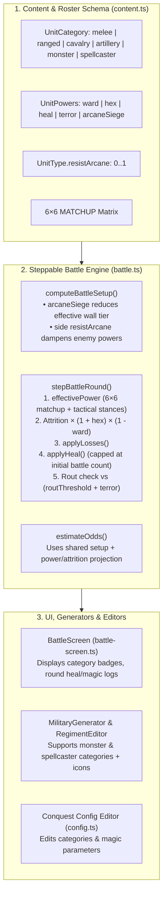

# Plan — OpenConquest Magic, Monsters & Arcane Warfare System

**Status:** In Progress (Phases 1–4 Completed)  
**Updated:** 2026-10-23  
**Companion Roster Plan (Phase 5):** [**`openconquest-old-world-rosters.md`**](openconquest-old-world-rosters.md) *(Warhammer: The Old World equivalent faction rosters & unit specifications)*  
**Context:** To expand OpenConquest with asymmetric fantasy rosters inspired by *Warhammer: The Old World* (Imperial Collegia, Chivalric Damsels, Vampiric Necromancers, Tomb Liche Priests, Ruinous Sorcerers, Saurian Star-Priests, Under-Empire Warlocks, and Dwarven Runesmiths), the combat and content engines need first-class support for **spellcasters**, **monsters**, **magical powers**, and **arcane resistance**.

---

## 1. Review of Attached Design vs. Current Codebase

The attached three-layer design (Identity → Powers → Strategy) fits the deterministic architecture of OpenConquest, with five important adaptations required by recent codebase changes:

1. **Authored `blocks` instead of `men` (`CAPACITY-PLAN Phase 4b`):**
   - `UnitType.men` is no longer authored in JSON; the validator in [`src/conquest/engine/common/content.ts`](../../src/conquest/engine/common/content.ts) enforces `blocks` (`men = blocks × MEN_PER_BLOCK`, where `MEN_PER_BLOCK = 1000`).
   - A 20-man Battle Mage covens/cabal is authored as `"blocks": 0.02` (`20` men), and a single monstrous entity or war-shrine retinue is authored as `"blocks": 0.01` to `0.05` (`10–50` effective men-equivalent HP).
2. **Capacity Pool Synergy (`M / W / S / C`):**
   - We do not need to invent a separate mana resource. The existing 4-pool capacity ledger (`Military`, `Wealth`, `Social`, `Cunning`) naturally gates arcane and monstrous units:
     - **Spellcasters** load **Social (`s`)** (colleges, temples, priesthoods) and **Cunning (`c`)** (esoteric lore, cabals) alongside **Wealth (`w`)**.
     - **Monsters** load heavy **Military (`m`)** and **Wealth (`w`)** (or **Social (`s`)** for sacred temple beasts).
3. **Steppable `BattleSession` & Interactive `BattleScreen`:**
   - Combat in [`src/conquest/engine/game/battle.ts`](../../src/conquest/engine/game/battle.ts) now runs on a round-by-round state machine (`initBattleSession` → `stepBattleRound` → `finalizeBattle`) shared by campaign auto-resolve (`resolveBattle`) and the interactive FMG Battle Simulator ([`src/controllers/battle-screen.ts`](../../src/controllers/battle-screen.ts)).
   - Multiplier setup is still duplicated between `initBattleSession` and `estimateOdds`. Extracting a shared `computeBattleSetup` helper ensures pre-battle odds bars accurately reflect `arcaneSiege` wall breaches and `resistArcane` damping.
4. **Power Scaling by Unit Strength & `powers` on Non-Casters:**
   - Attaching `powers` to `UnitType` generally (rather than restricting it to `category === "spellcaster"`) allows **monsters** and **undead/daemonic elites** to carry innate `terror`, `ward`, or `heal` (regeneration), and allows **Dwarven/Runic units** to carry `resistArcane`.
   - Active power output per round scales by unit fill (`unit.count / unitType.men`) so depleted caster/monster units lose potency proportionally.
5. **Direct FMG Military & Editor Integration:**
   - FMG's [`src/generators/military-generator.ts`](../../src/generators/military-generator.ts), [`src/controllers/regiment-editor.ts`](../../src/controllers/regiment-editor.ts), and [`src/conquest/ui/content/config.ts`](../../src/conquest/ui/content/config.ts) now read `UnitCategory` directly and must recognize `"spellcaster"` and `"monster"`.

---

## 2. Architecture & Data Flow



---

## 3. Pillar 1: Unit Categories & 6×6 Matchup Matrix (`Layer 1`)

### 3.1 Extended `UnitCategory`
Update [`src/conquest/engine/common/content.ts`](../../src/conquest/engine/common/content.ts):

```ts
export type UnitCategory =
  | "melee"
  | "ranged"
  | "cavalry"
  | "artillery"
  | "monster"
  | "spellcaster";
```

### 3.2 The 6×6 `MATCHUP` Matrix
`MATCHUP[attackerCategory][defenderCategory]` defines how effectively each archetype engages the opponent's force mix:

| Attacker ↓ \ Defender → | `melee` | `ranged` | `cavalry` | `artillery` | `monster` | `spellcaster` |
| :--- | :---: | :---: | :---: | :---: | :---: | :---: |
| **`melee`** | 1.0 | 1.1 | 0.8 | 1.2 | 0.8 | **1.4** |
| **`ranged`** | 1.1 | 1.0 | 0.7 | 1.0 | **1.25** | **1.2** |
| **`cavalry`** | 0.9 | 1.3 | 1.0 | 1.4 | 0.85 | **1.5** |
| **`artillery`** | 1.2 | 1.1 | 0.6 | 1.0 | **1.3** | 0.9 |
| **`monster`** | **1.3** | 0.8 | 1.1 | **1.4** | 1.0 | **1.4** |
| **`spellcaster`** | **1.25** | 1.0 | **0.5** | **1.2** | 1.1 | 1.0 |

**Tactical Counterplay:**
- **Spellcasters** devastate massed infantry (`1.25`) and artillery crews (`1.2`), but are fragile when hunted by cavalry (`0.5` effectiveness vs cavalry; cavalry deals `1.5×` against casters) or sniped by ranged units (`1.2×`).
- **Monsters** smash infantry lines (`1.3`), overrun artillery (`1.4`), and maul casters (`1.4`), but present large targets vulnerable to concentrated missile fire (`ranged 1.25×`, `artillery 1.3×` via Lanchester Square Law focus).

### 3.3 Tactical Stance Interactions in `effectivePower`
In [`src/conquest/engine/game/battle.ts`](../../src/conquest/engine/game/battle.ts):
- **`skirmish` order**: Boosts `spellcaster` (`×1.25`) alongside `ranged` and `artillery`.
- **`press` order**: Boosts `monster` (`×1.25`) alongside `melee`.
- **`charge` order**: Boosts `monster` (`×1.25`) alongside `cavalry` (`×1.35`).

---

## 4. Pillar 2: Declarative `powers` & `resistArcane` (`Layer 2`)

### 4.1 Schema Definition on `UnitType`
In [`src/conquest/engine/common/content.ts`](../../src/conquest/engine/common/content.ts):

```ts
export interface UnitPowers {
  /** Multiplicative reduction to own side's casualty rate (e.g. 0.10 => -10% casualties). */
  ward?: number;
  /** Multiplicative increase to enemy side's casualty rate (e.g. 0.08 => +8% enemy casualties). */
  hex?: number;
  /** Men restored per round across damaged friendly units (scaled by unit fill). */
  heal?: number;
  /** Increases enemy rout threshold (e.g. 0.05 raises rout threshold from 0.25 to 0.30). */
  terror?: number;
  /** Wall tiers ignored during siege assaults (e.g. 1 ignores 1 wall tier). */
  arcaneSiege?: number;
}
```

Add to `UnitType`:
- `powers?: UnitPowers;`
- `resistArcane?: number;` *(0..1; dampens enemy magical powers)*

### 4.2 Global Magic Caps in `CampaignConfig`
In [`src/conquest/engine/game/config.ts`](../../src/conquest/engine/game/config.ts) and [`src/conquest/content/docs/game.json`](../../src/conquest/content/docs/game.json), extend `battle`:

```ts
battle: {
  maxRounds: number;
  routThreshold: number;
  attritionScale: number;
  wallBonusPerTier: number;
  encampBonus: number;
  ambushBonus: number;
  riverDefenderBonus: number;
  magic: {
    wardCap: number;        // default 0.30
    hexCap: number;         // default 0.30
    healCap: number;        // default 40 (men per round)
    terrorCap: number;      // default 0.15
    arcaneSiegeCap: number; // default 2 (wall tiers)
    resistCap: number;      // default 0.50
  };
}
```

### 4.3 Aggregation & Resistance Math
Extract a pure helper `aggregateSideMagic(units, unitTypes, magicConfig)` in `battle.ts`:
1. For each living unit `u` (`u.count > 0`) with definition `t = unitTypes[u.type]`:
   - `fill = Math.min(1, u.count / Math.max(1, t.men))`
   - Sum `ward += (t.powers?.ward ?? 0) * fill`
   - Sum `hex += (t.powers?.hex ?? 0) * fill`
   - Sum `heal += (t.powers?.heal ?? 0) * fill`
   - Sum `terror += (t.powers?.terror ?? 0) * fill`
   - Sum `arcaneSiege += (t.powers?.arcaneSiege ?? 0) * fill`
   - Sum `resist += (t.resistArcane ?? 0) * fill`
2. Clamp each sum against its `config.battle.magic` cap.
3. Apply opponent's `resist` damping to offensive powers directed at them:
   - `effectiveHex = rawHex * (1 - opponentResist)`
   - `effectiveTerror = rawTerror * (1 - opponentResist)`
   - `effectiveArcaneSiege = rawArcaneSiege * (1 - opponentResist)`

### 4.4 Shared Multiplier Setup & Round Execution Order
1. **Shared Setup (`computeBattleSetup`)**:
   - Used by both `initBattleSession` and `estimateOdds`.
   - Computes `effectiveWalls = Math.max(0, modifiers.walls - attackerMagic.effectiveArcaneSiege)`.
   - Appends diagnostic modifier tags to `session.labels`: `"warded"`, `"hexed"`, `"regeneration"`, `"terror"`, `"arcane breach"`, `"spell resistance"`.
2. **Round Loop (`stepBattleRound`)**:
   - Re-evaluates `aggregateSideMagic` on surviving units at the start of the round (if a caster/monster is slain, its active powers cease).
   - **Step A — Effective Power**: `effectivePower` using 6×6 `MATCHUP` and tactical orders.
   - **Step B — Attrition Modification**:
     $$\text{aLossFrac} = \text{clamp}\!\left(\text{baseALoss} \times (1 + \text{dHex}) \times (1 - \text{aWard}),\, 0.02,\, 0.50\right)$$
     $$\text{dLossFrac} = \text{clamp}\!\left(\text{baseDLoss} \times (1 + \text{aHex}) \times (1 - \text{dWard}),\, 0.02,\, 0.50\right)$$
   - **Step C — Casualty Distribution**: `applyLosses` (deterministic PRNG jitter).
   - **Step D — Healing / Raising (`applyHeal`)**:
     - Distributes `Math.round(sideHeal)` across living units (`u.count > 0`) that are below their battle-start headcount (`u.count < initialUnitCount[i]`), prioritizing the most-damaged unit first.
     - Capping at battle-start count guarantees `losses` in `BattleSideReport` and `battle-screen.ts` never go negative.
   - **Step E — Rout Check**:
     - Attacker rout threshold: `config.battle.routThreshold + dTerror`
     - Defender rout threshold: `config.battle.routThreshold + aTerror`
3. **`estimateOdds` Accuracy**:
   - Incorporates `ward`, `hex`, `heal`, `terror`, and `arcaneSiege` into effective combat power projection so the pre-battle odds bar reflects magical superiority.

---

## 5. Pillar 3: FMG Military, Battle Screen & Editor Integration (`Layer 3`)

### 5.1 FMG Military Generator & Overview Support
- **[`src/generators/military-generator.ts`](../../src/generators/military-generator.ts)**:
  - Update `getCategoryForUnit`, `Military.getCategory`, and `Military.getCategoryCount` to include `"monster"` and `"spellcaster"`.
  - Add unit ID regex fallbacks for custom units:
    - `/(mage|wizard|sorcerer|shaman|necromancer|priest|damsel|seer|caster|warlock|runesmith)/i` → `"spellcaster"`
    - `/(dragon|giant|troll|ogre|hydra|griffon|gryphon|hippogryph|pegasus|sphinx|mammoth|demon|daemon|abomination|treeman|varghulf|terrorgheist|monster|behemoth|stegadon|carnosaur)/i` → `"monster"`
  - Assign map/overview glyphs: `🔮` for `"spellcaster"`, `🐉` for `"monster"`.
  - In `selectRosterUnitForCategory` / burg military generation: allow capitals and temple burgs to optionally spawn a roster's `spellcaster` or `monster` unit block if available.
- **[`src/controllers/battle-screen.ts`](../../src/controllers/battle-screen.ts)**:
  - Render distinct category badge colors for `spellcaster` (purple `#8e44ad`) and `monster` (amber/crimson `#d35400`).
  - Record healed/raised troops in `BattleRoundLog` (`attackerHealedMen`, `defenderHealedMen`) and display them in the Engagement Chronicle.
- **[`src/conquest/ui/content/config.ts`](../../src/conquest/ui/content/config.ts)**:
  - Add `"monster"` and `"spellcaster"` to `CATEGORIES` in the in-app Config Editor.

---

## 6. Phased Implementation Plan

| Phase | Status | Description | Key Files |
| :--- | :---: | :--- | :--- |
| **Phase 1: Core Schema & Validation** | ✅ Completed | Add `"monster"` and `"spellcaster"` to `UnitCategory`, expand `MATCHUP` to 6×6, add `UnitPowers` (`ward`, `hex`, `heal`, `terror`, `arcaneSiege`) and `resistArcane` to `UnitType`, and add `battle.magic` caps to `CampaignConfig` & `game.json`. | `src/conquest/engine/common/content.ts`<br>`src/conquest/engine/game/config.ts`<br>`src/conquest/content/docs/game.json` |
| **Phase 2: Battle Engine & Odds Refactor** | ✅ Completed | Extract shared `computeBattleSetup` & `aggregateSideMagic`, wire `ward`/`hex`/`heal`/`terror`/`arcaneSiege`/`resistArcane` into `stepBattleRound` and `estimateOdds`. | `src/conquest/engine/game/battle.ts` |
| **Phase 3: UI, Generators & Battle Screen** | ✅ Completed | Update `military-generator.ts`, `battle-screen.ts`, `military-overview.ts`, `regiments-overview.ts`, and `conquest/ui/content/config.ts` to support the new categories and round healing logs. | `src/generators/military-generator.ts`<br>`src/controllers/battle-screen.ts`<br>`src/conquest/ui/content/config.ts`<br>`src/controllers/military-overview.ts`<br>`src/controllers/regiments-overview.ts` |
| **Phase 4: Unit Tests & Baseline Verification** | ✅ Completed | Add unit tests covering `powers` math, `resistArcane` damping, `arcaneSiege` wall reduction, `heal` capping, 6×6 matchups, and content validation. | `src/conquest/test/battle-turn.test.ts`<br>`src/conquest/test/content.test.ts` |
| **Phase 5: Old World Fantasy Rosters** | 📋 Next | Upgrade existing fantasy rosters (`dwarf`, `elf`, `orc`) with casters/monsters/runes and author the 10 new *Warhammer: The Old World* equivalent rosters. Full specification in [**`openconquest-old-world-rosters.md`**](openconquest-old-world-rosters.md). | `src/conquest/content/docs/rosters/*.json`<br>`src/conquest/content/bundled.ts`<br>`src/conquest/engine/common/content.ts` |
