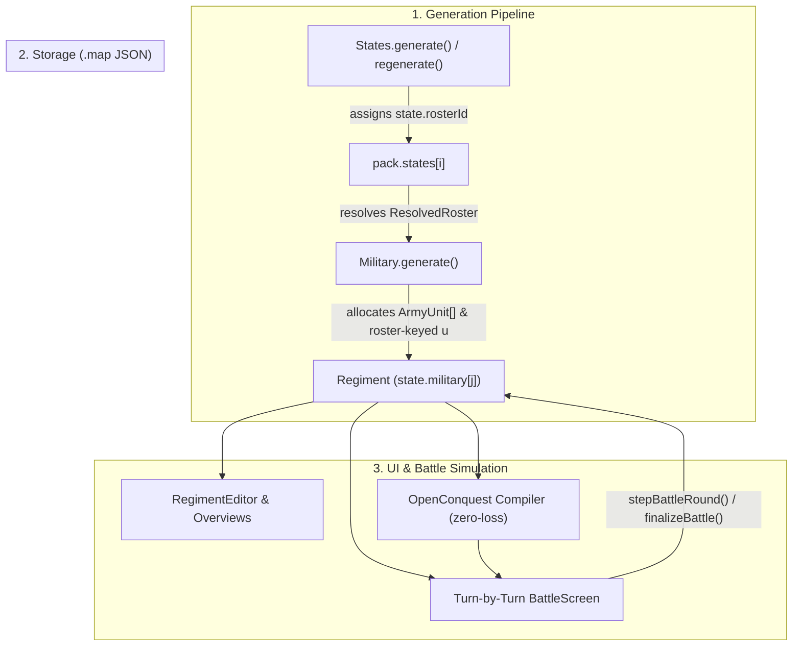
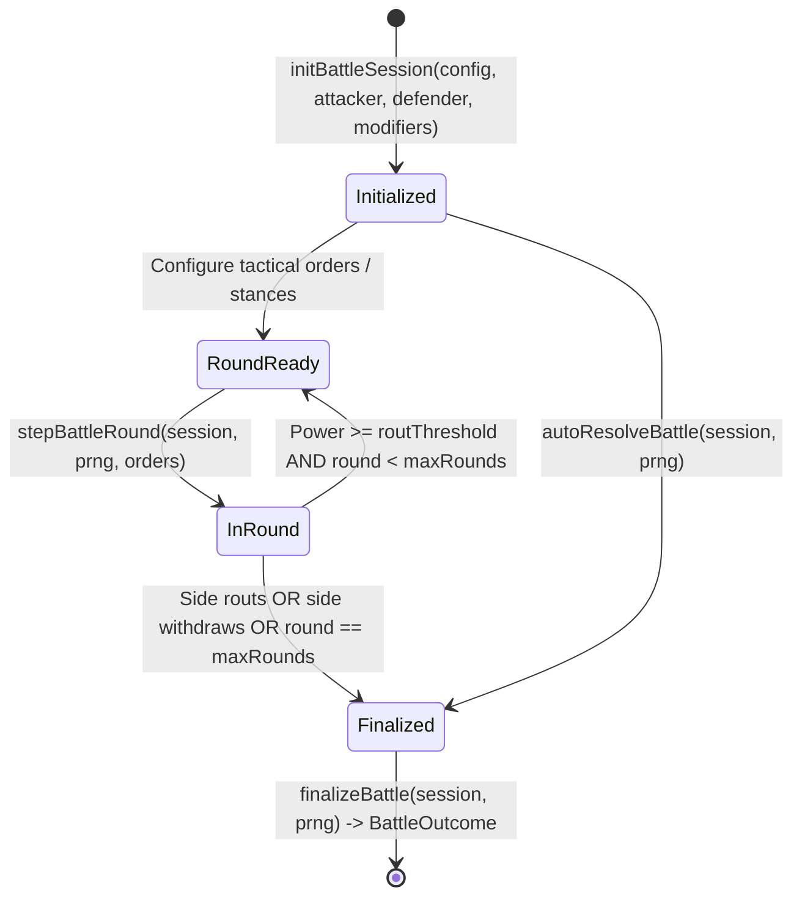

# Plan — Deep Integration of OpenConquest Rosters, Military & Battle Simulator

**Status:** Proposed  
**Updated:** 2026-10-23  
**Context:** Now that the repository is a unified fork (`README.md`, `docs/openconquest/README.md`), FMG and OpenConquest no longer need separate military abstractions bridged by a lossy converter (`regimentToUnits`). This plan unifies the military pipeline into a cohesive system across three core pillars:
1. Assign a concrete roster to every state (`state.rosterId`).
2. Generate and manipulate roster-defined units instead of generic blanket numbers (`regiment.units: ArmyUnit[]` and roster-keyed `regiment.u`).
3. Convert the FMG battle simulator (`battle-screen.ts`) to use the OpenConquest Lanchester battle sim (`battle.ts`) with turn-by-turn interactive control.

---

## 1. Architecture & Data Flow



---

## 2. Pillar 1: Assign a Roster to Every State

### 2.1 Data Model
Add `rosterId?: string` directly to the `State` interface in `src/generators/states-generator.ts` and `FmgState` in `src/conquest/engine/compiler/index.ts`:

```ts
export interface State {
  i: number;
  name: string;
  culture: number;
  rosterId?: string; // "commonBase" | "dwarfBase" | "elfBase" | "orcBase" | "steppeBase" | custom
  // ... existing fields
}
```

Since `src/services/io/save.ts` serializes `pack.states` via `JSON.stringify`, `state.rosterId` automatically persists in `.map` files without requiring custom serializer patches or breaking legacy saves.

### 2.2 Roster Assignment & Culture Mapping
Implement deterministic assignment in a shared utility (usable by both `states-generator.ts` and `src/conquest/engine/common/content.ts`):
1. **Existing override:** If `state.rosterId` is already valid and present in resolved rosters, preserve it.
2. **Culture name/race inference:** Evaluate the state's culture (`pack.cultures[state.culture]`) using `inferRosterForCulture`:
   - Culture name matches `dwarf` → `dwarfBase`
   - Culture name matches `elf` → `elfBase`
   - Culture name matches `orc|goblin` → `orcBase`
   - Culture name matches `steppe|nomad` → `steppeBase`
3. **Culture / State type inference:**
   - `state.type === "Nomadic"` or culture type `Nomadic` → `steppeBase` (if not already matched)
   - `state.type === "Highland"` and culture matches mountain themes → `dwarfBase`
4. **Fallback:** Default to `"commonBase"`.

### 2.3 Integration Points
- **`States.generate` & `States.regenerate` (`src/generators/states-generator.ts`):** Assign `state.rosterId` immediately after state boundaries and cultures are settled.
- **Save / Load Migration:** When loading older `.map` files lacking `rosterId`, lazily evaluate and populate `state.rosterId`.
- **States Editor (`src/controllers/states-editor.ts`):** Add a Roster column dropdown allowing the user to view and switch each state's roster.
- **State Forces Dialog & Content Editors (`src/conquest/ui/content/`):** Read and update `state.rosterId` directly.

---

## 3. Pillar 2: Use Roster Units Instead of Blanket Numbers

### 3.1 Regiment Model Evolution
Extend `Regiment` in `src/generators/military-generator.ts` to represent concrete roster unit blocks:

```ts
export interface Regiment {
  i: number;
  a: number;                       // Total men (sum of unit counts + fleet)
  cell: number;
  x: number;
  y: number;
  bx: number;
  by: number;
  u: Record<string, number>;       // Keyed by unitId (e.g. { spear: 450, sword: 300, archers: 240 })
  units?: ArmyUnit[];              // Concrete slots: { type: string, count: number, exp: number }[]
  rosterId?: string;               // Assigned roster identifier
  n: 0 | 1;                        // Naval fleet flag (1 if naval, 0 if land)
  name: string;
  state: number;
  icon: string;
  note?: string;
}
```

- `units: ArmyUnit[]`: Stores the individual unit blocks (e.g., two 150-man blocks of `spear`, one 150-man block of `sword`), with individual experience and casualty tracking.
- `u: Record<string, number>`: Maintained as the aggregate headcount by unit ID via `syncRegimentTotals(reg)`, ensuring backwards compatibility with any existing renderer or overview tool.

### 3.2 Roster-Native Military Generation (`src/generators/military-generator.ts`)
Replace the global blanket calculation (`options.map.military.units`) with roster-aware generation:
1. **Resolve State Roster:** Fetch `ResolvedRoster` for `state.rosterId` using `currentContent()`.
2. **Category Allocation:** Compute regional/settlement platoon points for the 4 core combat categories (`melee`, `ranged`, `cavalry`, `artillery`) plus `fleet` for coastal burgs:
   - Terrain & biome weights: Plains/steppes favor `cavalry`; forests favor `ranged`; hills/mountains favor `melee`; walled cities favor `artillery` and heavy infantry.
   - State & culture traits: Nomadic favors mounted archetypes; Naval favors fleets and marines.
3. **Unit Construction:**
   - Distribute category points across the roster's `recruitable` units in each category.
   - Size units in multiples of `UnitType.men` (`Math.round(unit.blocks * MEN_PER_BLOCK)`).
   - Enforce unit caps (`roster.caps[unitId]`) and army slot limits (`maxUnitsPerArmy = 20`).
   - Elite units requiring specific trade goods (`requiresGood`) or fortification tiers (`requiresWallTier`) are concentrated in developed capitals and hubs.

### 3.3 Zero-Loss Campaign Compilation & UI
- **Compiler Pass-Through (`src/conquest/engine/compiler/index.ts` & `src/conquest/engine/game/state.ts`):**
  - When `regiment.units` exists (or `reg.u` is already roster-keyed), pass unit slots directly into `Army.units`.
  - Retain `regimentToUnits()` solely as a legacy migration fallback for old `.map` files.
  - Fix `armiesFromRegiments` in `src/conquest/ui/source.ts` (where `regiment.a` was mistakenly read as army ID instead of total troops).
- **Regiment Editor (`src/controllers/regiment-editor.ts`):**
  - Render roster unit cards/rows with unit category icons, combat stats (ATK / DEF / CHG / MSL), and block counts (`count / men`).
  - Allow adding/removing unit blocks conforming to roster caps and 20-unit army limits.
- **Military Overview (`src/controllers/military-overview.ts`) & Regiments Overview (`src/controllers/regiments-overview.ts`):**
  - Group forces by category (`Melee`, `Ranged`, `Cavalry`, `Artillery`, `Fleet`), display the state's Roster badge, and show detailed tooltips with concrete unit counts.

---

## 4. Pillar 3: Convert FMG Battle Sim to OpenConquest Sim with Turn-by-Turn Control

### 4.1 Steppable Battle Engine (`src/conquest/engine/game/battle.ts`)
Deconstruct the continuous `while` loop in `resolveBattle()` into a steppable state machine while preserving deterministic Lanchester calculations:



#### Tactical Orders per Round
Allow per-round tactical stances (with an `"auto"` / `"balanced"` default for AI and automated passes):
- **`balanced` (Default):** Standard 1.0x baseline weights and regular round pressure.
- **`skirmish`:** Boosts `ranged` and `artillery` contribution (`×1.25`), reduces casualty exchange rate (`×0.65`) unless countered by `charge`.
- **`press`:** Melee attack/defense boost (`×1.2`), increases casualty exchange rate (`×1.2`).
- **`charge`:** Boosts `cavalry` and shock damage (`×1.35`), breaks `skirmish`, but vulnerable to `brace`.
- **`brace`:** Boosts defense (`×1.3`), blunts incoming `charge` (`×0.7`), reduces offensive output.
- **`withdraw`:** Orderly retreat; takes reduced pursuit penalties (`15%` vs. `30%` for routing).

#### Engine API
- `initBattleSession(config, attacker, defender, modifiers): BattleSession`: Initializes armies, initial effective power, starting counts, and round history.
- `stepBattleRound(session, prng, orders?): BattleRoundLog`: Computes category shares, matchup multipliers, tactical stance modifiers, distributes per-unit casualties, and checks `routThreshold` (25% power remaining).
- `finalizeBattle(session, prng): BattleOutcome`: Resolves pursuit casualties and produces the final outcome struct.
- `resolveBattle(...)`: Retained as a pure wrapper executing `initBattleSession` → loop `stepBattleRound` → `finalizeBattle` for backward-compatible headless calls.

### 4.2 Interactive Battle Screen (`src/controllers/battle-screen.ts`)
Rebuild FMG's `BattleScreen` to drive `BattleSession`:
- **Contextual Terrain & Fortifications:** Automatically detect defender cell properties (burg walls tier, river crossing, rough terrain) and pre-select corresponding `BattleModifiers`.
- **Combat Breakdown Header:**
  - Display the `estimateOdds()` balance-of-power bar.
  - Show active terrain/wall modifiers and category composition percentages (`Melee`, `Ranged`, `Cavalry`, `Artillery`).
- **Unit Roster Grid:**
  - List individual `ArmyUnit` blocks for each side with experience stars, starting men, round casualties, and surviving strength bars.
  - Display an army Morale / Cohesion bar tracking current power against the 25% rout line.
- **Turn-by-Turn & Auto-Resolve Controls:**
  - Per-round tactical stance selectors for player forces (with optional AI-driven stance for opponent).
  - "Step Round" button to advance combat one round and inspect casualty logs.
  - "Auto-Resolve" button to execute remaining rounds to completion.
  - "Apply Results": Synchronizes surviving `ArmyUnit[]` data back to regiments on the map, removes wiped-out regiments, records battle notes, and places a battlefield marker on the map.

---

## 5. Phased Implementation Plan

| Phase | Description | Key Modules | Status |
| :--- | :--- | :--- | :--- |
| **Phase 1** | **State Roster Binding**<br>- Add `state.rosterId` to data models.<br>- Implement culture/state inference helper.<br>- Wire into `States.generate()`, States Editor, and Military Overview. | `src/generators/states-generator.ts`<br>`src/conquest/engine/common/content.ts`<br>`src/controllers/states-editor.ts`<br>`src/controllers/military-overview.ts` | **Completed & Pushed** (commit `4c5eee77`) |
| **Phase 2** | **Roster-Native Military & Regiments**<br>- Generate `reg.units: ArmyUnit[]` and roster-keyed `reg.u` in `Military.generate()`.<br>- Update `RegimentEditor` and military overview tables.<br>- Pass native units through OpenConquest compiler without conversion loss. | `src/generators/military-generator.ts`<br>`src/controllers/regiment-editor.ts`<br>`src/controllers/regiments-overview.ts`<br>`src/conquest/engine/compiler/index.ts`<br>`src/conquest/ui/source.ts` | **Completed** |
| **Phase 3** | **Turn-by-Turn Lanchester Battle Simulator**<br>- Refactor `battle.ts` into steppable round state machine with tactical orders.<br>- Rebuild `battle-screen.ts` on top of `BattleSession`.<br>- Support terrain detection, odds bars, and map result application. | `src/conquest/engine/game/battle.ts`<br>`src/controllers/battle-screen.ts`<br>`index.html` | **Completed** |
