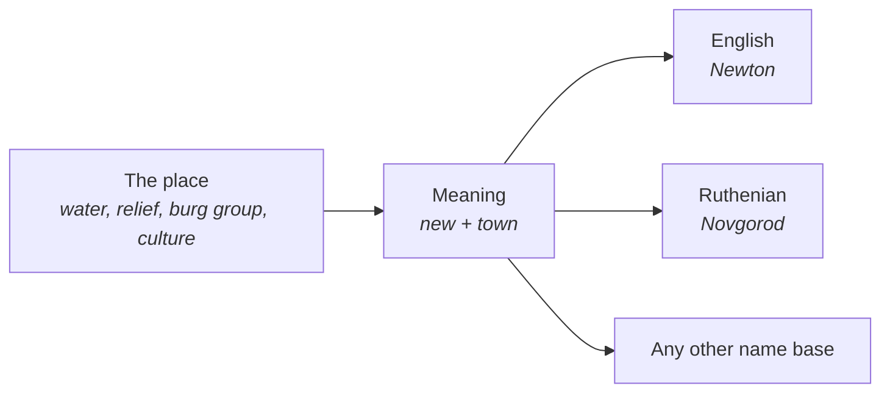

# PRD — Semantic names

Burgs and states get a language-neutral meaning first, such as "new town" or "Eadric's farm", and every name base then renders that meaning into a name that sounds native to it. The same meaning always renders to the same name in a given base, so any name can be shown in any other base.

## Problem and goals

Names today are Markov output from a corpus of real town names: they sound right but mean nothing. A port, a hill fort and a river crossing get the same kind of name, a town cannot be named after its river or founder, and a name cannot be carried into another culture's language.

Three symptoms in the code show the limit:

- `Names.getState` hardcodes the idea of "land" per base index (`land`, `ia`, `maa`, `orszag`, `guk`, `  Guo `). It breaks when name bases are reordered or replaced.
- Burgs are named in `Burgs.generate`, before ports, citadels, burg type, river names and feature names exist, so a name cannot reflect any of them.
- The name base format (`name|min|max|d|m|names`) has no room for anything but a corpus, and `m` is already unused.

### Goals

1. Every generated burg and state has a stored meaning that is logical for its place on the map.
2. Each name base holds the data needed to render a meaning into a name that sounds native to it.
3. Rendering is a pure function: the same meaning and base always give the same name.
4. The user can see any name's meaning in English and its rendering in every name base, and apply one.
5. Name bases with no authored data, including community bases, still work.
6. One clean name base structure is used in `src` and in saved `.map` files.

### Non-goals

- A conlang or grammar engine: no declension, agreement or syntax beyond toponym formants.
- Linguistic accuracy that would satisfy a native speaker in every case. The bar is "sounds right", with data that can be corrected over time.
- Semantic names for rivers, lakes, markers, religions and provinces in the first release. They keep using the Markov generator and can adopt meanings later.
- Translating state form names ("Kingdom of") or the English adjective forms.

## At a glance



Generation reads the map and the culture's name base once and stores a meaning on the burg or state. Rendering is a separate, repeatable step: the stored meaning plus any name base gives that base's name for it.

## Terms

| Term | What it is | Example |
| --- | --- | --- |
| Concept | An entry in a closed vocabulary, identified by an English word | `town`, `black`, `ford` |
| Proper root | An opaque name with no concept behind it: a person, people, river or older place | `~Eadric` |
| Pattern | The shape of a meaning: which slots it has | `owner-generic` |
| Meaning | A pattern with its slots filled, plus the base it was coined in and an optional salt | `owner-generic: ~Eadric, farm` |
| Gloss | The English reading of a meaning, shown to the user | "Eadric's Farm" |
| Formant | A name base's fixed toponymic form of a concept, not a dictionary word | `neu`, `stadt`, `gorod` |
| Template | How a name base lays out a pattern | `{owner}s{generic}` |
| Sound rule | A regex rewrite a name base applies to a joined name | `ee` at a boundary becomes `e` |
| Rendering | Meaning plus name base gives a name; the "translation" | `new town` in German gives Neustadt |
| Appropriation | Adapting a proper root coined in one base to the sounds of another | Eadric in Roman gives Eadricus |

## Meanings

A meaning is built from a small set of patterns filled with concepts and proper roots, chosen from what the map says about the place.

### Concept vocabulary

The vocabulary is closed, so the data each name base needs is finite. The English word is both the id and the gloss. Launch targets:

| Group | Target count | Examples |
| --- | --- | --- |
| Settlement generics | 40 | town, village, farm, fort, market, harbour, ford, bridge, mouth, spring, hill, pass, valley, field, wood, marsh, island, mine, mill, temple |
| Modifiers | 80 | new, old, great, little, long, high, upper, lower, north, black, white, red, oak, pine, wolf, bear, stone, iron, salt, king, holy, free |
| Land generics | 10 | land, realm, march, coast, isles, people |

Each concept carries tags that say when it fits (`coast`, `river`, `highland`, `forest`, `capital`), used when picking a meaning.

### Patterns

The pattern set is small and fixed, because every name base must be able to render every pattern.

| Pattern | Slots | Gloss | Used for |
| --- | --- | --- | --- |
| `simplex` | root | Aitern | burg, state |
| `feature` | generic | The Ford | burg |
| `modifier-generic` | modifier, generic | New Town | burg |
| `owner-generic` | person root, generic | Eadric's Farm | burg |
| `generic-of` | generic, river or lake root | Mouth of the Exe | burg |
| `relative` | modifier, burg root | New Aitern, Upper Aitern | burg |
| `root-land` | people, capital, founder or river root, land generic | Land of the Franks | state |
| `modifier-land` | modifier, land generic | East Realm | state |

`simplex` is the opaque name the generator makes today. Its weight sets how many names on the map carry no readable meaning.

### Picking a burg meaning

The pattern is drawn by weight: the name base's affinity for each pattern times how well the place supports it. Slots are then filled from concepts whose tags match the place.

| Signal | Source | Makes likely |
| --- | --- | --- |
| Sea or lake port | `burg.port`, `cells.haven` | harbour, shore, island, `generic-of` a lake |
| River, its size, mouth or confluence | `cells.r`, `cells.fl`, `pack.rivers` | ford, bridge, mouth, `generic-of` the river |
| Height and relief | `cells.h` | hill, pass, valley, high, upper, lower |
| Biome | `cells.biome` | wood, marsh, field, oak, pine, sand |
| Deposit in the cell | `cells.good` | mine, salt, iron, stone |
| Culture type | `culture.type` | shifts all weights: Naval to coast concepts, Highland to relief, Nomadic to spring |
| Capital | `burg.capital` | king, great |
| Placement score | `cells.s` | town for high scores, village or farm for low |
| Older burg nearby or across the sea | burgs already named | `relative` |

A meaning records why the name was given. It is not re-checked when the map changes: a town keeps "harbour" in its name after the user removes its port.

### Picking a state meaning

A state is named `root-land` or `modifier-land`. The root is the capital's root, a generated people name, a founder, or the main river of its territory. The modifier is a direction relative to the map or to an older neighbour. This replaces the suffix table in `Names.getState` and its trimming of `-berg`, `-ton`, `-sk`.

### Uniqueness

Because rendering is deterministic, two burgs with the same meaning would get the same name. Three measures keep names distinct:

1. A set of used meanings per name base: a duplicate meaning is re-drawn at generation.
2. A `salt` number stored in the meaning. It changes which weighted formant variant is picked, so "new town" can be Neustadt, Neudorf or Neuheim and stays that way.
3. A set of used names per map: if two different meanings render alike, the salt is bumped.

## Proper names

Proper roots come from a corpus of personal names per name base, separate from the corpus of place names.

### Two corpora per base

- `places` is today's list of town names. It keeps feeding `simplex` names and every generator that has not moved to meanings (rivers, lakes, markers).
- `people` is new: about 150 historical given names per base, kept as separate male and female lists. Toponym roots draw from both lists; the split is there for later consumers such as ruler names. It fills the person slot of `owner-generic` and the founder or people slot of `root-land`.

A base without a `people` corpus falls back to short Markov output from `places`, as `getBaseShort` does today.

### Chain or pick

Each corpus has a `mode`:

- `chain` builds a Markov chain from the corpus and generates new names. It suits fantasy bases and gives the most variety.
- `pick` draws a name from the list as written. It gives authentic results on real-world bases (Friedrichshafen) and repeats founders on large maps. Two burgs may share a founder; the salt and the used-names set keep the finished names apart.

A map option overrides the per-base default: by base, always generate, or always pick.

### Appropriation

Every language reshapes foreign names to its own sounds, so a proper root is never carried verbatim into another base. A meaning stores the base it was coined in (`origin`) and its roots in that base's form. When it is rendered in a different base, each root goes through that base's appropriation first:

1. Letters the target base never uses are replaced through a shared nearest-letter table (diacritics dropped, `w` to `v` and similar).
2. The target's sound rules marked `foreign` run. These are authored adaptations, such as adding `-us` in Roman or inserting vowels in Japanese.
3. Where a base has no `foreign` rules, consonant clusters that never occur in its corpus are broken with its most frequent vowel.
4. The target's ordinary sound rules run, as for any native name.

Appropriation is a pure function of the root and the target base. Illustrative results for `~Eadric`, which depend on the rules each base ships:

| Target base | Rendered root | What changed |
| --- | --- | --- |
| English (origin) | Eadric | nothing |
| Roman | Eadricus | `-us` added after a final consonant |
| Ruthenian | Edrik | `ea` reduced, `c` to `k` |
| Japanese | Edoriku | vowels inserted after consonants |
| Hawaiian | Ekeliki | `d` and `c` to `k`, `r` to `l`, open syllables |

The same step runs at generation when a place is named after something another culture named: a town on a river named by its neighbours stores the river's root already appropriated to the town's own base.

## Rendering

`render(meaning, base)` turns a meaning into a name in six fixed steps. Every choice in it is seeded by a hash of the meaning, its salt and the base id, so the result never changes between calls.

1. **Appropriate roots.** If the base is not the meaning's origin, each proper root is adapted to it.
2. **Pick a template.** The base's templates for the pattern are drawn by weight. A base with none uses the built-in default.
3. **Pick formants.** For each concept slot, the base's variants that are valid at that position are drawn by weight. Variants that keep the name within the base's length are preferred.
4. **Join.** Parts are concatenated with a `+` boundary marker and any `link` a formant asks for: `konig+s+berg`.
5. **Apply sound rules.** See the next section.
6. **Finish.** Markers are removed and words are capitalised.

### Templates

A template is a string with slots named by role: `{modifier}`, `{generic}`, `{root}`. Literal text and spaces are allowed, and a slot may be left out when a suffix carries it. Two meanings can then render alike, and the used-names set separates them.

| Pattern | Built-in default | Examples a base can define |
| --- | --- | --- |
| `simplex` | `{root}` |  |
| `feature` | `{generic}` | `al-{generic}` |
| `modifier-generic` | `{modifier}{generic}` | `{generic} {modifier}` |
| `owner-generic` | `{root}{generic}` | `{root}s{generic}`, `{root}ingen`, `{root}ov` |
| `generic-of` | `{root}{generic}` | `{generic}{root}`, `{generic} {root}` |
| `relative` | `{modifier} {root}` | `{modifier}{root}` |
| `root-land` | `{root}{generic}` | `{root}ia`, `{root} {generic}` |
| `modifier-land` | `{modifier}{generic}` |  |

A base sets two things per pattern: a `weight` that says how often it coins names of that pattern, and its list of templates. Weight matters only at generation. Templates matter for every rendering, including translations of meanings the base would never coin itself.

### Formants

A concept maps to a list of formant variants. Each variant has a `form` and may have a `weight`, a `position` where it is valid (`first`, `last` or `word`), a `short` form and a `link`. Variants are true synonyms: where size or kind differs, the vocabulary has two concepts instead.

### When a base has no formant

A concept is resolved through four sources in order, so every base can render every meaning:

1. The base's own lexicon.
2. The lexicon of the base it `extends`.
3. For generics only: a mined ending. The most frequent word endings of the `places` corpus are assigned to generic concepts by hash.
4. A seeded morpheme: two to five letters from the base's Markov chain, seeded by the base id and the concept.

Sources 3 and 4 need no authored data, which is what makes community and custom bases work. A prototype over the shipped corpora gave these results:

| Meaning | Authored lexicon | Seeded morpheme | Mined ending |
| --- | --- | --- | --- |
| German: new town | Neustadt | Bollsmahl | Bollsach |
| German: new fort | Neuburg | Bollslauf | Bollsgen |
| Ruthenian: black ford | Chernobrod | Gorodros | Gorodtsk |
| Nahuatl: white hill | not authored | Tezotlanc | Tezotepec |
| Elven: black hill | not authored | Hinorm | Hinora |

The fallbacks are consistent and sound native, but on a real-world base they are not true: the seeded morpheme for "black" in Ruthenian came out as "Gorod", which is the real word for town. They are right for fantasy bases and a stopgap for real ones. Mined endings cover 50 to 67% of names in the German, English, Chinese, Korean and Nahuatl corpora and under 10% in Amazigh, Nigerian, Levantine, Draconic and Arachnid, where source 4 does the work.

## Sound rules

Each name base carries one ordered list of regex rules that does three jobs: cleans up joins, wears names down the way real names wear, and adapts foreign roots.

### How a rule sees a name

Rules run on the joined string while morpheme boundaries are still marked: `eadric+s+ham`, with a space between words. A rule can therefore target a join or a word end instead of guessing from spelling, which is where most natural change happens.

| Field | Meaning |
| --- | --- |
| `match` | Regex source. `+` stands for a morpheme boundary |
| `replace` | Replacement, with `$1` groups |
| `when` | Absent: always applied. `long`: only while the name exceeds the base's maximum length. `foreign`: only on proper roots coined in another base |
| `chance` | 0 to 1. The rule fires on a seeded roll, so a worn name stays worn on every render |

### Order of application

1. `foreign` rules, on each appropriated root before joining.
2. Always-on rules, in list order.
3. Rules with a `chance`, each rolled once.
4. `long` rules, one at a time in list order, stopping as soon as the name fits.

### Shortening

Some names are shortened only because they are too long, others just because the short form is easier to say. Both are data in the base. When a name is over length after step 4, a fixed ladder runs:

1. Re-pick formant variants, preferring shorter synonyms.
2. Use the `short` form of each formant that has one.
3. Clip the proper root at a syllable boundary, using the base's own syllable splitter. Formants are never clipped.
4. As a last resort, leave the modifier out of the name. The stored meaning is unchanged.

At generation a name that still does not fit is simply re-drawn. The ladder matters for translation, where the meaning is fixed.

### Illustrative rules

| Base | Rule | Kind | Effect |
| --- | --- | --- | --- |
| Shared defaults | `(.)\1\1` to `$1$1` | always | no triple letters |
| Shared defaults | `([aeiou])\+\1` to `$1` | always | one vowel across a join |
| German | `([^lt])\1` to `$1` | always | replaces today's `d: "lt"` |
| German | `heim$` to `um` | chance 0.1 | Bochheim becomes Bochum |
| German | `ingen$` to `ing` | long |  |
| English | `chester$` to `ster` | long | Eadricchester becomes Eadricster |
| Roman | `([^aeiou])$` to `$1us` | foreign | Eadric becomes Eadricus |
| Castillian | `^s([^aeiou])` to `es$1` | foreign | Stefan becomes Estefan |

### What this replaces

- The `d` field: the letters allowed to double become one always-on rule, generated by the migration.
- The fix-ups hardcoded in `Names.getBase` (`ae` to `e`, triple letters, trailing apostrophes and hyphens) become shared default rules.
- `validateSuffix` and the per-base branches of `Names.getState`.

The same list post-processes plain Markov output, so there is one clean-up path.

### Limits

Regex over spelling knows nothing about stress or syllables, so erosion is approximate where spelling and sound diverge, as in English and French. Rules should be anchored to boundaries and word ends to keep the effect local. Rules are compiled once per base at load; an invalid rule is reported in the editor and skipped.

## Worked examples

The formants and rules below are illustrative. Rows marked "fallback" are real prototype output for bases with no authored lexicon.

### `modifier-generic: new, fort`, coined in German

| Base | Template | Joined | Name |
| --- | --- | --- | --- |
| German | `{modifier}{generic}` | `neu+burg` | Neuburg |
| Ruthenian | `{modifier}{generic}` | `novo+grad` | Novograd |
| Japanese | `{modifier}{generic}` | `shin+jo` | Shinjo |
| Celtic | `{generic} {modifier}` | `caer newydd` | Caer Newydd |
| Nahuatl (fallback) | default | `izta+pan` | Iztapan |
| Orc (fallback) | default | `brog+ekh` | Brogekh |

### `owner-generic: ~Eadric, farm`, coined in English

| Base | Root after appropriation | Template | Joined | After rules | Name |
| --- | --- | --- | --- | --- | --- |
| English, salt 0 | Eadric | `{root}{generic}` | `eadric+ham` | `eadricham` | Eadricham |
| English, salt 1 | Eadric | `{root}{generic}` | `eadric+ton` | `eadricton` | Eadricton |
| German | Eadrik | `{root}ingen` | `eadrik+ingen` | `eadriking`, by the `long` rule | Eadriking |
| Ruthenian | Edrik | `{root}ov` | `edrik+ov` | `edrikov` | Edrikov |
| Roman | Eadricus | `{generic} {root}` | `villa eadricus` | `villa eadricus` | Villa Eadricus |

The Roman row shows the non-goal: a grammar engine would give the genitive, Villa Eadrici. A `foreign` or template-level rule can approximate it; full case agreement is out of scope.

### `generic-of: mouth, ~Exe`, coined in English

| Base | Template | Joined | Name |
| --- | --- | --- | --- |
| English | `{root}{generic}` | `exe+mouth` | Exmouth, by a rule that drops a final e at the join |
| Celtic | `{generic}{root}` | `aber+exe` | Aberexe |
| German | `{root}{generic}` | `exe+munde` | Exemunde |

### `root-land: ~Frank, land`, a state coined in German

| Base | Joined | Name |
| --- | --- | --- |
| German | `frank+en+land` | Frankenland |
| Finnic | `frank+maa` | Frankmaa |
| Hungarian | `frank+orszag` | Frankorszag |
| Chinese | `fulan guo` | Fulan Guo |
| Roman | `franc+ia` | Francia |

## Data model

One structure describes a name base in `src` and in saved maps. Field names are spelled out; `b`, `d` and `m` are gone.

```ts
type Pattern =
  | "simplex" | "feature" | "modifier-generic" | "owner-generic"
  | "generic-of" | "relative" | "root-land" | "modifier-land";

type Token = Concept | `~${string}`; // ~ marks a proper root

interface Meaning {
  pattern: Pattern;
  tokens: Token[]; // in the pattern's slot order
  origin: string; // id of the name base it was coined in
  salt?: number;
}

interface Corpus {
  names: string[];
  mode?: "chain" | "pick"; // default chain
  length?: [min: number, max: number]; // chain output
}

interface People {
  male?: Corpus;
  female?: Corpus;
}

interface Formant {
  form: string;
  weight?: number; // default 1
  position?: "first" | "last" | "word"; // filters variants; the template sets the order
  short?: string;
  link?: string; // inserted before the next part
}

interface Template {
  parts: string; // "{root}s{generic}"; a slot may be omitted
  weight?: number;
}

interface SoundRule {
  match: string; // regex source; "+" is a morpheme boundary
  replace: string;
  when?: "long" | "foreign";
  chance?: number;
}

interface NameBase {
  id: string; // stable slug
  name: string;
  extends?: string; // inherit lexicon, patterns and rules
  length: [min: number, max: number]; // finished toponyms
  places: Corpus;
  people?: People;
  lexicon?: Partial<Record<Concept, Formant[]>>;
  patterns?: Partial<Record<Pattern, { weight?: number; templates?: Template[] }>>;
  rules?: SoundRule[];
}
```

### Changes to existing entities

| Entity | Change |
| --- | --- |
| `Burg` | adds `meaning?: Meaning`; `name` stays the displayed value |
| `State` | adds `meaning?: Meaning` |
| `Culture` | `base` changes from an array index to a name base id |

`name` and `meaning` are independent fields, and both are editable. Each is stored exactly as the user typed it: editing the name does not touch the meaning, and editing the meaning does not change the name until the user asks to re-render. A name can therefore differ from what its meaning would render to.

### Names API

| Call | Returns |
| --- | --- |
| `Names.proper(baseId, kind)` | a place root, or a male or female personal name, from the base's corpora |
| `Names.burgMeaning(burg)`, `Names.stateMeaning(state)` | a meaning picked from map context |
| `Names.render(meaning, baseId)` | the name in that base |
| `Names.gloss(meaning)` | the English reading |
| `Names.getBase`, `getCulture`, `getCultureShort` | unchanged behaviour, addressed by id; still used by about 80 call sites |

### Source layout

| Path | Holds |
| --- | --- |
| `src/data/name-bases/<id>.ts` | one name base per file, loaded on demand |
| `src/data/name-concepts.ts` | the concept vocabulary with kinds and tags |
| `src/data/name-rules.ts` | shared default rules and the nearest-letter table |
| `src/model/society/names/` | `chain.ts` (today's Markov code), `meanings.ts`, `render.ts`, `sound-rules.ts`, and the `Names` facade |

One file per base makes a lexicon a per-language contribution, like a locale file. Today the 86 KB corpus file loads whole; per-base files let a map load only the bases its cultures use.

## Save format and migration

The name bases record of a `.map` file becomes a JSON array of `NameBase` objects, and old maps are converted once on load.

### The record

- Record 31 holds `JSON.stringify` of the bases the map uses.
- A base equal to the shipped one with the same id is saved as a reference, `{ "id": "german" }`. An edited or custom base is saved in full.
- Burgs and states carry `meaning` inside their existing JSON records. Cultures carry the base id.

A referenced base picks up later improvements to the shipped data. Stored names do not change, because `name` is saved; only new renderings and the translations view reflect the newer lexicon.

### Migrating old maps

The conversion lives in `src/services/io/auto-update.ts` and nowhere else.

1. Split the old `name|min|max|d|m|names` string.
2. An entry whose names equal the default at that index becomes a reference to that default's id.
3. Any other entry becomes a custom base: an id slugged from its name, `places.names` from `b`, `length` from `min` and `max`, one always-on rule from `d`. `m` is dropped.
4. Each culture's numeric `base` is replaced by the id at that index.
5. Burgs and states get no meaning. Their names are untouched.

A name without a meaning, from an old map or typed by hand, is treated as `simplex` with the whole name as its root and the culture's base as origin. It can be shown in other bases through appropriation straight away.

### Code that reads a base by index

These move to ids in the same change:

| Place | Today |
| --- | --- |
| `Names.getState` | suffix per `base === n`, fantasy range `base > 32 && base < 42` |
| `States.defineStateForms` | form names per base index, such as `base === 24` for Satrapy |
| `Names.getMapName`, `Names.getEra` | `rand(0, 31)`, base `1` |
| `src/data/culture-sets.ts` | numeric `base` per predefined culture |
| Cultures editor, namesbase editor, assistant context | base select values and lookups |

### Namesbase files

- Export writes JSON: one base or an array.
- Import reads JSON and the legacy pipe-delimited `.txt`, converted as in step 3. Community bases on Cartography Assets use the `.txt` form and must keep loading.
- An imported base with no lexicon works through the fallbacks, and can name a parent in `extends`.

## Pipeline changes

River and feature naming move ahead of burgs, and burgs are named at the end of `Burgs.generate`. Naming cannot move to the end of the pipeline, because of a cycle.

### The cycle

- Religion names read burg and state names (`religions-generator.ts`, the `place` helper).
- `Burgs.specify` reads religions and the state form to decide temples, and sets population, citadel and walls.
- So a naming step placed after `burgsSpecify` would leave religions without names to read.

### Proposed order

1. `cultures`, `culturesExpand`
2. `riversSpecify`, moved up from after `provinces`
3. `featureNames`, moved up
4. `burgs`: places burgs, assigns ports, then gives each burg a meaning and a name
5. `states`: gives each state a meaning and a name
6. `routes`, `development`, `religions`, `burgsSpecify` and the rest, unchanged

`Rivers.specify` and `Features.defineNames` name by the culture at a cell, so they appear to need only cultures. That is to be confirmed when the steps are moved.

### What naming can and cannot see

At step 4 the physical context is complete: rivers and their names, lakes, coast, height, biome, deposits, ports, capitals and culture type. Population, citadel, walls and temple do not exist yet, so the placement score `cells.s` stands in for size. As a follow-up, `defineFeatures` could read the meaning, so a burg named "fort" is more likely to get a citadel.

### Randomness

Naming uses its own generator, seeded from the map seed, the entity kind and its id. It does not draw from `Math.random`, so naming no longer shifts the steps after it, and renaming one burg does not change another. Removing today's draws shifts the main sequence once: a seed gives a different map than in the previous version.

### Other entry points

Every path that names a burg or state calls the same two functions: `Burgs.generate`, `Burgs.regenerate`, adding a burg by hand, `Burgs.setCulture`, `States.generate`, `States.regenerate`, `States.found`, and a province becoming a state.

## User interface

The user sees a name's meaning next to the name, can view it in every name base, and edits name base data in a reworked namesbase editor.

### Burg and state editors

- A gloss line under the name: "Eadric's Farm, coined in English". The gloss is English only at launch.
- A **Translations** view: one row per name base with the rendered name and an Apply button.
- Three regenerate actions in place of today's two: a new meaning, the same meaning in another variant (bumps the salt), and a plain random name.
- A meaning editor: pattern select, a concept picker per slot, a text field for a proper root.
- Name and meaning are edited independently and kept as typed. A **Re-render** action applies the current meaning to the name; nothing else overwrites either field.

### Culture changes

When a burg's culture changes, `Burgs.setCulture` offers to re-render its name in the new culture's base. The meaning is kept, so a conquered Neuburg can become Novograd.

### Burgs overview

An optional Meaning column with the gloss, included in search and CSV export.

### Namesbase editor

| Tab | Content |
| --- | --- |
| Places | today's names textarea, mode, length |
| People | the male and female name lists and their mode |
| Lexicon | concept by concept: variants with form, weight, position, short form, link; a coverage figure for the base |
| Patterns | weight per pattern and its templates |
| Rules | the ordered rule list with a test field that shows a sample name before and after each rule |

The examples panel shows meanings with their gloss and rendered name instead of bare Markov samples. The existing Analyze action also proposes the base's most frequent endings as formant candidates. A base can name a parent in an `extends` select.

### Options

| Option | Values | Effect |
| --- | --- | --- |
| Meaningful names | 0 to 100% | scales the weight of `simplex` against the other patterns |
| Proper names | by base, generate, pick | overrides each corpus `mode` |

### Later

- A display mode for labels: native names, the English gloss, or every name rendered in one chosen base. It changes what is drawn, not what is stored.
- Glosses in the interface language, with concept words as locale keys.
- Meanings in the map context the Assistant and the lore generator read.

## Data authoring

The code is the smaller part of this feature. The data is about 6,400 formants and 6,500 personal names if every real-world base is fully authored, so it ships in waves behind the fallbacks.

### What one base needs

| Data | Size | Needed for |
| --- | --- | --- |
| `people` corpus | about 150 names in male and female lists | proper roots that sound like people |
| Generic and land formants | 50 concepts, about 75 variants | the load-bearing half of most names |
| Modifier formants | 80 concepts, about 120 variants | true meanings instead of seeded morphemes |
| Pattern weights and templates | 8 patterns | native word order and joins |
| Sound rules | 5 to 15 rules | doubles, joins, erosion, foreign roots |

There are 43 shipped bases: 33 real-world, the generic human base, and 9 fantasy. Fantasy bases have no true lexicon, so the fallbacks are acceptable for them permanently; they only need a `people` corpus and rules.

### Order of work

1. English and Ruthenian in full: generics, modifiers, templates, rules and `people` corpora. They prove the format on a compounding base and on a suffixing one. Annotating mined endings gives most generics quickly: English `-ton`, `-ford`, `-bury`; Ruthenian `-sk`, `-gorod`, `-ets`.
2. `people` corpora for all other bases.
3. Generics, templates and rules for further bases, in the order the default culture sets use them.
4. Remaining data by contribution.

### Tooling

- A script that mines endings and beginnings per corpus and prints coverage, to seed a lexicon file. The prototype of it exists.
- A validation test over every base file: ids are unique, lexicon keys are in the vocabulary, every rule compiles, `extends` resolves without a loop.
- A snapshot test: 50 fixed meanings rendered in every base. A data change shows up as a readable diff in review.

### Contributions

One base is one file, so a language is a self-contained pull request, the way a locale is today. The namesbase editor's JSON export produces a file in the same shape, so a user can author a lexicon in the app and submit it. Each base shows its coverage in the editor, which tells users whether a rendering is authored or a fallback.

## Phases

Four phases, each shippable on its own. The first changes no names.

| Phase | Ships | User-visible result |
| --- | --- | --- |
| 1. Foundation | New `NameBase` structure and per-base files; base ids in place of indexes; JSON save record and migration; sound rules replacing `d` and the hardcoded clean-up; JSON namesbase export, legacy import | None intended. Old maps load, names generate as before |
| 2. Meanings | Concept vocabulary and patterns; meaning generation for burgs and states; `render` with fallbacks; pipeline reorder and the naming generator's own seed; gloss and Translations view in the burg and state editors | Names that fit their place; any name viewable in any base. Renderings are fallbacks on most bases |
| 3. Authored data | `people` corpora; full lexicons, templates and rules for English and Ruthenian; appropriation with `foreign` rules; namesbase editor tabs; the two options | True meanings in English and Ruthenian; founders with personal names; users can author bases |
| 4. Reach | Remaining bases by contribution; label display mode; re-render on culture change; localised gloss; meanings for rivers, lakes and provinces | The whole map readable in one language or in English |

Phase 1 is the riskiest for existing users and the least visible, so it goes alone, covered by the map restoration tests.

## Acceptance criteria

The feature is done when these hold. The numbers are targets to confirm in phase 2.

### Behaviour

- `render(meaning, base)` returns the same name across calls, sessions, and a save and reload.
- Every shipped base renders 1,000 random meanings of every pattern without error, and no result exceeds the base's maximum length unless a picked root alone does.
- A generated map of 1,000 burgs has no two burgs with the same name.
- A concept never contradicts the place at generation: `harbour` only on ports, `mouth` only at a river mouth or confluence, `island` only on islands, `mine` only on a deposit.
- A proper root rendered outside its origin base differs from the stored form whenever the target base has a letter or cluster restriction it breaks.
- A burg whose culture changes can be re-rendered and keeps its meaning.

### Compatibility

- A map saved by the previous version loads with every burg, state and culture name unchanged and every culture resolved to a base.
- Save, reload and save again produces identical records.
- A legacy `.txt` namesbase file imports and generates names.
- After phase 1 alone, a custom base from an old map produces the same kind of names as before: its doubles rule is equivalent to its old `d`.

### Performance

- Naming adds under 50 ms to generating a 1,000-burg map.
- The Translations view for one name across all bases opens in under 50 ms once bases are loaded.

### Tests

- Unit tests for sound rules, the shortening ladder, appropriation, template parsing and seeded picks.
- The per-base snapshot of 50 meanings and the base file validation described under Data authoring.
- Migration fixtures: an old map with default bases, one with an edited base, one with a fully custom set.
- A scenario test on a real generated map for the context rules above.

Playwright suites are not run during development; Vitest runs with at most three workers.

## Risks and decisions

The largest risk is data volume and quality, not code.

| Risk | Mitigation |
| --- | --- |
| Authoring thousands of formants and names takes long | Fallbacks make every base work from day one; data ships in waves; one file per base invites contributions |
| A native speaker finds a rendering wrong | The bar is "sounds right"; coverage is shown per base; snapshot tests make corrections easy to review |
| Names become more repetitive than Markov output | `simplex` weight, person roots, weighted variants and the salt; the Meaningful names option |
| Fallback morphemes look like real words with another meaning | Authored generics first on real-world bases; fallback renderings marked in the Translations view |
| A rule in an imported base is invalid or slow | Rules compile inside a guard and are skipped on error; rule count and pattern length are capped; names are short |
| Old seeds give different maps | One-time, stated in the release notes |
| Moving from indexes to ids breaks a reader | Phase 1 ships alone with no intended behaviour change, under the map restoration tests |
| Scope grows toward a language generator | Non-goals above; formants and regex only |

### Decisions

| Question | Decision |
| --- | --- |
| A name typed by hand | Name and meaning are both editable and kept exactly as typed; neither overwrites the other |
| Template order against formant `position` | The template sets the order; `position` only filters variants |
| A saved reference to a shipped base | Follows later data updates |
| First authored bases | English and Ruthenian |
| Shared founders in `pick` mode | Allowed |
| Gloss language | English only at launch |
| `people` corpus | Split by gender |
| A template that drops the generic slot | Allowed; two meanings may render alike |

## Implementation status

All four phases are done, with the differences listed below. The sections after the phases record what changed once the names were tested; where they differ from the text above, they are what the code does.

| Phase | State | Where it differs from the text above |
| --- | --- | --- |
| 1. Foundation | Done | Name bases are imported eagerly, not on demand: `Names.getBase` is synchronous at about 80 call sites |
| 2. Meanings | Done | See the list below |
| 3. Authored data | Done |  |
| 4. Reach | Done | See the list below |

### Phase 2 differences

- **Sound rules:** a rule carries `at: "join"` to run on a name made of parts. Other rules shape only generated words and borrowed roots, so a form written for a base keeps its spelling ("Oakwood", not "Oakwod"). Phase 3 added the `when` and `chance` fields.
- **Relative pattern:** the default template is fused, `{modifier}{root}`, because a separate fallback word read badly.
- **Land generics:** a state takes only a land generic its base has a written form for. Without that, a fallback form would name a state like a town.
- **State suffixes:** the suffix table of `Names.getState` became lexicon, templates and join rules in 27 shipped bases, and the function is gone. Provinces use the same forms through `Toponyms.land`.
- **Plain English:** Human Generic renders every concept with its own English word, and English borrowed it until phase 3 gave English a lexicon of its own.
- **Appropriation:** in phase 2 a root rendered in another base went through that base's word rules only. Phase 3 added the letter table, foreign rules and cluster repair.
- **Meaning editor:** the editors show the gloss and the Translations view and can coin a new meaning. Editing a meaning slot by slot is not built.
- **Uniqueness:** a name already taken is re-drawn with another meaning. The salt is stored and read, but nothing sets it yet, because fallback forms have no variants to choose between.

### Phase 3 differences

- **Corpus size:** each base has about 85 personal names (60 male, 30 female on average), not the 150 planned. English and Ruthenian have about 120 each.
- **Land generics in Ruthenian:** only `land` is written. A land generic a base has no form for renders as plain `land`, in any base.
- **Root adoption is conservative:** unknown consonant pairs are parted only in bases of open syllables (Hawaiian, Japanese), and a final vowel is added only where the base's names mostly end in vowels. A looser rule broke real names such as Aswan.
- **Foreign rules run before the letter table,** so a rule can see the letters it is written for (`qu` to `kv`).
- **Own roots are left as coined.** A base's word rules no longer touch a root of its own origin, so a picked name keeps its spelling (William, not Wiliam).
- **Notation:** lexicons, templates and rules have a short written form, used in the shipped base files and in the editor.
- **Rule test field:** it shows the finished name with every chance rule fired, not the name after each rule.
- **Places corpus:** it gained an optional `length` for generated names, so Ruthenian compounds may run to 12 letters while its generated names stay at 10. `mode` works for people only.
- **State roots:** a state named with a bare root uses a place-like root; a personal name is used only with a land generic ("Milesia", not "Miles").

### Phase 4 differences

- **Remaining bases:** no further lexicon was written. English and Ruthenian are authored; the other 41 bases still render with forms found in their corpora. A contributor guide, `docs/wiki/Name-bases.md`, explains how to write one.
- **Localised gloss:** concept words and gloss templates are interface strings, so a translator can supply them, but no locale has them yet and they show in English. Words are joined as written, with no grammatical agreement, so a gendered language needs care in how it words its modifiers.
- **Label display mode:** the option **Names on labels** is a browser preference, `options.app.labels.names`, not saved with the map. It shows the names, their meaning, or their rendering in one name base. Under a form name a land reads by its root alone: "Duchy of Aric", not "Duchy of Land of Aric".
- **Re-render on culture change is an offer, not automatic.** Changing a burg's or a state's culture asks whether to take the name the new base gives. Changing a culture's name base asks the same for all its unlocked burgs at once. States, rivers and provinces are not swept on a base change.
- **Waters:** three concepts were added, `river`, `brook` and `water`. A river is named for its look ("Blackwater") or with a proper name; a lake may also be named after a person ("Kenelm's Pool"). Half as many waters as burgs get a meaningful name, since real rivers mostly keep opaque old names.
- **Provinces:** a province named after its burg carries that burg's meaning; any other is a land around a root, as before.
- **Not covered:** islands, seas, routes, markers and religions have no meanings.
- **Testing:** unit and scenario suites and ad-hoc browser checks pass. The Playwright end-to-end suite was not run.

### Rework after testing Ruthenian names

The maintainer tested Ruthenian names and asked for four changes. They replace parts of the design above.

- **No bare proper names for burgs.** Every burg has a meaning. The simplex pattern stays for states and waters only, and the "meaningful names" option is removed.
- **The burg group sets the ending.** Most burg names are one stem plus a settlement concept taken from the burg's group: `city`, `town`, `village`, `hamlet`, or `fort`, `abbey`, `market` and `camp`. In Ruthenian `birch` gives Berezovsk for a city, Berezov for a town, Berezovka for a village and Berezki for a hamlet. About 85% of burg names end this way.
- **Naming order.** A burg is named in `Burgs.specify`, once its group is known. Capitals are still named first, because states are named after them. Route names moved to a new `routeNames` step after the burgs. A religion that needs the name of a burg not yet named gets one on the spot, and that name says nothing of the burg's size.
- **Two stems make two words.** A formant may be a suffix (`-sk`), a stem (`berez@stem`) or a free word (`gorod@word`). The renderer draws the template and the forms together and keeps only combinations that may stand, so a suffix joins a stem or a proper name, and two free words stand apart.
- **Grammar.** A base may hold noun classes (genders, plural) and the ending a describing word takes beside each. `nov*` gives Novyi Gorod, Novaya Sloboda, Novoye Selo. A noun may be left unsaid (`_/n`), which gives Krasnoye for a village. Spelling at the join stays with the sound rules.
- **Ruthenian was rewritten** on these parts: suffixes by group, stems for about 90 concepts, genders, plural and possessive forms (Olgina Gora, Vladimirovy Luki, Dvinskiy Brod, Ust-Izhora).
- **Bases with no lexicon** take three mined endings per settlement type, so a town and a village of one culture end differently and the pool of free names is larger.
- **Burg Editor:** changing a burg's group offers the name the new group gives.

Not done in this rework: English got settlement endings by group but no grammar; the other 41 bases have no written suffixes or grammar; a custom burg group is matched to a settlement type by its size limits, with no setting of its own.

### Second round of feedback

- **Suffixes over settlement words.** A settlement concept is a suffix nearly always. Its full words, such as Gorodok, Posad and Selo, are kept rare by their weights.
- **A proper name takes only suffixes.** Where a concept has suffixes, a proper name joins nothing else. A full word stands apart from the name: after a dash (David-Gorodok, from the template `{root}-{generic}`) or as a possessive phrase (Davidov Gorodok). Davidov, Davidovsk and Davidovo remain the rule.
- **English endings vary more:** twelve or so per burg group instead of four to six.
- **A base sets its own share** of burg names that end in the burg's group (`settled`, 0.85 by default). English sets 0.65, since an English name is as often what stands at the place.

### Third round: a wider vocabulary

The goal set by the maintainer is names that are more interesting and read like fantasy, in the manner of Martin's.

- **Vocabulary.** The concept list grew from about 140 to about 415: some 70 new places (keep, watch, rest, nest, barrow, falls, hollow) and some 210 new describing words (seasons and sky, materials, crops, qualities, beasts, plants, people, trades, objects). All are written for English and Ruthenian.
- **A third pattern slot.** `compound` holds a describing word, a landform and the settlement: Krasnogorsk and Zmeinogorsk in Ruthenian, Redhill and Deepwood Keep in English. The landform is always one the place has.
- **English** gained possessive words (King's Landing, Crow's Nest), names after a lord (Torrhen's Square) and more two-word names.
- **Ruthenian** gained stems written with a final a, which give Rybinsk, Babino and Utkino, and short possessives, which give Chertov Most and Babiy Yar.
- **Weights.** A concept may be marked rare. One that fits anywhere weighs less than one the place asks for, so the land still steers the name.

Not done: numerals (Three Towers, Pyatigorsk), since they need plural nouns; the new words in the other 41 bases, which still coin forms for them; translations of the 280 new concept labels.

### Numerals

- **Eight numerals**, two to thousand, are a kind of concept of their own. They stand where a describing word does, and only with something there may be several of: towers, hills, springs, islands.
- **Counted nouns.** A sound rule with `as` and a noun class makes a noun of that class. A counting word written with the class makes the noun beside it take that form. English has one class, the plural: Three Towers, Seven Falls, Twin Peaks. Ruthenian has a class for a few, in two genders, and one for many: Tri Ozera, Dve Gory, Sem Holmov.
- **Joined numerals** need no rule: Pyatigorsk, Semiluki, Trehgorka.

Not done: the other 41 bases have no counting rules, so their numerals stand beside a plain noun.
