# Azgaar's Fantasy Map Generator v1.155.0: Translations

Version 1.155.0 brings the Generator's interface to 30 languages. Translation was one of the oldest open requests, and it leads a release.

In September the project's to-do lists were consolidated into GitHub issues. Cards from the old Trello board and requests from community discussions became GitHub issues, each with a short description. The result was a single list, and it was long. Some items were years old, and some were waiting on work that has only become possible since the code moved to TypeScript. 55 issues have been closed since. Of the 44 cards migrated from Trello, most are now closed.

## The interface in 30 languages

Until now, the only option for other languages was a Google Translate button in the Options tab that machine-translated the page. It worked, but it could break the controls: translated text sometimes replaced values the code expected to find.

The interface now has its own built-in translations: English plus 29 languages. On first launch the Generator follows the browser's language if it is one of these. Otherwise, the **Language** row in the Options tab changes it after a reload. The Google Translate widget has been removed.

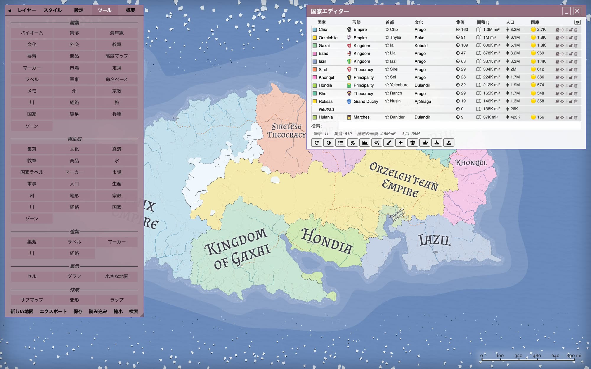

The choice of languages follows the Generator usage data. Below is the browser language over the month before the release, as a share of all visitors.

| Browser language | Share of visitors | Translated |
| ---------------- | ----------------: | :--------: |
| English          |            70.28% |     ✓      |
| Russian          |             4.89% |     ✓      |
| Spanish          |             3.83% |     ✓      |
| Portuguese       |             3.47% |     ✓      |
| French           |             2.88% |     ✓      |
| German           |             2.52% |     ✓      |
| Chinese          |             1.88% |     ✓      |
| Italian          |             1.73% |     ✓      |
| Polish           |             1.13% |     ✓      |
| Turkish          |             1.10% |     ✓      |
| Japanese         |             0.79% |     ✓      |
| Dutch            |             0.64% |     ✓      |
| Indonesian       |             0.54% |     ✓      |
| Korean           |             0.51% |     ✓      |
| Ukrainian        |             0.42% |     ✓      |
| Czech            |             0.42% |     ✓      |
| Swedish          |             0.41% |     ✓      |
| Hungarian        |             0.29% |     ✓      |
| Thai             |             0.26% |     ✓      |
| Vietnamese       |             0.23% |     ✓      |
| Danish           |             0.23% |     ✓      |
| Arabic           |             0.20% |            |
| Greek            |             0.17% |     ✓      |
| Finnish          |             0.15% |            |
| Norwegian Bokmål |             0.15% |            |
| Slovak           |             0.12% |            |
| Romanian         |             0.11% |     ✓      |
| Hebrew           |             0.10% |            |
| Catalan          |             0.08% |            |
| Croatian         |             0.08% |            |
| Serbian          |             0.07% |            |
| Persian          |             0.06% |            |
| Bulgarian        |             0.05% |     ✓      |
| Slovenian        |             0.02% |            |
| Lithuanian       |             0.02% |            |
| Estonian         |             0.02% |            |
| Malay            |             0.02% |            |
| Uzbek            |             0.02% |            |
| Azerbaijani      |             0.02% |            |
| Latvian          |             0.02% |            |
| Bosnian          |             0.01% |            |

Another 38 languages had too few visitors to list. The translated languages cover 98.8% of visitors, and 95.9% of those whose browser is not in English. Arabic is the largest group still without a translation: it and other right-to-left languages need layout changes first.

To make translation possible, every piece of interface text first had to be marked. That included about 3,500 strings across menus, editors, tooltips and messages. Each language has a glossary, so terms such as _burg_, _province_ or _culture_ are translated the same way everywhere. Layouts were checked in each language, and labels that did not fit were shortened.

The translations were done with AI as we obviously don't know all these languages. Some languages we do speak have been validated manually. If a label reads wrong in your language, the [bug reporting page](https://github.com/Azgaar/Fantasy-Map-Generator/wiki/Reporting-bugs-and-ideas#report-a-wrong-translation) explains how to get it fixed.

Only the interface is translated. Generated names, legends and notes stay as they were made, so a map looks and saves the same whatever language it was opened in.

## Finding what is on the map

Navigating a map has been a weak spot of the Generator for years. Finding a particular burg meant scanning the map or scrolling an overview, and reaching an element hidden under another one meant switching layers. Version 1.153.0 added the Omnibar, a global search opened with Space. This release adds the other half: a way to ask what is at a given spot.

A single spot on the map can belong to many things: a burg, the market it trades in, the goods it produces, rivers and roads passing through, a province, a state, a culture and a religion. Clicking opens only the topmost one.

Right-clicking now opens a **context menu** listing everything at that spot. Visible elements come first, then what the cell holds, then the areas it belongs to. Choosing a row opens that element's editor. Rows on hidden layers are dimmed, and choosing one turns the layer on. Shift + right-click still opens the browser's own menu.

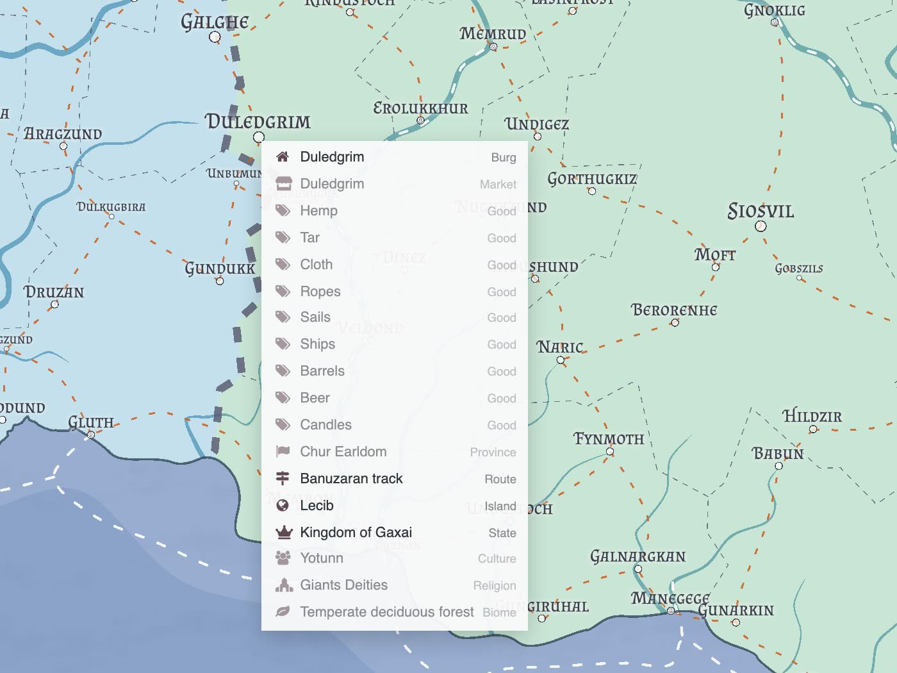

## Tags

The Generator has fixed categories: states, provinces, cultures, religions and so on. Users often need groupings of their own, such as the members of a trade league, the regions a campaign has visited, or the burgs a faction controls. Until now there was nowhere to record them except in notes.

**Tags** are labels you add yourself, so they mean whatever you need them to mean. States, provinces, cultures, religions, burgs, markers, rivers, routes, zones, features, goods and regiments can all be tagged. Nothing in the Generator assigns or interprets tags; they exist only for your own organization of the map.

Tags are entered as a comma-separated list, for example `coastal, trade league, visited`. A semicolon works as a separator too. Tags are stored in lowercase with surrounding spaces trimmed. Duplicates are dropped, and so is a leading `#`, so `#Coastal` and `coastal` are the same tag.

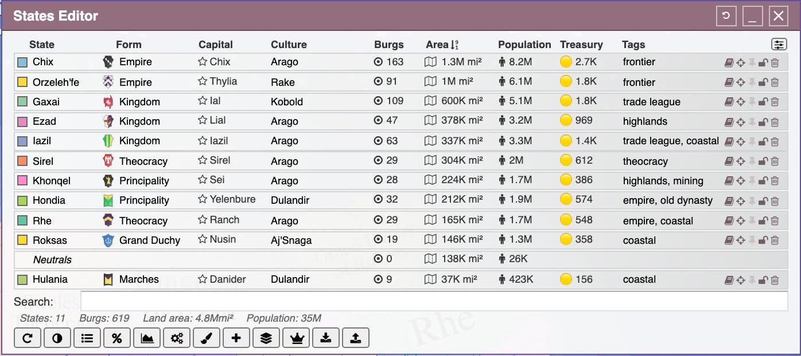

The editor tables have a **Tags** column, hidden by default and enabled from the column menu. Single-element editors such as the Burg, Marker, River, Route and Regiment editors have a tags field. A plain search matches names and tags. A search starting with `#`, such as `#coastal`, matches tags only, in the editors' search fields and in the Omnibar.

## CSV upload

Most editors could already download their data as CSV. Uploading it back from CSV was a long-standing request. Many people are used to spreadsheets and prefer them for working on tabular data, especially for renaming many entries at once or filling in data prepared elsewhere.

States, Cultures, Religions, Provinces, Burgs, Rivers, Routes, Markers, Zones, Biomes and Features now have an upload button next to the download button. The workflow is simple: download the CSV, edit what you need in a spreadsheet, and upload the file back. Each row is matched to the map by its `Id`. Empty cells and unchanged values are left as they are, so you only need to touch the values you want to change.

An upload updates existing entries; it does not create new ones. To add entries, create placeholder ones in the editor first, download the CSV again to see their ids, and fill them in.

Nothing is applied straight away. The upload first runs against a copy of the map and shows a preview of every value it would change. Values that cannot be applied, such as an unknown culture or a malformed color, are listed with the reason. **Apply** commits the changes; **Cancel** leaves the map untouched.

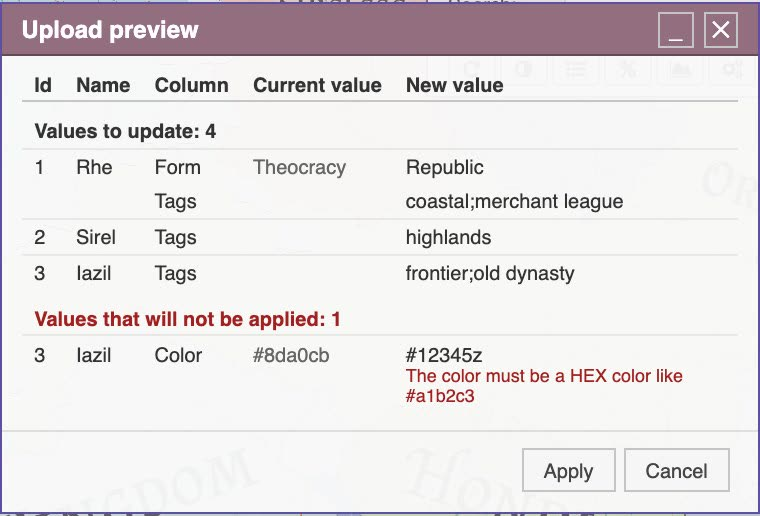

The [Data import](https://github.com/Azgaar/Fantasy-Map-Generator/wiki/Data-import) page lists the columns each upload reads, along with the other files the Generator accepts.

## Saving to machine

**Save → Machine** now creates a new file every time. Where the browser supports it, each save asks for a file name and location, and the earlier files stay as they were. Every save is a backup, and a bad save never replaces a good one.

Version 1.154.0 introduced the opposite behavior: the first save picked a file and later saves wrote over it. That approach was also new, and I hope you did not get used to it. It turned out unreliable, as a single file meant that one broken or unwanted save could cost the whole map, and there is no way to restore a lost `.map` file.

Overwriting is still available when you want it. Shift + click **Machine**, press **Ctrl/Cmd + Shift + S**, or run **Overwrite Saved Map File** from the Omnibar to write over the last saved file. Generating or loading another map resets it. Browsers without a save-location picker, such as Firefox and Safari, keep downloading a new file each time.

## View-only mode

A map is often made by one person and read by others: players in a campaign, readers of a story, or members of a community project. Sharing the `.map` file gave them the full editor, and one stray click could move a border or rename a burg. The request for a read-only map has been on the list since the Trello days.

**Save** now has a **View-only mode** checkbox. A map saved with it opens for browsing only. Layers, zoom, tooltips and the Omnibar search work as usual, but editors do not open, and the editing hotkeys, saving and autosave are disabled. The interface opens on the Layers tab and the load message says the map is view-only.

A view-only save is always a separate copy. The checkbox resets after each save, and the copy never becomes the file that a later Shift + **Save** overwrites, so your editable map stays editable. The `view=1` URL parameter opens any loaded map view-only, for example `?maplink=<file URL>&view=1` for a map shared by link.

View-only mode keeps viewers from changing the map by accident. It is **not** protection against someone determined to edit the file.

## Alternative lattices

Every map has always been built on a jittered square grid: points placed in rows and nudged randomly, each becoming a Voronoi cell. A draft for alternative grids has been open since July 2024.

A new **Advanced options** dialog (Options → Configure → Advanced) now offers alternative lattices. Points can be sampled on pointy or flat hexagons, diamonds or triangles, and **Jitter** is now a separate control for how far they move off the lattice. At jitter 0, a hex grid gives a regular hex board, ready to print for a wargame or hex-crawl. Many such games need numbered hexes, so the Cells layer can now print each cell's number, fully styled in the Style tab.

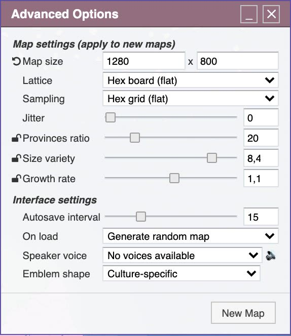

The default stays the classic grid at jitter `0.9`, and it reproduces the old points exactly. Saved maps keep the lattice they were made with.

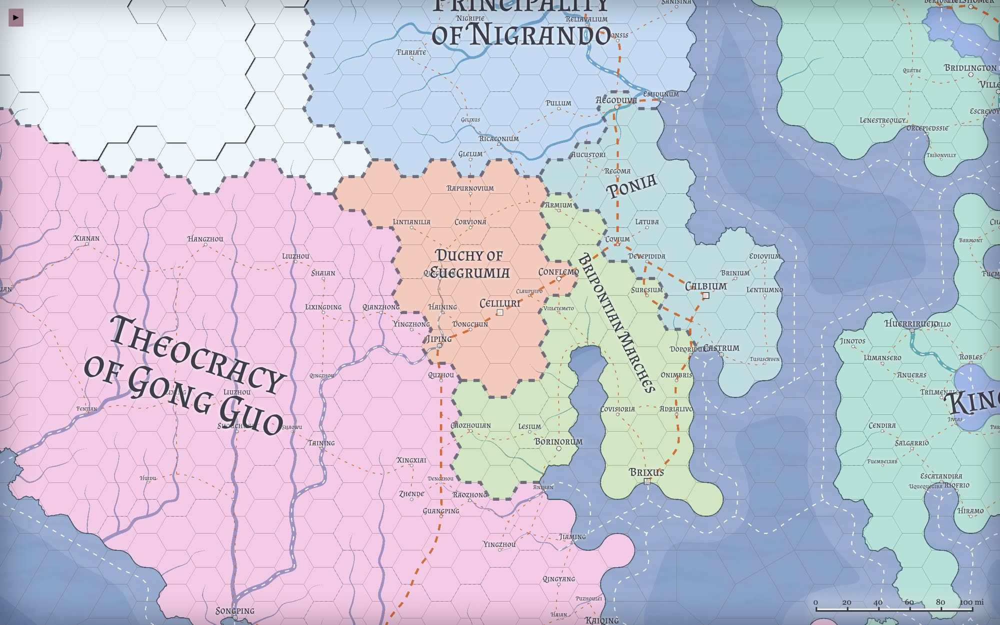

The **Square board** preset places points on a regular square grid with no jitter. Every cell is a square, so borders follow the grid lines, and the heightmap can be exported one cell per tile for tile-based game engines.

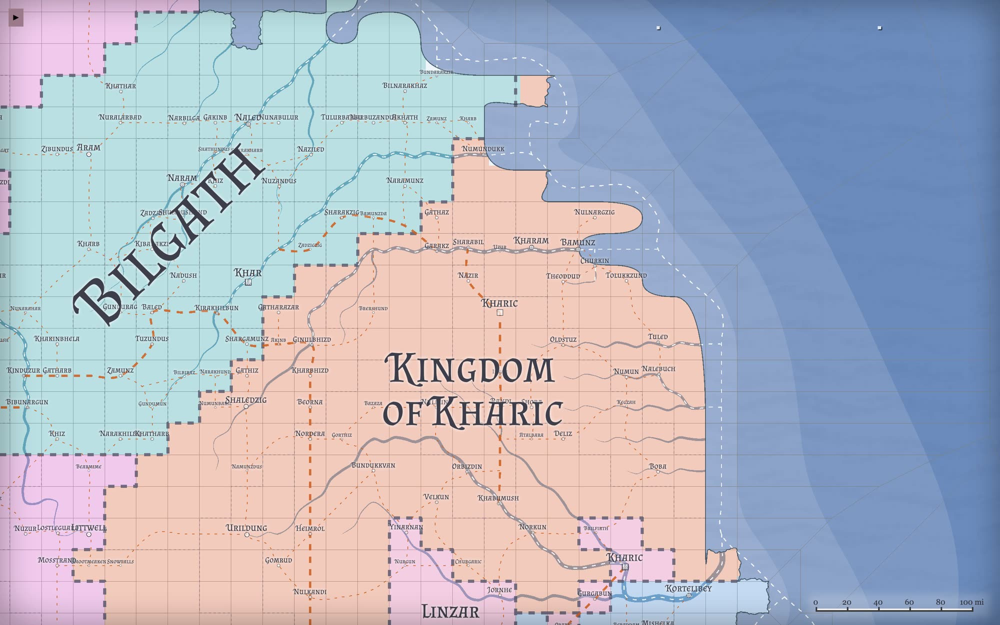

The same dialog also takes over settings that used to sit in the Options panel: map size, provinces ratio, size variety and growth rate, plus rarely changed interface settings such as autosave. New users frequently misunderstood them. Map size, for example, was often confused with the viewport size. They are meant for advanced users, so they now live with the other advanced settings.

## Tariffs and embargoes

The economy added in earlier releases moved goods between markets and taxed the sales. It did not let one state treat another's goods differently.

States now set import **tariffs** and **embargoes** rules. Rules can target all foreign states or a chosen few, and all goods or specific ones. The most specific rule wins. New maps derive the rules from diplomacy: _allies_, _friends_ and _vassals_ trade freely, _suspicion_ and _rivalry_ add 20% and 30% tariffs, and _enemies_ embargo each other. Tariffs raise the price of imported goods, so heavy duties reduce trade, and the revenue goes to the importing state's treasury.

The rules are edited in the States Editor by clicking a state's treasury, alongside its sales and poll taxes. Changes take effect when trade is regenerated.

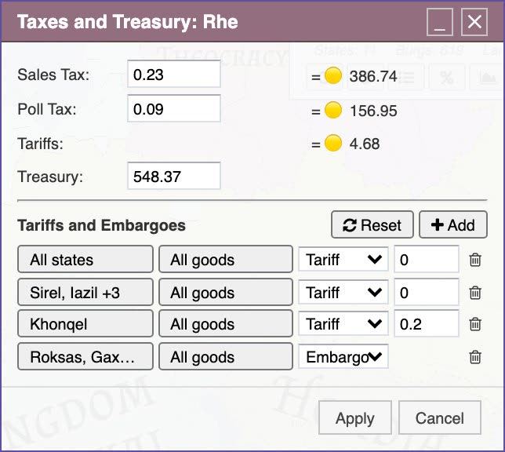

## Ancestry

Races and species have been among the most frequent requests since 2017, raised dozens of times.

Cultures can now have an **ancestry**, such as Elfish, Dwarven, Orkish or Human. The fantasy and dark fantasy culture sets assign one to every culture they create, and you can set or change it in the Cultures Editor. The column is shown by default when any culture has an ancestry, and can be enabled from the column menu otherwise. Ancestry is shown in the map tooltip and cell details, and it is included in the culture CSV download and upload.

It also affects generation. Cultures that share an ancestry share a folk religion, so the dwarven holds of several cultures can worship the same ancestral gods. In the hierarchy tree, cultures with the same ancestry are grouped under a common node, so the family of related peoples is visible at a glance.

A separate race layer, with its own territories independent of cultures, was considered and decided against. Ancestry covers most of what was asked for without a second map of peoples to maintain; smart coloring and custom tags can handle finer distinctions.

## A new color picker

The old color picker offered a fixed palette and a list of hatching patterns and was clumsy to use.

The new picker has the color matrix people are used to, improved inputs, an eyedropper and a random color button. Hatch patterns can now be drawn in any color, rather than only in black. Any element with a fill can use a red crosshatch or a teal stipple, including states, provinces, cultures, religions, zones and biomes.

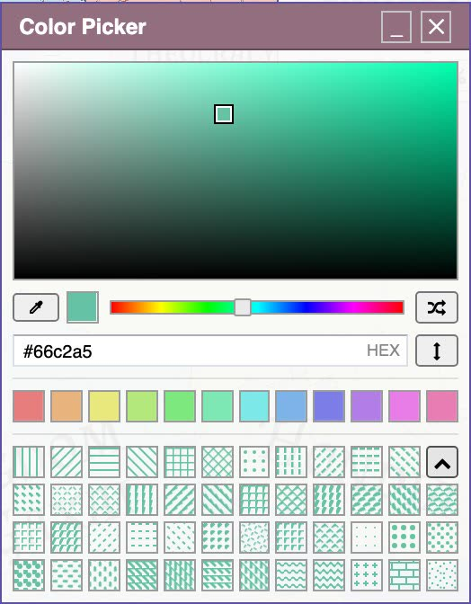

## Community work finally merged

Several contributions in this release had been waiting as pull requests, some for a long time.

[Inviktos](https://github.com/inviktos) proposed a population view that colors land by density instead of drawing bars. It is now the **Cells** style of the population layer. Hue runs from blue to red with the urban share, and darker cells are denser. Density uses a logarithmic scale, so a few large cities do not wash out the rest of the map. The 3D bar style remains the default.

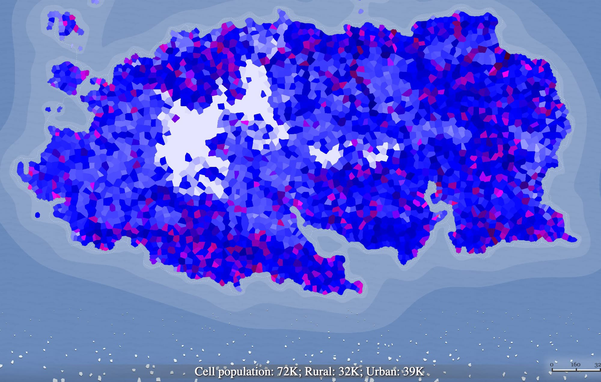

[Avengium](https://github.com/Avengium) contributed two features. The first is an altitude legend that shows the heightmap colors as bands with round height values in your chosen unit, toggled from the Units Editor. This also closes an old request to read heights from a legend. The second adds separate colors for the ruler line and its dashes, and an option to hide measured values.

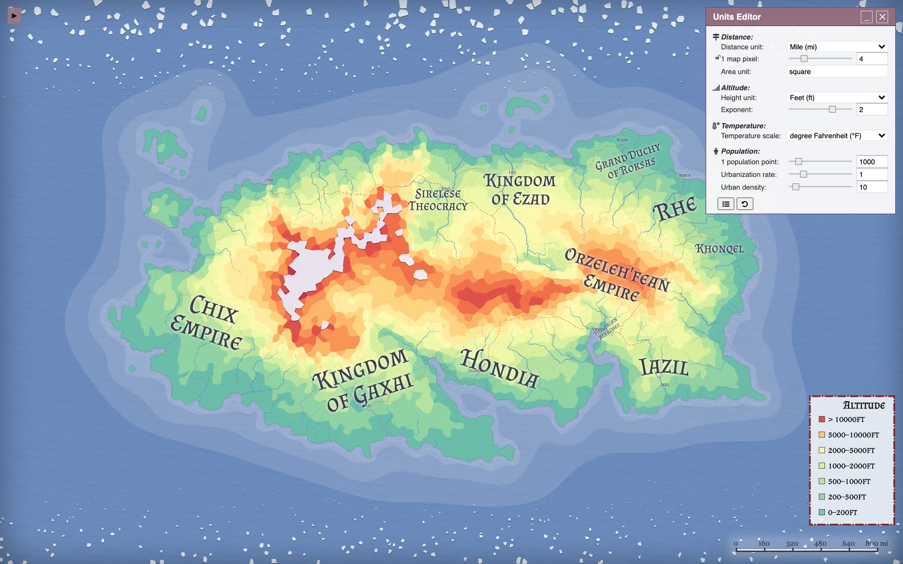

## Smaller items from the list

Several issues were small on their own but had stayed open for a long time:

- **Confirmation.** Confirmation dialogs accept **Enter**, and Shift + click skips any confirmation that may be requested.
- **Paint editor.** Locked elements are not overwritten on painting.
- **Regiments.** Regiments can be hidden individually, and the Military regiments style can show their names below the units.
- **Journeys.** Journeys can show direction arrows, and each segment can carry its own note.
- **Labels and legend.** Labels can be underlined, and the legend's fill is editable.
- **Markers Overview.** The overview shows the name of each marker's note.

Older supported `.map` files continue to load and upgrade automatically.

## Further reading

- [Advanced options and lattices](https://github.com/Azgaar/Fantasy-Map-Generator/wiki/Advanced-options)
- [Data import (CSV uploads)](https://github.com/Azgaar/Fantasy-Map-Generator/wiki/Data-import)
- [Hotkeys](https://github.com/Azgaar/Fantasy-Map-Generator/wiki/Hotkeys)
- [User Interface](https://github.com/Azgaar/Fantasy-Map-Generator/wiki/User-Interface)

Thanks to all the contributors and everyone who filed reports and requests over the years.
