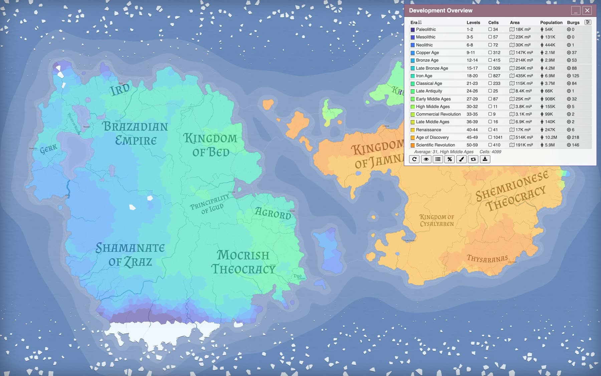
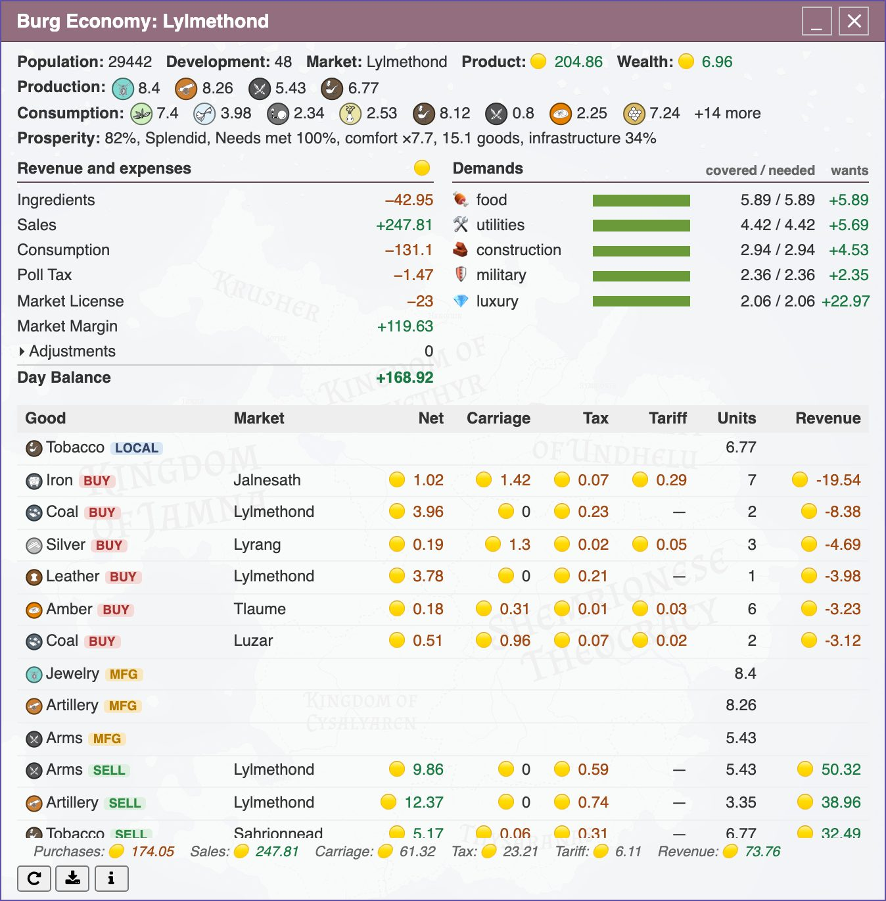
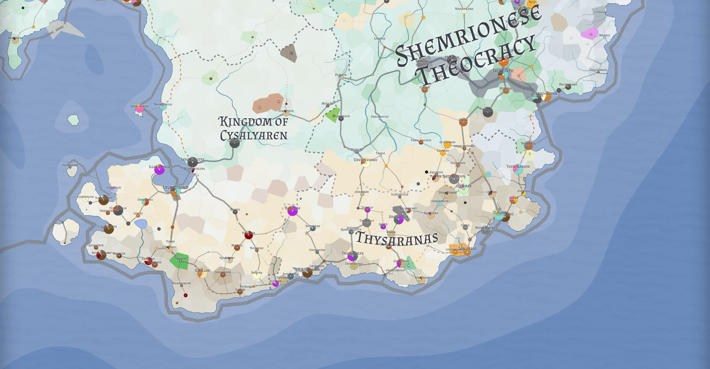
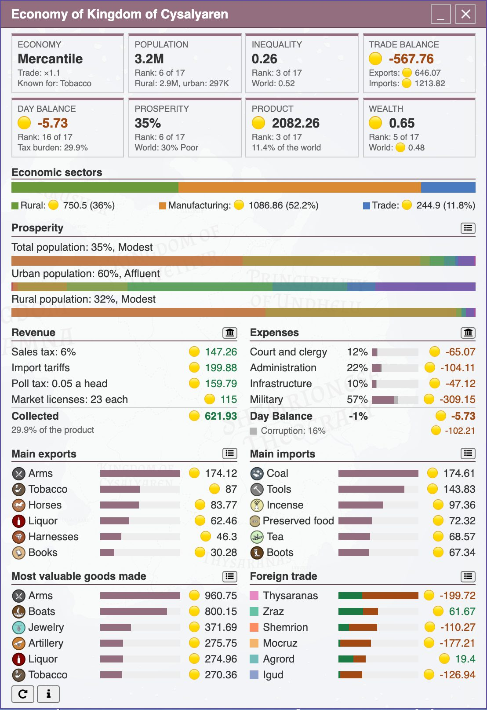
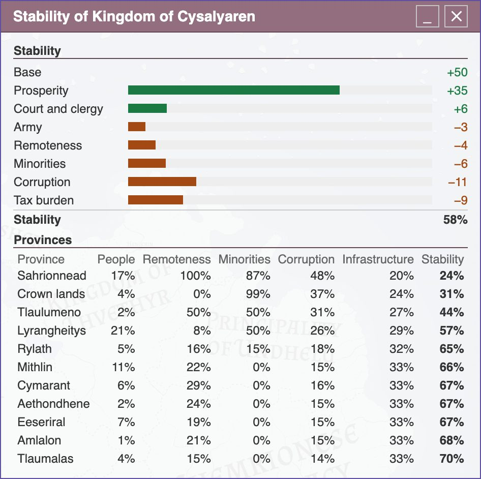
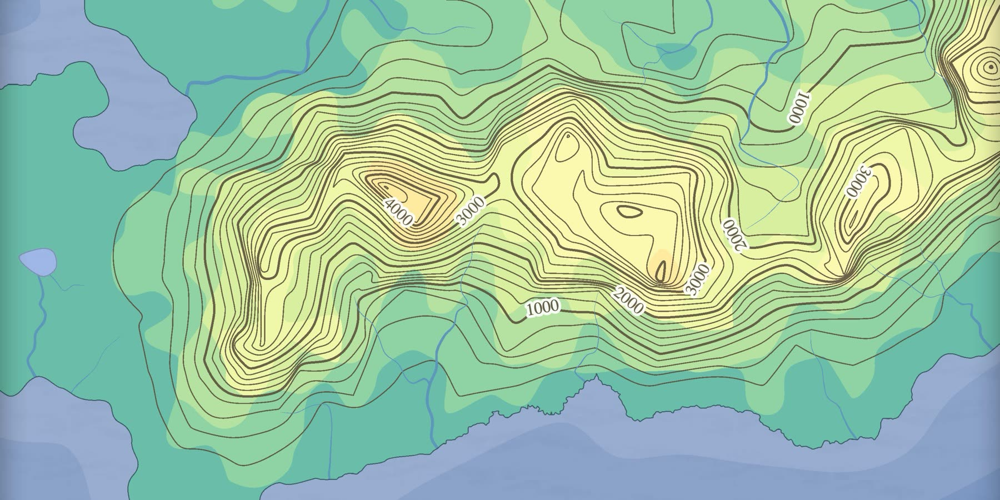

# Azgaar's Fantasy Map Generator v1.157.0: Economy rework

The economy was added in v1.124.0. It worked, but it was too dull. Every market offered the same goods at about the same prices, and a market with X% of the world's people held about X% of its output. No region was known for a specific product, and there were no rich trade centers or poor remote regions.

There were several reasons for this. Every land had the same set of goods, rural people earned nothing, what people bought did not depend on what they earned, and states took most of the money out of the economy. Changing settings could not fix that, so I rewrote how the economy's day works and measured each change on a set of test maps. The economy still shows one typical day. It is not a running simulation, so numbers change only when you regenerate them.

## Technological development

Every inhabited cell now has a development level from 1 to 100. The levels have era names from Paleolithic to Post-human, but the names are only for reference and nothing on the map depends on them. A land at level 30 does not have to look like the real High Middle Ages.

The initial level comes from cultures, so the culture set decides how advanced your world is. The Antique set gives a classical world, while in High Fantasy dwarves are at 50 or more and giants at 8. Culture types and biomes change the level a little, and broad waves raise or lower whole regions. Knowledge does not spread across the map automatically, so goblins stay goblins even next to developed dwarves.

Default maps are medieval and high fantasy worlds, so most of their cultures are between levels 32 and 36, low on the scale. The rest of the scale is left for modern and futuristic worlds.

Development affects several things. A region below a good's level can buy the good but cannot produce it. Gunpowder needs level 30 and artillery 36, while anyone can produce wood or fish. Above level 30 output grows: a third more at 40, 1.5 times at 45 and twice at 60. Developed and populous burgs pick their trades earlier, so rich regions tend to be the developed ones. A state whose capital is below level 12 gets a title like Tribe, Chiefdom, Horde, Tribal Council, Clans Union or Shamanate instead of a kingdom.

To see and edit development, open _Tools_ → _Development_ or press <kbd>Shift</kbd> + <kbd>X</kbd>. The overview shows the eras on the map, has a brush to paint them, can add them to the legend and exports a CSV file. Development is also a column in the States, Provinces, Cultures, Biomes, Burgs and Goods views, hidden by default to save space. See the [Development wiki page](https://github.com/Azgaar/Fantasy-Map-Generator/wiki/Development) for details.

## Trade and carriage

The old economy moved goods in two steps. A burg traded only with its local market, and then markets traded surpluses with each other. Now burgs trade with markets directly, which is more realistic, and trade between markets is not needed anymore. A burg sells to the market that pays it the most. If its own market has run out of a good, it buys from the market where the good is cheapest.

Moving goods now costs **carriage**. Before, only trade between markets paid for transport, based on straight-line distance and the good's value. Now every deal pays carriage along the actual best route between the burg and the market's center.

Each good has its own carriage price per unit, which you can edit in the Goods Editor. Bulky goods pay a lot for their value. A unit of stone worth 1.5 pays 1 per tenth of the map's diagonal, so stone mainly stays local. Sea travel is five times cheaper than land, loading between ship and wagon costs extra, and goods from another state's market pay twice the carriage.

A burg far from its market's center earns less and pays more. A market with no route to a burg cannot trade with it, and a burg with no route to its own market pays the highest carriage. This makes roads and ports important. A new road can connect a region to trade, and an island without ports trades only with itself.

## Specialization

Each map gets only a small number of deposits for each good, placed in loose clusters. Workers choose the trades that pay best, and a market that makes more of a good than the rest of the world earns more for it. This helps regions to specialize in different goods.

Prices follow demand and supply. A good is cheap where there is a surplus and expensive where there is a shortage. A burg importing a good also counts as demand in markets closer to it, so producers there can react. The more of a good is sold, the lower the price.

Rural people used to earn nothing. Now they feed themselves, earn money when their produce sells, and spend it at their market. Burgs cover their needs first and spend the rest on "wants". Rich burgs buy more luxuries and prefer have a huge variety of goods, when poor settlements almost look for the lowest price to fulful their basic needs.

Markers also depend on the economy now. Bridges, inns, brigands, pirates and fairs are placed more often where trade is busy, mines are placed on deposits, and there are new customs houses, guild halls and merchant houses marker types.

The new **Traffic** group of the Goods layer draws routes wider the more goods they carry. It is off by default, and you can turn it on in the _Style_ tab.

## State spending

States used to keep their taxes in the treasury, so that money left the economy. Now they spend it, buying goods at the markets like burgs do. There are four types of expenses:

- **Military** defines how well the army is maintained. A regiment's strength in battle is multiplied by its state's upkeep, so a state at high war alert may raise an army it cannot maintain. More troops not always mean more battle power anymore.
- **Infrastructure** adds to the prosperity of people in each province.
- **Administration** reduces corruption. If it is underfunded, corrupted officials steal more of all other spending.
- **Court and clergy** expenses increase country stability.

There are three new values. **Prosperity** shows how well people live, based on needs met and the variety of goods. **Corruption** differs by province and is higher far from the capital and among other cultures and religions. **Stability** shows how firmly a province holds together, and rebels appear more often in the least stable provinces.

Click a state's Prosperity in the States Editor to open its new Economy dialog. It shows the state's world rank, sectors, foreign trade, revenue, expenses and goods. Provinces have the same dialog. The bank buttons open the taxes and budget, which you can edit, and clicking Stability shows what the value is made of.

## Armies

Armies now depend on goods. Each unit type lists the goods that equip it, such as arms for infantry or horses for cavalry. A state can field only as many of those troops as it can equip from the goods it consumes, including imports. The rest become levies, a new weak unit with half of an infantryman's power. A state short of arms keeps the size of its army, but the army is weaker.

A state at war also moves its regiments and fleets from their bases to the front.

## Results

| On average, on the test maps                                     | v1.156.0 | v1.157.0 |
| ---------------------------------------------------------------- | -------: | -------: |
| Wealth of the richest tenth of markets against the poorest tenth |     2.9× |     6.4× |
| A market's output that differs from the world's mix              |      47% |      70% |
| Markets whose share of output is far from their share of people  |       2% |      23% |
| State taxes as a share of what the economy makes                 |      64% |      29% |
| Burgs ending the day with money                                  |    96.5% |      75% |

Markets differ much more now, and states take a smaller share. The downside is in the last line: some burgs now end the day in debt.

A lot of things are still not where I want them. The richest tenth of burgs hold about three quarters of all burg money, which is more than I aimed for. Only 43% of produced goods are bought the same day, and output still follows population more closely than I wanted. I will keep working on these.

## Other changes

- **Economy regeneration** now uses one dialog, where you tick what to redo: goods, deposits, markets, market areas or production.
- **Contour labels**. Contours are spaced at round heights and every fifth one can show its elevation. Set the contours font size to show the labels.
- **River groups**. Rivers can be styled by group like routes: regular, frozen, dry, lava or your own.
- **Tributaries** now bend gently into the main river instead of meeting it at a weird angle.
- **Image Converter**. You can fit, zoom and move the image before converting it.
- **Update window**. It shows the latest update note and recent releases.
- **Emblems** are drawn from Armoria data instead of API images.
- **Measurers**, regiment controls and editing handles keep their size on zoom.

## Older maps

Older maps are updated on load. They get development, goods tiers, state budgets and river groups, and their contours keep about as many lines. Armoria pictures become emblem data where possible.

Some of this may not convert perfectly:

- **An older map keeps its economy data**, so you will not see the new economy right away. Its goods, old prices, markets and saved numbers all stay. Until you regenerate, state expenses and the rural sector are mostly empty, prosperity means little, and armies count as fully maintained. To get the new economy, it is better to restore the default goods and regenerate markets and production. Open _Tools_ → _Regenerate_ → _Economy_ and tick _Restore default goods_, _Regenerate markets_ and _Regenerate production and trade deals_. This replaces your edited and custom goods, deposits and markets, and changes prices, balances and treasuries, so keep a copy of the map first. If you regenerate only production, your goods stay, but they keep their old prices and you do not get the new balance.

- **Regiments and military options stay as they are.** The default options have changed too, so restore them to get units equipped from goods and the new levies. After regenerating the economy, open _Tools_ → _Military_, click the cog button (_Edit Military Units_), then _Restore_ and _Apply_, and choose _Recalculate_. This replaces your custom units and all regiments.
- **Development is generated from your cultures by name.** A culture without a known name gets the default level, 33. Development can be later painted as you want it to be.

The new strings are translated into all 29 languages. If a term reads wrong in yours, please report it.

If you have any questions or find a bug, write to me on [Discord](https://discord.com/invite/X7E84HU).
