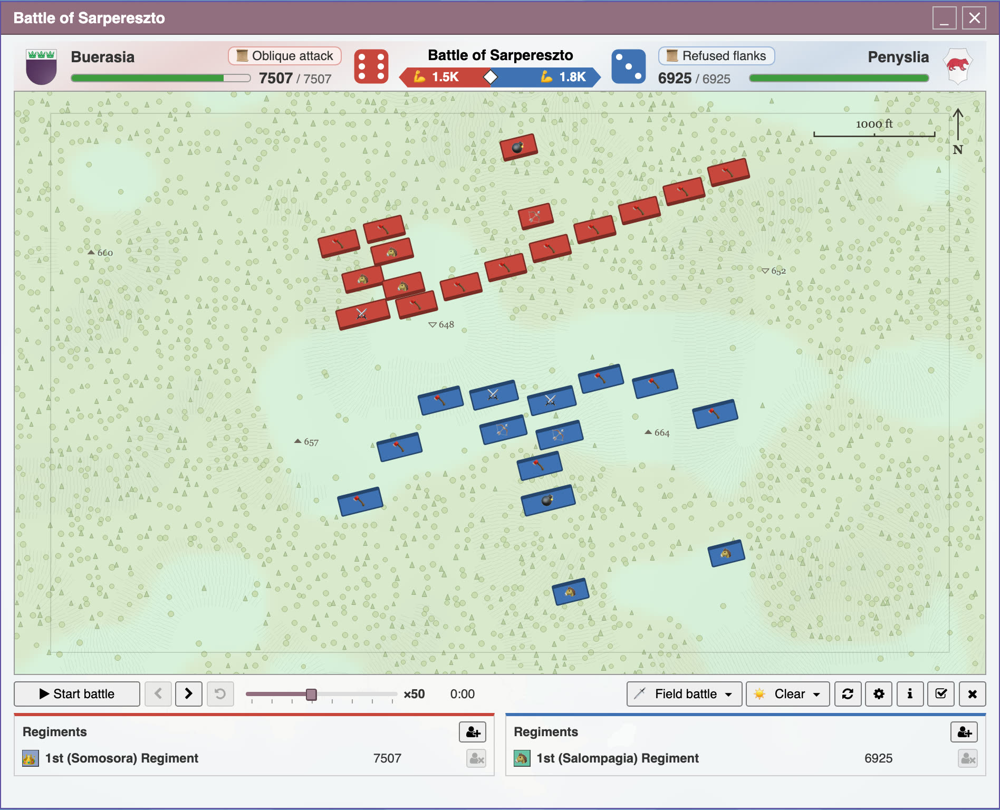
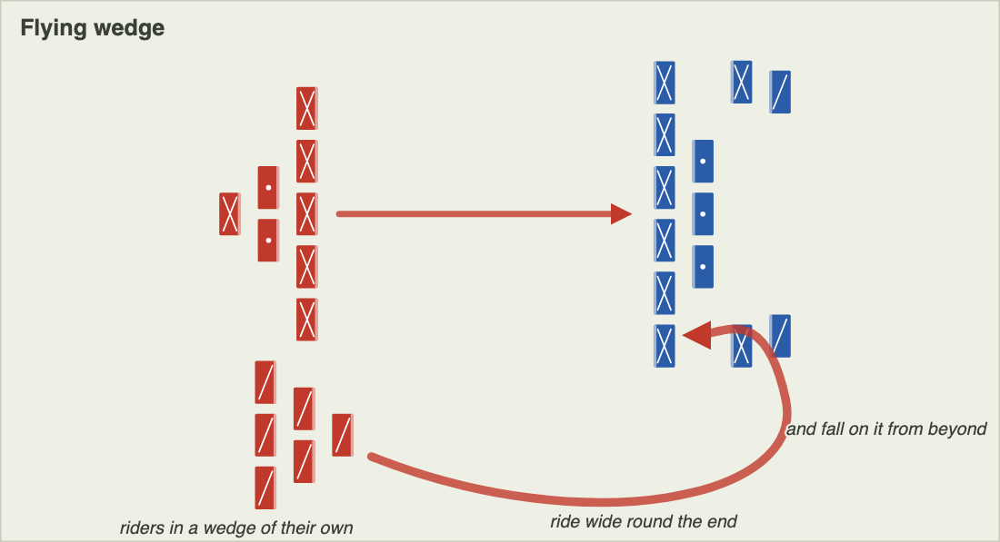
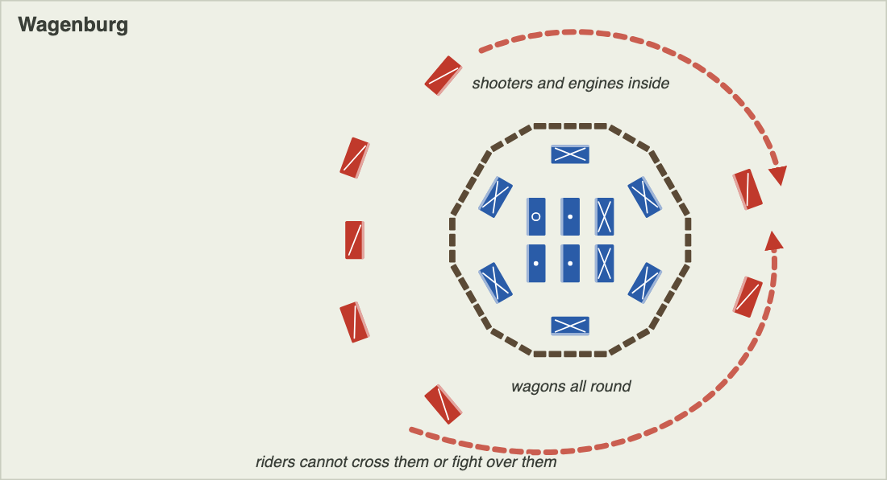
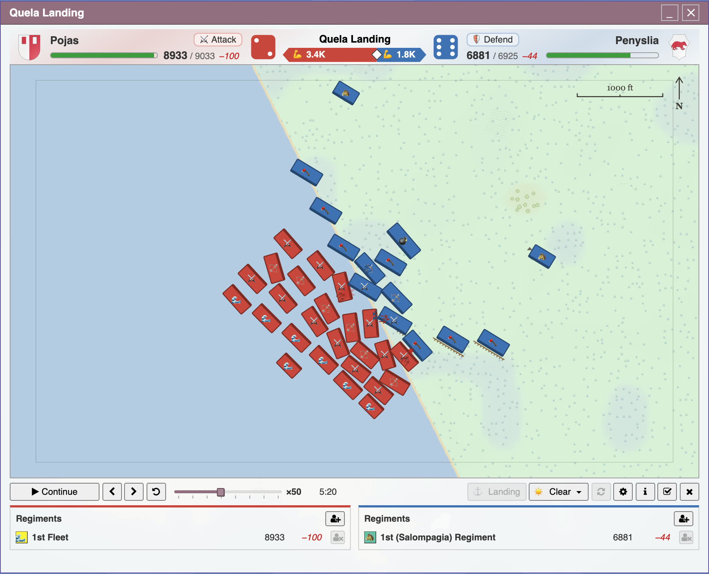
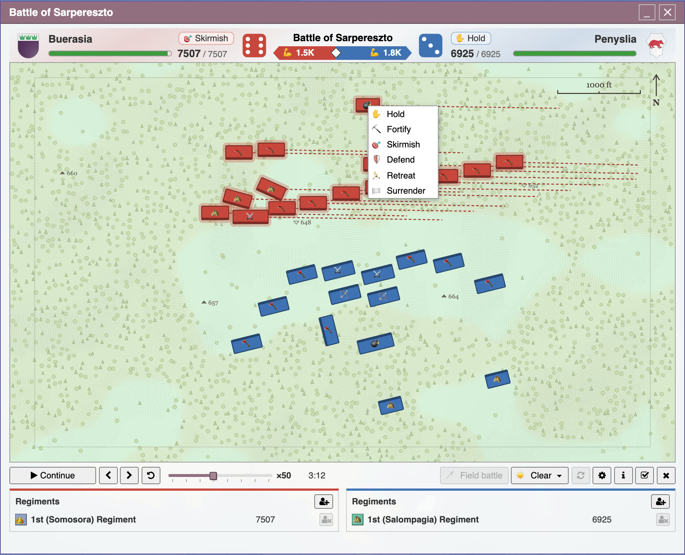
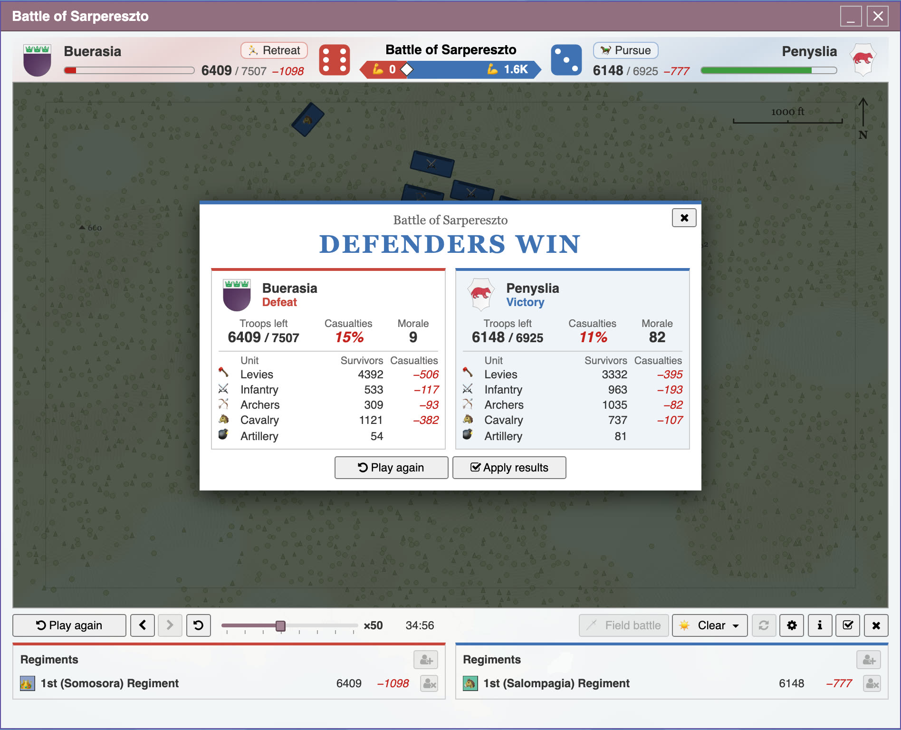

# Azgaar's Fantasy Map Generator v1.159.0: Battle Simulation

The Battle Simulator was added in v1.4.0, back in 2020. It was a table: two lists of troops, a die for each side and a button to play the next iteration. The strength of a side was the number of its units multiplied by their power and by a modifier of the current phase. The place of the battle barely mattered. It gave a result, but you never saw a battle itself.

I wanted battles to look like the plans in a history book: a field, two armies drawn up on it, and arrows showing who went where. So here comes the new Battle Simulator. A battle is now fought on the ground of your map by battalions that march, shoot, charge, break and run. Each side is led by a general who picks the best tactic and gives the orders. You can just watch, or pause at any moment and take command.

## The battlefield

A battle starts as before: select a regiment, click _Attack foreign regiment_ and then click the regiment to attack. What opens now is a battle plan, a piece of your map at true scale. Rivers, roads, the coast, burgs and slopes are taken from the map around the battle point. Woods, marshes and hills follow its biome and heights. The map is too coarse for a battlefield, so small hills, copses, bogs and river bends are added, but the same spot always gives the same field.

Regiments are split into battalions: a few hundred men each in a usual battle, thousands in a very big one, forty battalions at most by default. So a battle of a few thousand and a battle of a hundred thousand both fit the screen. A battalion of 300 stands 60 metres wide, a bowshot is 160 metres, and the scale bar in the corner is in your map's units.

The ground is not a backdrop. Troops climb slopes slowly and fight worse on them, while a charge downhill hits harder. Woods give cover from arrows and are bad for cavalry. A river is crossed by a bridge where a road meets it, or at a ford, and whoever fights standing in water fights at half strength. Mountain fields have cliffs nobody can cross, and the walls of a burg stop everybody but the troops that climb them.

There is weather too: rain and fog shorten the range of bows and guns, mud halves the pace, heat tires troops twice as fast, and a frozen river can be crossed anywhere. A battle starts with the weather its place is likely to have, and you can change it at any moment.

## How a battle goes

Press _Start battle_ or <kbd>Space</kbd>. The battle plays by itself in steps of eight seconds of battle time. A usual battle takes about twenty minutes: a few minutes of approach, then the fighting. At the default speed that is about half a minute on screen, and you can slow it down, speed it up or go step by step.

What happens in those minutes comes from simple rules:

- **Shooting and charging**. Archers and artillery start from afar. Then the lines close, and a battalion runs the last stretch. The faster it hits, the more men it cuts down: cavalry at the gallop does almost three times the damage of troops standing still.
- **Flanks**. A blow in the flank is a quarter stronger and one in the rear almost twice as strong, and both shake the morale. So cavalry does not charge formed infantry head on while there is a flank, an archer or a cannon to go for.
- **Morale**. Every battalion has its own. It drops with losses and when the battalion is outnumbered. A shaken battalion only defends itself. One that breaks runs away, which unsettles its neighbours, and may rally later once nobody chases it.
- **Surrender**. A battalion that cannot get away raises a white flag. Its men are captured, and freed if their side holds the field at the end.
- **Energy**. Troops tire from marching, fighting and running, and a spent battalion fights at half strength. Fresh reserves and the side that waits have an advantage.

Most of a beaten army runs or is captured rather than killed. The loser usually loses about a third of its troops and the winner about a tenth.

The only random thing is fortune: the die of each side, rolled once when the battle opens. The same armies on the same ground with the same dice always fight the same battle, so any battle can be played again, and one changed order shows what it was worth.

### Units

To make all this work, a unit is no longer described by a single power. In the Military units editor each unit now has **attack**, **defense**, **speed**, **range** and **morale**. Power is calculated from them and is still used for upkeep and for the forces of a state. Artillery hits hard and stands little. Levies have half the morale of infantry, so they do fine while the day goes well and crumble under pressure.

The unit type defines how it fights: mounted units are riders, ranged units are shooters, machinery is engines and the rest are line troops. Give a mounted unit a range and you get horse archers, who keep to the wings, shoot and ride off from infantry that comes at them.

## Generals

This is the part I spent the most time on. Each side has a general. Before the battle he looks at both armies and at the ground, picks a tactic and draws his troops up by it. In a field battle he also plays every tactic open to him through in his mind and takes the one that leaves him the field with the lightest losses. This takes up to a second, and the buttons wait for it.

There are six ways to attack in the open: a frontal assault, an oblique attack with one wing massed, an envelopment, a wedge, harassing fire and a flying wedge of cavalry riding wide round the end of the enemy line. A defender looks for the best ground nearby and forms a defensive line on a hill, bends the ends of his line back when outnumbered, holds the far end of a ford or a bridge, or closes a ring of wagons against an enemy strong in cavalry.

During the battle the general decides again every round. He keeps shooting if his archers are the better, and closes at once if they are not. He sends the reserve to plug a gap or to meet cavalry coming round a flank, guards his artillery, orders the pursuit when the enemy runs and the retreat when the day is lost. A side that has time before the enemy comes can build stakes, a ditch or a line of wagons in front of its line.

A general also knows when not to fight. A clearly weaker attacker waits instead of attacking, and a general who sees that an attack would end badly does not make it. In the battle below both sides chose a defensive line at the Saura River. The attackers were the weaker side and did not attack, the defenders started to fortify, and after six minutes the attackers left the field. Whoever seeks a battle and will not fight it goes home.

Other battle types have plans of their own:

- **Siege**. Besiegers storm walls only when they have about four times the power of the garrison. Otherwise their artillery works breaches into the wall, and every breach lowers those odds. A strong army rings the burg in and starves it out, while the garrison may sortie at the besiegers' artillery or try to break the ring.
- **Ambush**. A weaker defender in a forest or a marsh catches the attackers in a column on the road. Their general chooses between lying on one side of the road or on both, and between shooting from cover first and falling on the column at once.
- **Landing**. The attackers come in waves and wade ashore, fighting at half strength while in the water. The defenders either meet them at the water's edge or wait inland.
- **Bombardment** is a new type: a fleet with no troops aboard shells a regiment on the shore, and each side leaves if the other has the stronger fire.

The generals are not geniuses. They follow rules, do not know what you are going to do, and are sometimes too careful: a general may refuse a battle you wanted to see. That is what the controls are for.

## Taking command

Everything below is optional. A battle can be started right away and left to the generals.

**Before the start** you can arrange the battle as you like:

- Change the battle type, the weather and the morale of a side, and click a die to control the battle fortune.
- Drag a box over the field to pick battalions, as in a strategy game. Drag the picked ones to move them, and rotate them with the round handle.
- Click the tactic beside a side's name and pick another one, or _Dug in_ to start the side behind finished field works. The other general will adapt.
- Add regiments to either side, on any round. The same state can even have regiments fighting on both sides.

**During the battle** you command instead of placing. Pick battalions of one side and right-click (or <kbd>Shift</kbd>-click):

- the ground, to march there and hold,
- an enemy battalion, to attack it,
- a broken enemy battalion, to chase it,
- a friendly battalion, to protect it.

Click a picked battalion for the orders it can carry out on the spot: hold, fortify, skirmish, defend, retreat or surrender. A battalion keeps your order until it is done or for about eight minutes of battle, and then its general takes it back.

You can also order a whole side: click its order beside the name and tell it to hold, skirmish, attack, defend, pursue, retreat or surrender. The general keeps to it for eight minutes and then decides again. This is how you make a careful general attack, or stop a storm that is going badly.

Regiments can be added and withdrawn in the middle of a battle too, so reinforcements can arrive late, and fresh troops count.

## Configure Battle

The cog button under the plan opens the options. They are kept in your browser, not in the map file.

- **View** and **Rendering**. The camera follows the troops or shows the whole field. You can zoom with the wheel and drag the view with the right mouse button. The relief is drawn as hachures or contours, and almost everything on the plan can be turned off, from unit icons to missiles and weather effects. Sides are red and blue by default, or in the colors of their states.
- **Playback**. The battle can pause by itself at the first clash, when a battalion routs or surrenders, when a wall is breached or when a side breaks.
- **Simulation**. How many battalions the troops are split into, how long a battle may last, how far ahead the generals think and how much fortune weighs. Set fortune to 0 for a battle with no dice at all.
- **Export**. Save the battle as a GIF or an animated SVG, or as a battle report: one offline page with the summary and a picture of the field at each key moment.

## Results and the battle log

When one side has no troops left in order, the other holds the field and a summary shows who won, the casualties, the captured and the losses of every unit. As before, you can apply the result at any moment, without waiting for the end. Casualties and captured troops are then taken from the regiments, the regiments' notes get a line about the battle and a battlefield marker is added to the map. Cancel rolls the battle back.

Everything that happens is written to the battle log, with every order and change you made. The log can be downloaded and loaded later. With the same regiments on the map it replays the battle exactly as it went.

## Limits

- It is one battle, not a war. Nothing happens on the map until you apply the result, and there is no campaigns simulation.

- Armored and magical units have no specific behaviour. They fight as line troops with the attack, speed and range you give them.

- The balance is tuned on the default units. Custom units with very different numbers may give one-sided battles.

The full rules, all tactics with diagrams and the numbers behind them are on the [Battle Simulator](https://github.com/Azgaar/Fantasy-Map-Generator/wiki/Battle-Simulator) wiki page.

## Other changes

- **Military units editor** is a table now: click a header to sort, and show or hide columns with the sliders button.
- **Regiments at war**. About 30% of a state's regiments and fleets stay at their bases as a reserve instead of marching to the front.
- **Goods Editor**. Deposits can be limited by the least and the most rural population of a cell, clustering is set per good, and the distribution function is easier to edit.

## Older maps

Older maps are updated on load. A unit that had a single power gets attack and defense that keep this power, and the speed, range and morale of the default unit of its type. So your custom units fight right away, but they are worth a look: a custom cavalry unit gets the speed of cavalry, and an armored, aviation or magical unit gets the speed and morale of infantry.

The default units have changed as well: cavalry is a bit stronger than before, while archers, artillery and levies are weaker. An older map keeps its own units. To get the new ones, open _Tools_ → _Military_, click the cog button (_Edit Military Units_), then _Restore_ and _Apply_.

If you have any questions or find a bug, write to me on [Discord](https://discord.com/invite/X7E84HU).
