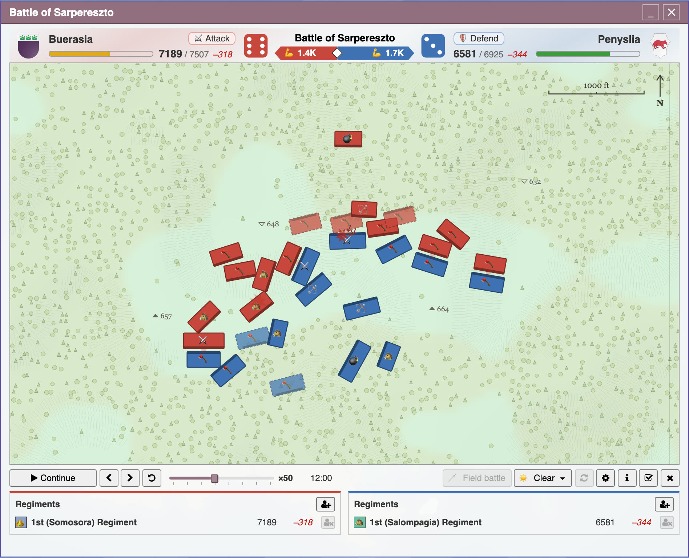
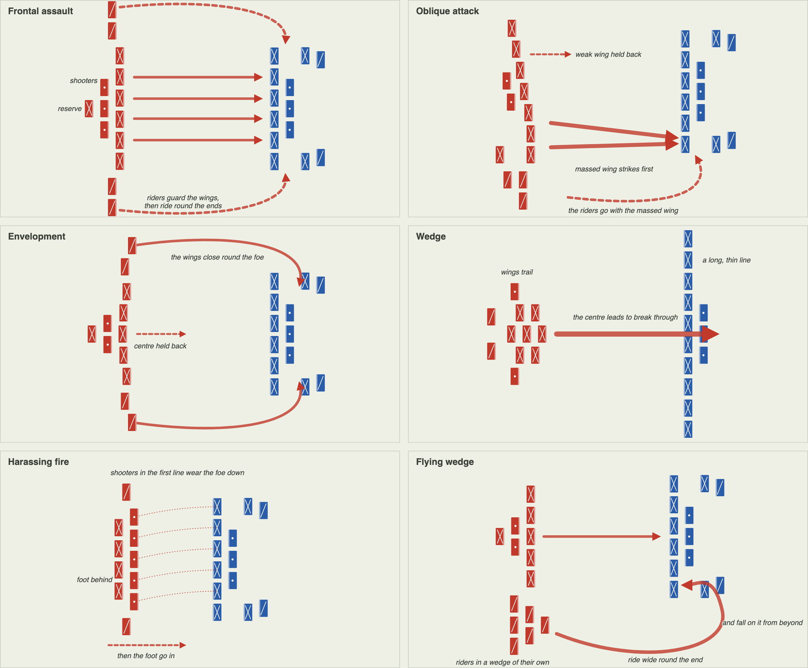
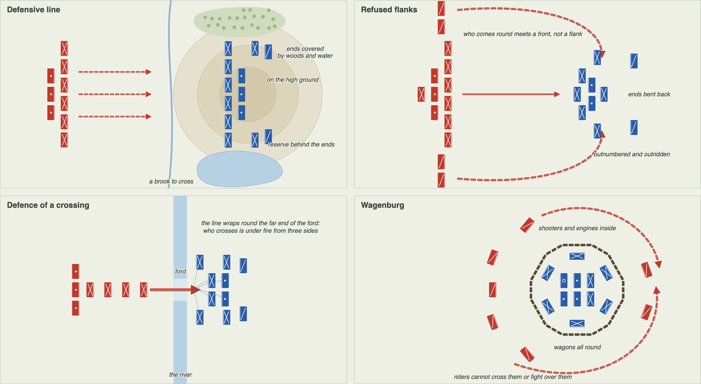
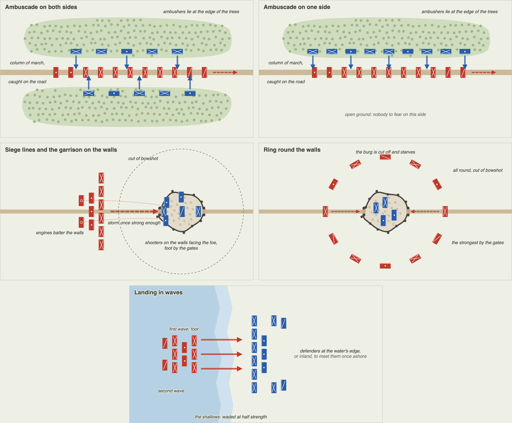
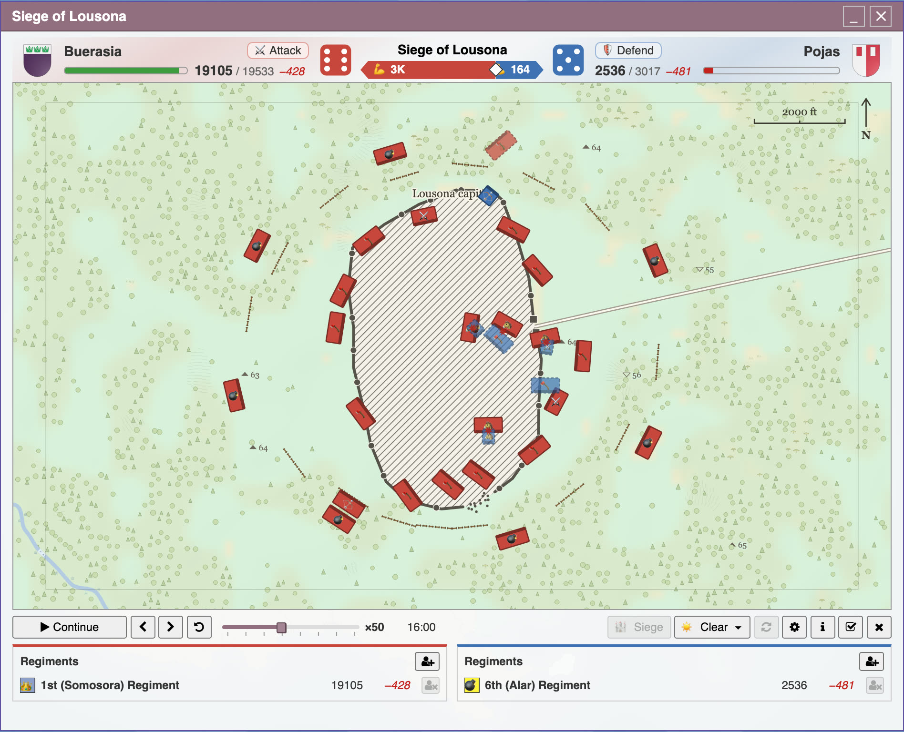
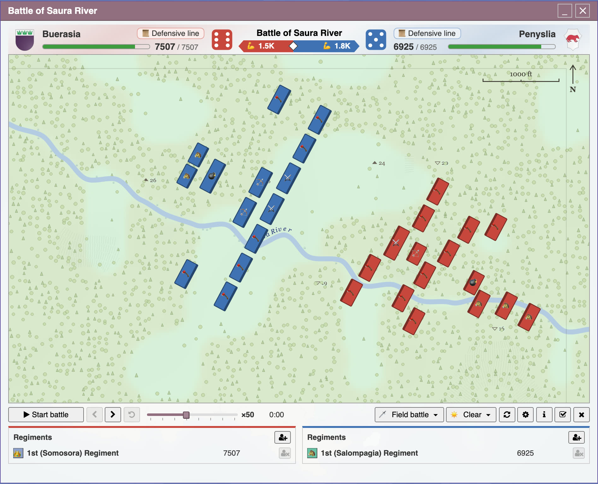
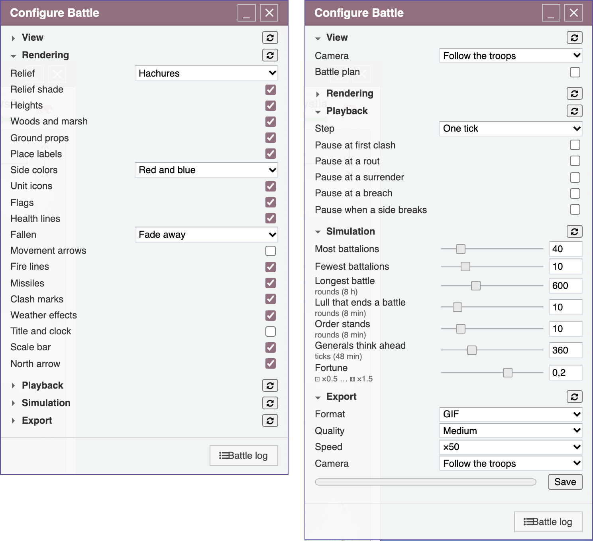

# Azgaar's Fantasy Map Generator v1.159.0: Battle Simulation

The Battle Simulator was added in v1.4.0, back in 2020. It was basically a table with two lists of troops, a die for each side and a button to play the next iteration. The strength of a side was the number of its units multiplied by their power and by a modifier of the current phase. The place of the battle barely mattered. It gave a result, but you never saw a battle itself.

I wanted battles to look like the plans in a history book, with a field, two armies drawn up on it and arrows showing who went where. So here comes the new Battle Simulator. A battle is now fought on the ground of your map, by battalions that march, shoot, charge and sometimes run away. Each side is led by a general who picks the best tactic and gives the orders. You can just watch, or pause at any moment and take command.

## The battlefield

A battle starts the same way as before: select a regiment, click _Attack foreign regiment_ and then click the regiment you want to attack. But instead of a table you now get a battle plan, drawn from the piece of your map around that point. Rivers, roads, the coast, burgs and slopes are taken from the map, and woods, marshes and hills follow its biome and heights. The map itself is too coarse for a battlefield, so the simulator adds the small things like low hills, copses, bogs and river bends. It adds them the same way every time, so a battle at the same spot is always fought on the same field.

Regiments are split into battalions of a few hundred men each. In a very big battle the battalions get bigger instead of more numerous, and by default there are never more than forty of them. This way a battle of a hundred thousand men fits the screen as well as a battle of two thousand.

All of this ground matters in the fight. Troops climb slopes slowly and fight worse while on them, and a charge downhill hits harder. Woods give cover from arrows and are bad for cavalry. A river can be crossed at a ford, or by a bridge where a road meets it, and troops standing in water fight at half strength. Mountain fields have cliffs that nobody can cross. The walls of a burg stop everybody except the troops climbing them.

There is weather too. Rain and fog shorten the range of bows and guns, mud halves the marching pace, heat tires troops twice as fast, and a frozen river can be crossed anywhere. A battle starts with weather that is likely for its place, and you can change it whenever you want.

## How a battle goes

Press _Start battle_ or <kbd>Space</kbd> and the armies start to move. The battle plays by itself in steps of eight seconds of battle time. A usual battle lasts about twenty minutes, a few minutes of approach and then the fighting. At the default speed this is about half a minute on screen, and you can slow it down, speed it up or go step by step.

It begins with shooting. Archers and artillery open up from a distance while the lines walk towards each other. Close to the enemy a battalion breaks into a run, and speed matters here. The faster it hits, the more damage it does, and cavalry at full gallop does almost three times the damage of troops standing still.

It also matters where a battalion is hit. An attack from the side is a quarter stronger and one from behind almost twice as strong, and both are bad for morale. This is why cavalry will not charge formed infantry head-on if it can get at a flank, at archers or at a cannon instead.

Then morale comes into play. Every battalion has its own morale, which drops as it takes losses or finds itself outnumbered. A shaken battalion stops attacking and only defends itself. If things get worse it breaks and runs, and the battalions next to it get nervous too. A broken battalion may rally later if nobody chases it. One that has nowhere to run raises a white flag and is captured. Its men are freed at the end if their side wins.

Troops also get tired from marching, fighting and running, and an exhausted battalion fights at half strength. So it helps to keep a reserve, and sometimes to stay where you are and let the enemy come to you.

Because of all this, most of a beaten army runs away or is captured, and far fewer are killed. The loser usually loses about a third of its troops and the winner about a tenth.

Luck is still there, but only in one place. Each side rolls a die once, when the battle opens, and nothing else is random. The same armies on the same field with the same dice always fight the same battle. So you can play a battle again, change one order and see what difference it makes.

### Units

For all this a single power value per unit was not enough. In the Military units editor each unit now has **attack**, **defense**, **speed**, **range** and **morale**. Power is still there. It is calculated from these values and is used for upkeep and for the forces of a state, as before. Artillery, for example, has a strong attack and a much weaker defense. Levies have half the morale of infantry, so they fight well enough while things go well and are the first to run when they don't.

The unit type defines how a unit behaves. Mounted units act as riders, ranged units as shooters and machinery as engines, and all the rest fight in the line. The traits can be mixed. Give a mounted unit a range and you get horse archers, who stay on the wings, shoot and ride away when infantry comes at them.

## Generals

This is the part I spent the most time on. Each side has a general, and the generals make every decision that you don't make yourself. Before the battle a general looks at both armies and at the ground, picks a tactic and draws the troops up. In a field battle the general also tries every available tactic in advance, playing each one through to the end, and takes the one that wins the field with the lightest losses. This can take up to a second, and the buttons wait for it.

### Tactics

A tactic is the way a side is drawn up and how it plans to fight. Which one a general picks depends on the armies, such as who is stronger and who has more cavalry or better archers, and on what the ground offers. You can see the choice next to the side's name before the battle starts.

Here they are. On the diagrams attackers are red and defenders blue. A cross marks infantry, a slash cavalry, a dot shooters and a ring artillery.

**Attacking in the open**

- **Frontal assault**. The plain way to fight. Infantry stands in a line with the best troops in the middle, shooters behind them and cavalry on both wings, and a fifth of the infantry waits in reserve. The cavalry guards the wings until the lines meet and then rides round the ends. The stronger side takes it when there is nothing smarter to do.
- **Oblique attack**. One wing gets the best infantry, the reserve and all the cavalry and attacks first, while the other wing is held back. The idea is to break one end of the enemy line before the weak wing has to fight at all. It is chosen when the armies are about equal, or when one enemy wing looks weak.
- **Envelopment**. The wings move ahead of the centre and close around the enemy from both sides. It needs clearly more cavalry than the enemy has.
- **Wedge**. A deep column in the middle hits first and tries to break through. It is used against a line that is longer and thinner than the attackers' own.
- **Harassing fire**. The shooters go in front and wear the enemy down before the infantry attacks. It suits an army that shoots better than it fights hand to hand, and it is the way to deal with a Wagenburg. The risk is an enemy who simply charges and catches the shooters out in front.
- **Flying wedge**. The cavalry waits apart from the army, beyond one end of the line. Once the infantry is fighting, it rides wide around the enemy and attacks. The cavalry has to make at least a fifth of the army's power for this.

**Defending in the open**

A defender starts by looking for good ground nearby. That can be a hill, a place where both ends of the line rest on water, woods or a burg, or anything the enemy has to cross on the way.

- **Defensive line**. One line along the top of a slope, with shooters behind it and reserves behind both ends. The usual choice when the odds are fair.
- **Refused flanks**. The ends of the line are bent back, so an enemy coming round them runs into a front instead of a flank. Taken by a side that is outnumbered or short of cavalry.
- **Defence of a crossing**. The line curves around the far end of a ford or a bridge, so everyone who crosses is shot at from three sides. A defender always takes it when there is a river between the armies.
- **Wagenburg**. A ring of wagons with infantry on the wagons and shooters, artillery and the reserve inside. Cavalry can't cross the wagons or fight over them, so it works well against an enemy with a lot of cavalry on open ground. But it can't move, and enemy artillery knocks the wagons down.

**Ambush, siege and landing**

- **Ambuscade**. A weaker defender hides in a forest or a marsh and catches the attackers while they are still marching in a column along the road. The defenders lie on both sides of the road, or on one side if only that side has trees to hide them. If they have shooters, they also decide whether to shoot from cover first or to charge the column right away.
- **Siege lines**. The besiegers stay out of bowshot with their artillery behind the first line, and the garrison mans the walls. Walls are stormed only by an army about four times stronger than the garrison. Until then the artillery makes breaches in the wall, and each breach lowers that number. The garrison may strike back with a sortie if the artillery is poorly guarded.
- **Ring round the walls**. A besieger three times stronger than the garrison surrounds the burg, with the strongest troops at the gates. The burg is cut off and starves, unless the garrison manages to break the ring.
- **Landing in waves**. The attackers cross the water in waves and wade ashore, fighting at half strength while they are still in the water. The defenders either meet them at the water's edge or wait further inland.

Fleets also got a new battle type, **bombardment**. A fleet with no troops aboard shells a regiment on the shore, and either side leaves if the other one has the stronger fire.

You don't have to accept the general's choice. Before the start you can give a side any tactic yourself. The dice stay the same, so playing the battle again with another tactic shows how much the choice mattered.

### In the battle

Once the battle is on, the generals decide again every round. A general with the better archers keeps shooting, and one without them closes in as soon as possible. The reserve is sent to plug a gap or to meet cavalry coming round a flank, and the artillery gets a guard. When the enemy runs, the general orders a pursuit. When the battle is clearly lost, the order is to retreat. A side that has some time before the enemy arrives can also build stakes, a ditch or a line of wagons in front of its line.

Generals also know when not to fight. A clearly weaker attacker waits, and a general who has played an attack through and seen it fail will not order it. Here is an example. Both sides chose a defensive line at the Saura River. The attackers were the weaker side and did not attack, so the defenders started to fortify. After six minutes the attackers gave up and left the field.

This is probably what a real general would do, but it is not much of a battle to watch. Don't expect too much from the generals either. They follow rules, they can't guess what you are going to do, and sometimes they are just too careful. For such cases you can take command yourself.

## Taking command

None of this is required. You can start a battle right away and leave it to the generals, or you can change almost anything, from the weather to the orders of a single battalion.

**Before the start** you can arrange the battle as you like:

- Change the battle type, the weather and the morale of a side, and click a die to set the fortune of a side yourself.
- Drag a box over the field to select battalions, as in a strategy game. Then drag the selected ones to move them, or turn them with the round handle.
- Click the tactic next to a side's name to pick another one. _Dug in_ starts the side behind finished field works. The other general will adapt to your choice.
- Add regiments to either side. One state can even have regiments on both sides.

**During the battle** you give orders. Select battalions of one side and right-click (or <kbd>Shift</kbd>-click):

- the ground, to march there and hold,
- an enemy battalion, to attack it,
- a broken enemy battalion, to chase it,
- a friendly battalion, to protect it.

Click a selected battalion to see the orders it can carry out where it stands: hold, fortify, skirmish, defend, retreat or surrender. A battalion follows your order until it is done, or for about eight minutes of battle time. After that the general takes it back.

You can also give an order to a whole side. Click its current order next to the name and tell it to hold, skirmish, attack, defend, pursue, retreat or surrender. The general follows the order for eight minutes and then decides again. This is the way to make a careful general attack, or to call off a storm that is going badly.

Regiments can also join or leave in the middle of a battle. Reinforcements that arrive late come in fresh, while everybody else is already tired.

## Configure Battle

The cog button under the plan opens the options. They are saved in your browser and not in the map file.

- **View** and **Rendering**. The camera can follow the troops or show the whole field. You can zoom with the wheel and drag the view with the right mouse button. The relief is drawn as hachures or contours, and almost everything on the plan can be turned off, from unit icons to missiles and weather effects. Sides are red and blue by default, or in the colors of their states.
- **Playback**. The battle can pause by itself at the first clash, when a battalion routs or surrenders, when a wall is breached or when a side breaks.
- **Simulation**. Here you set how many battalions the troops are split into, how long a battle may last, how far ahead the generals think and how much fortune weighs. Set fortune to 0 for a battle with no dice at all.
- **Export**. Save the battle as a GIF or an animated SVG. There is also a battle report, a single offline page with the summary and a picture of the field at each key moment.

## Results and the battle log

The battle ends when one side has no troops left in order. A summary then shows who won, the casualties, the captured and the losses of every unit. As before, you don't have to wait for the end and can apply the result at any moment. When you apply it, casualties and captured troops are taken from the regiments, every regiment gets a line about the battle in its notes and a battlefield marker is added to the map. Cancel rolls the battle back.

Everything that happens is written to the battle log, including every order and change you made. You can download the log and load it later. If the same regiments are still on the map, it replays the battle exactly as it went.

## Limits

A few things the simulator does not do:

- It plays one battle at a time. Nothing happens on the map until you apply the result, and there is no campaign simulation.

- Armored and magical units have no specific behaviour. They fight as line troops with the attack, speed and range you give them.

- The balance is tuned on the default units. Custom units with very different numbers may give one-sided battles.

The full rules, every tactic and the numbers behind them are on the [Battle Simulator](https://github.com/Azgaar/Fantasy-Map-Generator/wiki/Battle-Simulator) wiki page.

## Other changes

- **Military units editor** is a table now: click a header to sort, and show or hide columns with the sliders button.
- **Regiments at war**. About 30% of a state's regiments and fleets stay at their bases as a reserve instead of marching to the front.
- **Goods Editor**. Deposits can be limited by the least and the most rural population of a cell, clustering is set per good, and the distribution function is easier to edit.

## Older maps

Older maps are updated on load. A unit that had a single power gets attack and defense that keep this power, and the speed, range and morale of the default unit of its type. Your custom units can fight right away, but please check them. A custom cavalry unit gets the speed of cavalry, while an armored, aviation or magical unit gets the speed and morale of infantry.

The default units have changed as well. Cavalry is a bit stronger than before, while archers, artillery and levies are weaker. An older map keeps its own units. To get the new ones, open _Tools_ → _Military_, click the cog button (_Edit Military Units_), then _Restore_ and _Apply_.

If you have any questions or find a bug, write to me on [Discord](https://discord.com/invite/X7E84HU).
