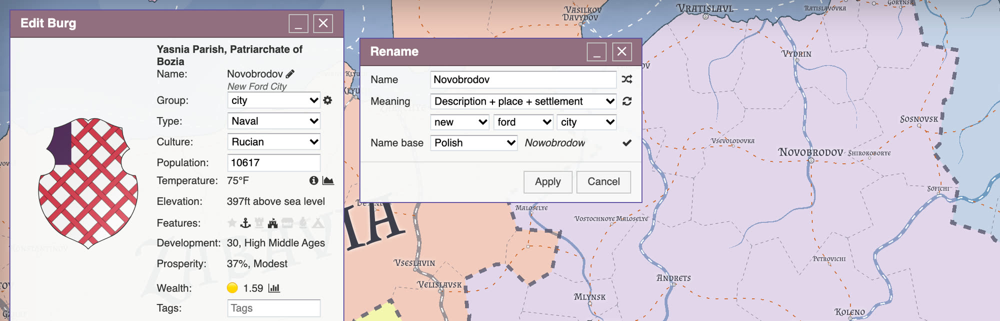
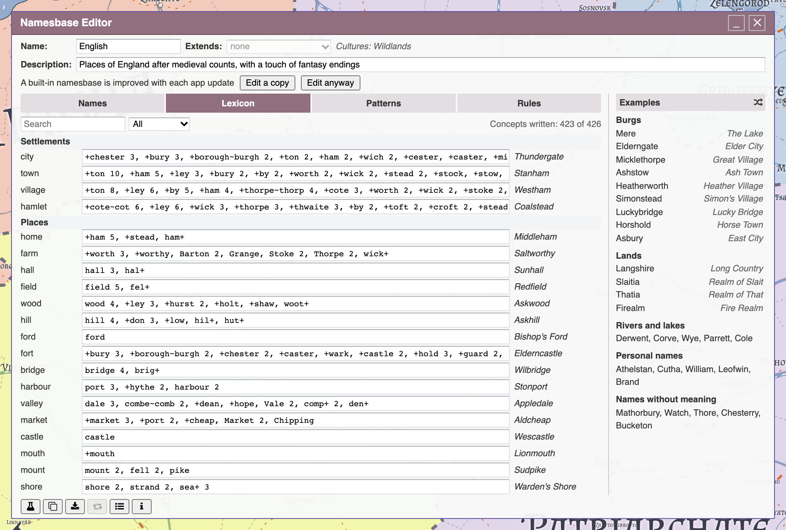

# Azgaar's Fantasy Map Generator v1.160.0: Semantic names

Since the very first versions we generatednames using a Markov chain approach. A chain is trained on a list of real town names, e.g. German or Japanese, and puts together new words that sound like them. It works relatively well for the sound, and that is all it does. The names meant nothing. A port and a hill fort got the same kind of name. State names were made by gluing a suffix to a burg name, with a hardcoded table of suffixes that said `land` for one base, `ia` for another and `Guo` for a third.

Real place names are not random sounds. Newton is a "new town", Exmouth is at the "mouth of the Exe", Novgorod is a "new city" too, only in Ruthenian. So this update changes how names are made. A place now first gets a **meaning**, chosen from what is around it, and then its culture define how that meaning sounds in its own language.

## Meaning first

A town by a forest may get the meaning _Birch Town_. A town founded by a man named Eadric may be _Eadric's Town_. The meaning is stored in the burg data, and the namesbase rules turns it into a final name. Here is what some meanings become in a few bases:

| Meaning       | English      | German     | French      | Ruthenian      | Swahili          | Japanese   | Sindarin    |
| ------------- | ------------ | ---------- | ----------- | -------------- | ---------------- | ---------- | ----------- |
| Black Water   | Blackwater   | Schwarzach | Aiguenoire  | Chernovka      | Maji Meusi       | Kurokawa   | Mornen      |
| The Ford      | Ford         | Furth      | Le Gué      | Brod           | Kivukoni         | Watari     | Athrad      |
| Mouth of Exe  | Exmouth      | Exemünde   | Condé-Exe   | Exeskoye Ustye | Mlango wa Exe    | Exeguchi   | Exethir     |
| Red Hill City | Radhill      | Rotberg    | Rougemont   | Chervonogorsk  | Kilima Chekundu  | Akasaka    | Caranamon   |
| Green City    | Grenton      | Grünheim   | Villeverte  | Zelenograd     | Mji Kijani       | Aogakyo    | Minas Galen |
| Three Towers  | Three Towers | Dreitürme  | Trois-Tours | Tri Stolpa     | Minara Mitatu    | Miyagura   | Nelminas    |
| Land of Frank | Frankland    | Frankien   | Frankagne   | Frankzemye     | Ufranka          | Frashu     | Frankiand   |
| East Realm    | East Realm   | Osterreich | Terre-Est   | Vostochnozemye | Ufalme Mashariki | Higashishu | Amrunardh   |

These are real outputs of the current data, not a hand-picked showcase, and they will change a little as the bases get better.

Rendering a meaning is deterministic: the same meaning in the same base always gives the same name. This is what makes the rest possible. Since a meaning belongs to no language, any name can be shown in any other base, and the editor can tell you what a name means.

Every name has one of nine shapes, or patterns: a plain proper name (Aldwick), what stands at the place (The Ford), a describing word and a place (New Town), a founder and a place (Eadric's Town), a place on a river (Mouth of Exe), a description of the land and what the burg is (Red Hill City), a name told apart from another (New Barton), and two shapes for lands (Land of Frank, East Realm). A number can stand where a describing word does, so there are Three Towers and Seven Falls, and in Ruthenian Tri Ozera, Sem Holmov and Pyatigorsk.

## Where a meaning comes from

The generator reads the place: a river or a coast, a harbour, hills, mountains, forest, marsh, desert, ore, cold or heat, the burg's size, walls, citadel and temple, whether it is a capital. It picks words that fit and never words that contradict the place. A harbour is only named at a port, a mouth only where a river ends or joins another, a mine only where there is ore. A good produced at a burg is favoured, so a burg on salt is likelier to be a salt town.

Most burg names end in what the burg is: a city, a town, a village or a hamlet, and for forts, monasteries, trading posts and caravanserais a fort, an abbey, a market or a camp. So a birch city, town, village and hamlet in English are Birchcester, Birkton, Birkham and Birchrest, and in Ruthenian Berezin, Berezov, Berezino and Berezka. The rest are named after what stands at the place, like a ford, a hill or a wood.

The order of naming matters too. Rivers and lakes are named before burgs, so a burg can be named after its river. Capitals are named before other burgs, and states after their capitals. States are named once they have expanded, because the name depends on the size: a big land is more often a realm named after a people or a founder, a small one a march or a district named for what it is like. Each base has its own land suffixes, which never end a town name, so you get Frankland and Frankia, but no Frankton for a state.

Provinces are named after their burg or as small lands, and a colony is a "new" something after its state. Islands are named as islands and continents as lands. The map itself is named as a big land in the language of one of its cultures. Seas, routes, markers and religions don't get meanings: they keep plain names that only sound like their language.

Each burg, state, river, lake and island is named on its own random sequence, seeded by the map seed and the place. The same seed gives the same names, and renaming one place does not shift anything else.

## Name bases

The name bases had to change completely for this. A base used to be a list of names, a length range and a few letters allowed to double. Now it also holds a lexicon (how the language says each concept in place names), templates (how it lays the parts out), sound rules for the joins, a grammar for languages where words agree, and lists of personal names for founders. The vocabulary has about 400 concepts: settlements, places such as `ford` and `hill`, describing words such as `new`, `black`, `oak` or `wolf`, numerals and land words.

There are 67 bases now. Every built-in base has its words written:

- **English** and **Ruthenian** were written against counts of real historical names. English was set against the 14,300 places of the Domesday Book, Ruthenian against a study of Old Rus' place names of the 10th to 14th centuries. I didn't try to copy the statistics, only to keep every type of name and the bigger ones in the right order. English deliberately has far fewer names in -ton (8% against 27% in Domesday) and more fantasy endings like -haven, -hold and -watch.
- **Other real-world bases** use the words their place names are actually built of, with grammar where it is needed: Novyi Gorod and Novaya Sloboda in Ruthenian, Pont-sur-Moselle and Puebla de Sanabria with their lowercase joining words.
- **Human Generic** extends English and turns it into high fantasy, after the naming in Tolkien and Martin: Black Keep, Aldric's Watch, Greyhaven, Westlands.
- **Fantasy bases** use words of their invented tongues. Where published word lists exist, I used them: Eldamo for Sindarin and Quenya, the Language Creation wiki for Valyrian and Dothraki, UESP for Dovahzul, the Black Speech for Orc, Enochian for Celestial. A Sindarin describing word follows its noun (Caras Galen), and Dothraki puts the noun first (Vaes Sash). Famous places and persons from the books are left out.

Every base has a description saying where its data comes from. Don't expect a native speaker to agree with every name. The bar is "sounds right and means what it says", and the data can be improved over time. A concept that a base has no word for is said with endings and words taken from its list of place names, so it sounds right but means nothing.

### New and renamed bases

There are 18 new real-world bases: Egyptian, Polish, Hindustani, Gaelic, Gaulish, Phoenician, Ethiopic, Thai, Malay, Georgian, Lithuanian, Maya, Tibetan, Ojibwe, Gothic, Dutch, Romanian and Serbian. There are also 6 new fantasy ones: Halfling, Infernal, Quenya, Valyrian, Dothraki and Celestial.

Three bases were renamed because they now hold a specific language: Celtic is **Welsh**, Elven is **Sindarin** and Draconic is **Dovahzul**.

All new bases are used in the culture sets:

- **All-world** and **European**: Polan (Polish), Gaelan (Gaelic), Litvan (Lithuanian), Batavan (Dutch), Vlahian (Romanian), Raskan (Serbian).
- **All-world** and **Oriental**: Bharati (Hindustani), Siyam (Thai), Nusantar (Malay), Bodan (Tibetan).
- **All-world** only: Habeshan (Ethiopic), Kemeti (Egyptian), Kartlian (Georgian), Mayab (Maya), Anishin (Ojibwe).
- **Antique**: new Egyptian and Colchian (Georgian) cultures. The Celtic culture now uses Gaulish, Germanic uses Gothic and Carthaginian uses Phoenician.
- **High Fantasy**: Quenian now speaks Quenya and Eldar Sindarin. Dulandir uses Dothraki and Rohand Gothic. New cultures are Valyr (Valyrian), Madrian (angels, Celestial) and Cottan (halflings).
- **Dark Fantasy**: new Khalasar (Dothraki), Valyr, Madrian and Gehennan (Infernal) cultures.

Slovan is renamed to **Rucian** and is now based on the East Slavs, as its Ruthenian base is.

## The Name Editor

Names are now edited in one dialog. Open it with the pencil beside the name in the burg, river, lake or route editor, or click a name in the States, Provinces or Features overview. The Burg Editor also shows the meaning in small print under the name.



- **Name**: type anything. Hover the field to show the speaker button that reads the name aloud.
- **Meaning**: the pattern and its words, such as _Description + place_: birch, town. Words are selected from lists, while proper names (a founder, a river) are typed.
- **Name base**: select any base to see how its people would say the name, and press the check mark to take it. A proper name is not translated but respelled, the way languages adopt foreign names: Lipsko becomes Lipzku in German, Kraków Kracau and Warszawa Warsau.
- The crossed arrows say the same meaning another way in the selected base. The round arrows coin a new meaning that fits the place, with its name.

Nothing changes until you press _Apply_. When you rename a river, lake, burg, state or province, the places named after it are offered the new name too: the towns on the river, a New Barton beside Barton, the colonies named after a land.

The form and full name of a state or province ("Kingdom of ...") have their own dialog now, opened by clicking the form.

## Your names are kept

The name and the meaning are stored separately, and neither overwrites the other. A name you typed stays even if it says something else than its meaning, and nothing renames a place without asking:

- When you change the culture of a burg or a state, or the name base of a culture, you can **Appropriate** the names (say the same names as the new culture would), **Regenerate** them (new meanings and names in the new base), or let **Random** pick either for each place.
- A place that returns to its old base is offered its old name back, unless you renamed it meanwhile.
- When you change a burg's group, a new name ending in the new group is offered and waits for a confirmation.
- The arrows next to the name base in the Cultures editor, and the regenerate button in the Burgs overview, give the burgs new meanings and names. Both skip locked burgs.

A name set by the Assistant or uploaded from a CSV file has no meaning, so the old meaning is cleared. The CSV has a new `Meaning` column, written as `owner-generic: ~Eadric, town`, and the Assistant can set meanings too. See [Data import](https://github.com/Azgaar/Fantasy-Map-Generator/wiki/Data-import#meanings) for the format.

## Namesbases Overview and Editor

_Tools_ → _Namesbase_ (or <kbd>Shift</kbd>+<kbd>N</kbd>) now opens the **Namesbases Overview**: a table of all bases, whether each is built-in, edited or custom, and which cultures use it. From there you can add, download, upload and restore bases.

The **Namesbase Editor** edits one base, on four tabs:



- **Names**: four lists: places, rivers and lakes, male and female names. A list is either _Generated_ (new names in the same style) or _Picked_ (the names are used as they are).
- **Lexicon**: how the base says each concept.
- **Patterns**: how often the base uses each kind of name and how it lays the parts out, the share of names that end in the burg's group, and the share of founders who are women.
- **Rules**: sound changes at the joins, the grammar and the doubled letters, with a box to test a name.

The examples on the right are sample burgs, lands, waters and people made by the base. They stay the same while you edit, so you can see at once what a change does.

A lexicon line looks like this:

```
city:     ^sk 6, ^ovsk 2, +grad 2, Gorod
```

This says that a Ruthenian city is mostly the suffix -sk, sometimes -ovsk, the end of a compound -grad, or the separate word Gorod. So Ivansk, Berezovsk, Novograd and Novyi Gorod are all cities. The full notation, with grammar, numerals and rules, is on the new [Names](https://github.com/Azgaar/Fantasy-Map-Generator/wiki/Names) wiki page. It also explains how to make a new base, from a simple list of place names to a base with its own words.

Built-in bases now open locked. _Edit a copy_ makes your own base from one; _Edit anyway_ unlocks the original. Please prefer the copy: an edited built-in base stays as you left it and will not get updates. Custom and edited bases are saved with the map and carried over to new maps. Built-in bases are not saved in the file, so they get the improvements of future versions.

Bases are now downloaded and uploaded as `.json`. The old `.txt` files, like the community bases on Cartography Assets, still load.

## Old maps

Old maps are updated on load, but their names are not touched:

- Every burg, state and feature keeps its name as it was. Loading never coins meanings. A name without a meaning is treated as a plain proper name, so it can still be shown in other bases in the Name Editor.
- To get meanings, regenerate the names: per culture with the arrows in the Cultures editor, for listed burgs in the Burgs overview, or one by one in the Name Editor.
- Unedited name bases become the built-in ones. Edited and custom bases are kept as custom bases with their names and lengths, and their doubled letters become a sound rule. They have no lexicon, so their new names will sound right but won't mean much until you write one.
- Cultures that used Celtic, Elven or Draconic now use Welsh, Sindarin or Dovahzul.

The same seed no longer gives the same names as in older versions, and with the new cultures in the sets, the cultures and states can differ as well.

## Other changes

- Bases are loaded on demand: a map loads only the bases its cultures use, and the Name Editor loads a base when you select it. The bases now have far more data than before, so it doesn't make sense to load all of them at startup.
- Gods, religion founders, merchant houses and travellers get personal names of their culture's base.
- Feature names in the Features overview open the Name Editor.
- The interface is translated into all 29 languages. Concept words and meanings stay in English in all of them, as in the CSV and for the Assistant.

## Known limits

- A meaning is not checked again when the map changes: a town keeps "harbour" in its name after its port is removed.
- Names in other bases are approximations. A proper name is respelled by sound, not translated, and some joins still come out clumsy.
- Two join rules are shared by all bases: a vowel ending takes the place of the vowels before it, and two same letters meeting become one. They suit most languages but not all, and a base has to turn them off with rules of its own.
- If you see a name that is clearly broken in a language you know, please report it with the base, the meaning and the name.

If you have any questions or found a bug, ask on [Discord](https://discord.com/invite/X7E84HU).
