**Battle Simulator** plays battles between two or more regiments on an animated battle plan. It works based on the attack, defense, speed, range and morale of the units, set in the [Military units editor](https://github.com/Azgaar/Fantasy-Map-Generator/wiki/Military-Forces#military-units-editor).

To start a battle select a regiment, click on the _Attack foreign regiment_ button and then click on another regiment to attack it. You cannot attack regiments of the same state as the selected regiment or regiments without any forces. It does not matter where attacked regiment is located and whether it's reachable or not - attacker regiment will be moved straight to the selected one.

## Battle screen

The battle opens as a battle plan: a map of the ground around the battle point with both armies drawn up on it. The rivers, roads, coast, burgs and slopes are those of the map around the battle cell; woods, marshes and hills follow its biome and heights, with details added to make a battlefield of it. The details are a fixed pattern of the place: the same spot of the map always gives the same ground. A burg is drawn as rooftops: its roads become main streets meeting in a market square, with blocks of houses between them, tile roofs in the middle and more thatch toward the edge. A burg with walls is drawn with battlements, with a tower on each side of every gate. A wider river is dotted with stones where it can be waded, a brook can be waded anywhere and has no marks, and a road crossing a river has a bridge.

Above the plan both sides are named, the attackers on the left and the defenders on the right: the emblems of their states, morale as a bar beside the title, the order the side is under, the troops left and lost. Attackers are red and defenders blue by default, whatever the colors of their states; Configure Battle can color the sides by their leading states instead. Between them are the battle name and the balance of power: a ribbon with the power of the troops each side still has in order, each side taking as much of the ribbon as it has of the total. The power is counted as in the Military overview: units number multiplied by unit power and by the square root of upkeep. Battalions that broke and run, gave themselves up, were destroyed or withdrawn are not counted. The die of each side stands at its end of the ribbon.

Under the plan are the button to start, pause and continue the battle, the step back, step, restart and speed buttons, the battle clock, with the result beside it once the battle is over; then the battle type, the weather, the reset button, the _Configure Battle_ cog and the buttons to apply or cancel the battle. Below the controls are the regiments of each side; click a regiment to see its units. Point at a regiment to make its battalions stand out on the plan; point at a battalion to mark its regiment in the list.

Every regiment is split into _battalions_ of its units. A battalion has the same size for both sides, 0.3, 0.5 or 1 population point (300 to 1000 men by default): the bigger the battle, the bigger the battalion, so that all the troops make no more than forty of them. A battle of up to 12 thousand men has battalions of 300, one of 12 to 20 thousand has battalions of 500, one of up to 40 thousand battalions of 1000. A bigger host gets battalions of as many thousands as keep it within forty: 3000 men each for 120 thousand. Such a battalion stands on the 200 m front of one of 1000, only deeper, so any number of troops can be fought out. A small battle that would field fewer than ten battalions of 300 gets battalions of 200. A regiment with 5000 infantry fields ten times as many blocks as one with 500. A unit too small for a battalion still gets a block, a narrower one. Battalions never stand on each other: they close up side by side and go around those in their way, so only as many fight as the front has room for and the rest wait behind. Only troops on the run pass through the others. A battalion held up by a friend asks it to give way: an idle friend, or one crossing its way, steps aside and keeps out of the way till the other is by; of two making for the same gate or bridge the nearer goes first, so narrow places are passed in the order battalions come to them. One held up by friends for longer than 1.5 minutes files through them. Units with a crew, such as cavalry or artillery, count by their men. The icon on a block is its unit; the dark line along the front of the block is as long as the share of its troops alive. When allies fight on one side, every battalion flies a small flag of the color of its state. Hover over a block to see its troops, morale, energy, speed and range. A red star marks a melee. Ranged units loose volleys of arrows, machinery and ships lob shells that burst in a bigger star where they land, and dotted arcs are the shooting of the other units.

**The view**. By default the view shows the whole field; Configure Battle can set it to follow the troops: then it frames every battalion still on the field and glides as they march, spread and close up. Zoom with the mouse wheel or a pinch, and drag with the right or middle mouse button (or a finger) to look round; the view then stays where you put it. A double-click on the ground returns it to the camera chosen in Configure Battle: following the troops or the whole field. Battalions keep their real size at any zoom, while flags, icons and labels keep a readable size. The battle name and clock, the scale bar of the view in sight and the North arrow stay in the corners of the view.

**Configure Battle**. The cog opens the battle options, kept in the browser and never in the map file; each group has a _Restore defaults_ button:

- _View_: the camera, and the battle plan overlay with each battalion's mission and target.
- _Rendering_: the relief as hachures, fringed contours or none, an optional relief shade, the time of day light (the sun and the shadows of the heights, cloud, dusk and night over the plan; off, the plan is lit as a map, from the north-west), heights (contour labels, tops ▲ and hollows ▽), woods and marsh, ground props (trees, grass, rocks, reeds and the like), place labels, side colors, unit icons, flags, health lines, fallen battalions fading away or kept as faint outlines, movement arrows (off by default), fire lines, missiles, clash marks, weather effects (rain, snow, fog, heat haze, mud and ice on the plan, on the screen only), the title and clock, the scale bar and the North arrow.
- _Playback_: whether the step button advances a step or a round, and the events the battle pauses at by itself: the first clash, a battalion routed or surrendering, a breach, a side breaking.
- _Simulation_: the most and the fewest battalions a battle is split into, the longest battle, the lull that ends one, how long an order stands, how far ahead the generals think and how much [fortune](#generals) weighs, 0 for no dice. Each is set with a slider or typed in; the label tells what the number comes to. They apply to the next battle, or to this one before it starts, and are stored in the battle log.
- _Export_: an animation (GIF or animated SVG) or a _battle report_: one offline page with the battle's summary and a picture of the field at each key moment, with arrows of where the battalions went and the log lines in between.

With movement arrows on, arrows show while paused where each battalion went since the battle was last started or continued. The playback speed, the camera and the open log are kept for the next battle.

## Setting up

Everything in the setup is optional, the battle can be started right away.

- **Deployment**. Each side is drawn up by its general, by the tactic he has chosen, see [Generals](#generals). Defenders hold the battle point on the best ground nearby, and attackers form up facing them. The ground sets the way the attack comes: square to the edges of the plan, the way that keeps water off the sides' ground and puts a river, the high ground or a burg on the defenders' side; the way the attackers came on the map only breaks a tie. A landing and a bombardment come from the water. Pick troops the way you would in a strategy game: click a battalion to pick it, or drag a box over the field with the left mouse button to pick all the battalions in it; a click on empty ground drops the pick. Drag a picked battalion to move all the picked ones together, in the order they stand in, or drag the round handle just before their front to turn them round their middle. A double-click turns a single battalion by 15 degrees. The general keeps a battalion in the place it was put in. Every move and turn is written to the battle log. The reset button sets the troops up anew.
- **Regiments**. Add more regiments with the _Add_ button above the regiments of a side. There is no restriction for state: a state can have regiments on both sides. The _Withdraw_ button of a regiment takes it out: before the start it goes back to where it stood on the map, after the start it marches off the field in order, and the foe may cut it down on the way. A side keeps at least one regiment.
- **Battle type**. Click the type under the plan and pick another one, see below. The type can be changed only before the battle starts.
- **Orders and morale**. Click the order of a side, beside its title, to pick another order from the list. Before the start the list begins with every tactic the battle type allows the side, see [Generals](#generals), the ones its general is likeliest to pick first: pick one to draw the side up in it instead of the tactic its general chose, or _General's choice_ to leave it to him again. A side given a tactic by hand is not thought through by its general; the other general thinks again against it. Before the start a side that may build [works](#works) also has _Dug in_ at the end of the list: the side starts the battle behind works finished the night before. Hover over the morale bar of a side to show − and + buttons: each click takes away or adds 5 morale. Power is changed by the die only. Every change can be made at any time and is written to the battle log; clicks on the morale buttons in a row make one line.
- **Time of day**. Click the clock under the plan to pick the hour the battle starts at, see [Time of day and sight](#time-of-day-and-sight).
- **Name**. Type the battle name or generate one.
- **Reset** draws the troops up anew and drops the moves made by hand, before the battle starts.

## Battle process

Press _Start battle_. The battle goes by itself in steps of eight seconds, six steps make a _round_ of 48 seconds. The clock under the plan shows the time of day (point at it for the round), and every entry of the battle log carries its time. <kbd>Space</kbd> starts, pauses and continues it too. It can be paused at any moment to add or withdraw regiments, give another order or change morale, and then continued.

**Commanding battalions**. Once the battle has started, troops are no longer placed by hand: they are commanded. Pick battalions of one side (a box over both sides picks the side with more battalions in it), then right-click, or shift-click, where they should go:

- **empty ground**: they march there, keeping the order they stand in, and stand there; shooters shoot what comes in range, and anyone fights the foe that comes at them;
- **an enemy battalion**: they attack it, shooters from within their range;
- **a broken enemy battalion**: they pursue it until it is off the field, gives itself up or rallies;
- **a friendly battalion**: they protect it, keeping by its side and going for the foes that come near it.

Click a picked battalion to give the picked battalions an order on their own spots; each takes the ones it can carry out:

- ✋ **Hold**: keep the spot and shoot what comes within range;
- ⛏️ **Fortify**: build stakes or a ditch before the spot and hold behind them; troops on foot, where their side may build;
- 🎯 **Skirmish**: come within shot of the foe and shoot, stepping back from those who come at them; shooters only;
- 🛡️ **Defend**: keep the spot and charge the foe that comes near it; troops that fight hand to hand;
- 🏃 **Retreat**: march off the field in order; the besieged cannot;
- 🏳️ **Surrender**: lay down arms.

Orders can be given while the battle plays too. An order stands until it is done (the foe or the friend is broken or gone), the battalion breaks or leaves the field, or for ten rounds, as long as an order to the side stands; then the general takes the battalion back into his formation. A battalion you give an order while its side retreats or falls back to draw the foe out obeys it; one so kept from its side's retreat fights on after the order is done, from where it stood in the formation, until it breaks. Every order is written to the battle log. Picked battalions show their order at once: a dashed line to where they go, a solid one to the foe they attack, a dotted one to the friend they protect. The step buttons take it a single step forward or back (going back plays the battle anew from its start, with every change made, so it may take a moment in a long battle), and the speed buttons say how much faster than real time it plays: ×25, ×50, ×100 or ×200. _Play again_ returns the battle to its start and plays the same battle once more, with every change made on the way.

Once a battle is initiated, the system automatically selects a _Battle type_. The battle type defines the _battle phases_ a side goes through. There are 7 battle types, each with its own logic. The type is chosen from the two initial regiments, counting only the units they have troops of, in this order:

1. **Naval** — both regiments are naval
2. **Air** — every unit on both sides is of the aviation type
3. **Landing** — the attacker is naval and carries non-naval units, and the defender is not naval
4. **Siege** — the battle is in a burg with walls; a citadel alone is not enough. A fleet alone besieges only a port: at a walled burg with no port it bombards it
5. **Bombardment** — the attacker is naval with naval units only, and the defender is not naval
6. **Ambush** — the defender is in a forest or wetland biome out of a burg and has less than three quarters of the attacker's power
7. **Field** — everything else

A fleet at sea, by the coast too, cannot be attacked by a land regiment that has no naval or aviation units, and a fleet cannot attack troops away from the shore: a land regiment more than a map cell or so from a coast or a lake shore. Field battles and ambushes are played on the ground of the map. Naval and air battles are played on open water and sky; sieges, landings and bombardments use the ground. A landing and a bombardment are fought on the shore nearest the defenders, the water on the attackers' side of the plan, unless the defenders hold a port: then at its harbour. In a siege the defenders start within the besieged burg; in a field battle at a burg they hold the burg, at one end of the plan, and the attackers come from the other.

## Generals

Each side is led by a general. Before the battle he weighs both armies and the ground, picks a _tactic_ and draws his troops up by it; the tactics of both sides are the first lines of the battle log. Every round he looks at the field again, decides what his side is to do and gives every battalion an order. Nothing in a battle is left to chance but fortune, the dice rolled at the opening: the same armies on the same ground with the same dice always fight the same battle.

**Planning**. In a field, a naval and an air battle the generals think the battle through before it begins: each plays every tactic open to him in his mind, to its end or for 48 minutes, against the foe as the odds make him expect it, and takes the one that leaves him holding the field with the lighter losses. Neither knows what the other has settled on. An attackers' general whose army is the weaker of the two also weighs not attacking at all, and leaves the field if that ends better for him; leaving before a blow is struck counts as no defeat. Against strong ground he weighs it up to 1.4 times the defenders' power: water, walls or cliffs, works a side starts behind that stop riders or everybody, a foe that forms a Wagenburg, or ground where his blows would land the weaker, such as a crest. On ground with water, walls or cliffs, or behind such works, only the attackers' general thinks it through: his likeliest tactic against not attacking. A general who chose not to attack is not drawn in by the foe digging in. An attackers' general with engines before wagons also weighs storming them at once against battering them first. Against a foe that forms a Wagenburg the attackers' general plays only his likeliest tactic, and a battle where either side may form one is thought through for 24 minutes, not 48: a Wagenburg is slow to reckon. The other battle types have a choice of their own to think through. In an ambush the ambushers' general weighs lying on both sides of the road against lying on one (only on one where trees hide them on that side alone), and, with shooters, falling on the column at once against shooting first; the general of the column has no plan, it is caught. In a landing defenders who are ready weigh meeting it at the water's edge against waiting inland. In a siege besiegers with at least two thirds of the odds the walls ask for weigh storming at once against keeping to the rule, unless they have cut the burg off: then they starve it out; with more than 28 battalions on the field a storm is not thought through: there is no time for it.

The first deployment on screen is the one the odds alone suggest; while the generals think, for up to a second, the start and step buttons are disabled, and then the troops take their final places. Adding a regiment, giving a side a tactic, or changing the battle type before the start makes them think again; a new battle type drops the tactics given for the old one.

Each tactic is shown with an example under [Tactics](#tactics).

Riders kept in reserve stand behind the ends of the line, and never among trees or in a marsh: there they close in to the line till the ground is open. In a naval or an air battle all troops are of one kind and form lines.

**Who attacks**. Attackers come on unless they have less than three quarters of the defenders' power: then they take a defensive tactic and wait. A side you give an attack tactic by hand comes on at any odds. Defenders with a quarter more power than the attackers, and no river to hold, come out to meet them. A side that waits goes over to the attack when the foe is spent (one and a half times the foe's power once the lines have met), when it is shot at with less than half of the foe's fire to answer with, or when the foe has not come for about 5 minutes and is no stronger; but it does not march on a waiting foe who has twice its fire, and a general who chose to wait keeps waiting. It is written to the battle log. A side that holds a river crossing stays behind it until the foe runs, and a side behind finished works does not come out because the foe does not come: only when the foe is spent or shoots at it with nothing to answer. A side that waits and has no works of its own comes on at once, if it is no weaker, when the foe begins a ditch or a Wagenburg: it does not wait for the works to stand. Stakes do not provoke it. When neither side comes, the attackers stand off for about 6 minutes and then leave the field to the defenders: whoever sought the battle and will not fight it goes home.

**Orders**. A battalion of the line keeps its place in the formation, which the general moves forward at the pace of its slowest troops, and fights what comes within a charge of its place. Shooters keep their place behind the line and step back from those who come for them. How a battalion fights comes from its unit's type, not its numbers: mounted and aviation units are riders, ranged units shooters, machinery and naval units engines, the rest line troops. Riders with a range, such as horse archers, take the wings like other riders, but shoot instead of charging and ride off from foot that comes at them. Riders on a wing set out round the end of the foe's line when the lines are a charge apart, so that they fall on him as the lines meet, unless the foe's riders on that wing are much the stronger: then they guard the wing. The weak wing of an oblique attack holds back and fights only what comes at it. The reserve waits behind and is sent, the nearest battalion first: into the place of a battalion of the first line that broke, against foes that come round a flank or through the line, at a foe that wavers in a fight, and all of it once the lines have fought for 6.5 minutes. Against foes coming round a flank or striking a battalion in the flank or rear, as many go as match them.

**Covering the flanks**. A side that holds its ground turns battalions out at an end of its line, a short line back from the end and facing out, as strong as the foes there: the reserve as soon as the foe has riders on that wing and near its end, before they come round, and the end battalions of the first line wheel back once foes come level with it, as far as nobody stands before them. A threatened end may take the reserve of a quiet one. In a defensive line the reserve stands behind the two ends for this. Shooters and engines are guarded: when a foe goes for them hand to hand, the nearest battalion free to go, of the reserve, the riders on guard or the line not at grips, comes to their aid, the engines' first, and goes back to its place once that foe is gone.

**A battalion's own mind**. Whatever its order, a battalion at grips fights on and turns on whoever has it by the flank. A battalion with morale below 30 is _shaken_: it defends itself but does not attack. Riders do not charge formed line troops head on while they have a flank, a shooter or an engine to go for.

**The day is lost** when a side has less than a third of the foe's power left in order; less than two thirds with a quarter of its troops gone; no more than the foe with half of them gone; or when its morale is below 25. In a field battle the power is weighed on the ground, by how each side's blows would land where the foe stands: a line on a crest, behind a ford or a bog or in a wagon ring holds on against odds that would send it off in the open. An attack is also called off once it has cost 15% of the attackers fallen and three times what the foe has lost. The general then orders the retreat and the side leaves the field: it does not come back unless you order it to fight on, see below. Battalions that can get away always do; those held at grips with every way out closed surrender, see _Surrender_ below. So a side more than three times weaker than its foe refuses the battle altogether.

**The order of a side** is what the general has it do, shown beside its title:

| Order        | The side                                                                                                     | When it is used                                                                                                                                                                                                                                           |
| ------------ | ------------------------------------------------------------------------------------------------------------ | --------------------------------------------------------------------------------------------------------------------------------------------------------------------------------------------------------------------------------------------------------- |
| ✋ Hold      | stands its ground and shoots what comes within range                                                         | A side that waits for the foe holds while he is still far off; besiegers holding a blockade and a garrison sheltering behind its walls hold too. Give it to keep a side where it is, to let the foe come on, or to wait for reinforcements                |
| ⛏️ Fortify   | holds its ground and builds works before its first line, see [Works](#works)                                 | A side that holds orders it when it has time before the foe comes. Give it before a fight you mean to receive. When both sides end behind works, nobody may come out and the battle can die down as a standoff                                            |
| 🎯 Skirmish  | comes within shot of the foe and shoots                                                                      | An attacker with the better shooters shoots for a while before going in, the longer the better his fire; besiegers bombard the walls. Give it to wear the foe down before the clash, or to keep ships and engines at their range                          |
| ⚔️ Attack    | closes with the foe                                                                                          | An attacker goes in when his fire is no better or has done its work; besiegers storm the walls, a garrison sorties. Give it to force the fight, also on a side whose general meant to wait. Going in at once spares the foe the fire and can cost the day |
| 🛡️ Defend    | stands its ground and fights what comes at it                                                                | A side that waits defends once the foe is near. Give it to keep a good position, a hill or a crossing, without leaving it                                                                                                                                 |
| 🐎 Pursue    | chases the broken foe                                                                                        | Ordered when the foe runs or has only a quarter of his battalions left in order; besiegers that took the burg loot it. Give it to finish a beaten foe off: riders and the reserve go after whoever they find                                              |
| 🏃 Retreat   | leaves the field                                                                                             | Ordered when the day is lost, see above. Give it to save what is left of an army; battalions held at grips with no way out surrender. A besieged garrison cannot retreat                                                                                  |
| 🏳️ Surrender | lays down its arms: every battalion in order gives itself up, and every broken one with no way off the field | Ordered by a garrison whose burg is taken or starved. Give it to end the battle at once; once the battle is on it cannot be undone                                                                                                                        |

Not every order fits every battle: only a side that may build works can fortify, and a bombardment, where ships and troops never come to grips, knows only hold, skirmish, retreat and surrender.

The order is the short of the _phase_ the side is in, see [Battle types](#battle-types). In a field, a naval and an air battle a side that goes to meet its foe skirmishes and then attacks, and one that waits for him holds and then defends.

You can give a side another order by hand; its general keeps to it for eight minutes, then decides again. Told to hold or to defend, a side stays where it stands; told to skirmish, attack or pursue, it goes for the foe even if its general meant to wait. The besieged cannot retreat. A side you order out of a retreat, by any order but surrender, fights on in any battle type, and its general orders no retreat again: each battalion fights till it breaks, unless you order the retreat yourself. Any side can be told to surrender, and once the battle is on that is for good.

- In a field, a naval and an air battle, and in a siege, the side goes over to the phase the order takes: an attack is a melee in the field, a boarding at sea, a storm or a sortie in a siege.
- In an ambush and a landing the phases are how the fight stands, and an order does not change them: it changes only what the troops do. A column told to attack attacks while still in shock, and a fleet told to hold off the shore has its landing still before it. Ambushers told to hold keep where they lie and shoot what is in range; told to skirmish, their shooters go forward to shoot. To pursue, to retreat and to surrender are the exceptions: they are phases of their own.

**Strength**. A battalion strikes and shoots with `troops × unit attack × √upkeep` and stands with the same of its unit's _defense_: what a unit is good at is in its attack and defense, not in the phase. The more a battalion is hit with for what it stands with, the more it loses. Troops on the run strike at a tenth of their strength and stand as well as ever, and a side in shock, taken by surprise in an ambush or a landing, strikes and stands at half. Position changes both:

- troops standing in a river or in the shallows by the land fight at half their strength, in deeper lake or sea water at a quarter, in a marsh at three quarters, in attack and in defence alike
- water does not trouble naval and aviation units, and the attackers of a landing are shipped to the shallows, where they wade ashore; nobody fights hand to hand from a boat
- mounted units lose 40% in woods
- cover takes its share of the losses however heavy the fire: troops in woods or in a burg lose 40% fewer men to shots, troops within walls three quarters fewer to anything from outside
- a blow or a shot in the flank is 25% stronger, in the rear 80%, and both shake the morale of the troops hit

**Charge and impetus**. A battalion about to strike runs in at three times its speed for the last stretch, what it covers in one step so: about 30 m on foot, 85 m on horse; engines never charge, and a charge stops at contact. Speed tells on how many fall. A battalion that runs into its foe strikes with the speed it closes at: its blows take `1 + speed in m/s ÷ 6.2` times the men, so riders at the gallop (10.5 m/s) cut down 2.7 times as many as standing troops would, foot at the charge (3.6 m/s) 1.6 times, troops that walk into the foe 1.2 times, riders slowed by a slope or a wood not much more than foot, and nothing more than five times however fast. The impetus wears off at grips, a sixth of it with every step, and a battalion that stood to meet the charge has none. A shot tells the more the nearer it is loosed: half again at point blank, half at the limit of the range. Bows cannot shoot at a foe less than 2 m off and guns 20 m: at that distance they fight hand to hand.

**The plan and the ground**. The battle plan is the map at true scale, in real lengths. A battalion stands a metre a man across five ranks: 60 m wide for 300 men, 200 m for 1000. The plan is about 23 battalion fronts wide and 0.6 as deep: 1.4 × 0.8 km for battalions of 300, 4.5 km wide for battalions of 1000 or more, 250 m at least. Burgs are at their true size, about 100 m² a dweller: 360 m across for 1,000 people, 1.6 km for 20,000, shaped as their cell on the map. A siege plan takes in the whole besieged burg and the land round it as far as the besiegers will stand off the walls, out of reach of the garrison's shooters (about 220 m against bows, 340 m at most), and a battalion front more; the battalions keep their real size. It is never more than 1.5 times as wide as the battalions ask for, so they stay visible: a city too big for that is drawn smaller than its true size. The scale bar under the North arrow is in the map's distance unit, short lengths in its height unit (m or ft). Weapon ranges, speeds and the ground keep their real size whatever the size of the battle, while the formations keep their proportions: a bowshot is about three battalion fronts at the default size, four in a small battle and less than one in a big one, so small battles favour who stands and shoots, and big ones take long to close. The field lies at the burg the battle is named for, or by its river, on the bridge if a road crosses it there. Roads, rivers, coasts, heights and forests follow the map; hills, copses, bogs and meanders the map is too coarse to show come from the place, the same every time. A road comes onto the plan and leaves it where the map has it, and between goes as the ground lets it: round the hills rather than over them, off the bogs, and over a river once, square to the stream. Hills rise by a tenth of the relief of the map around the battle, 4 m on a plain to 100 m in the mountains. Slopes slow troops by how steep they are the way the troops go: 2° uphill costs a third of the pace, 6° uphill two thirds, and from 12° uphill or 18° downhill troops keep only a tenth of it, while a gentle way down, about 3°, is 1.7 times as quick. A charge down a hill is the fiercer for it, one up a hill comes in spent. Troops on a slope also fight and stand the weaker the steeper it is, down to half, whichever side they are on, so the side holding a flat crest has the better footing. Fliers and ships do not mind slopes. Shooters reach further from above and shorter from below, as a missile flies: bows of 160 m reach about 196 m from 40 m higher and 113 m from 40 m lower, and cannot reach a foe more than half their range above them; a shot uphill also hits softer.

**Movement**. Every unit moves at its own _speed_: by default troops on foot march at 1.2 m/s (4.3 km/h), mounted units at 3.5 m/s (12.6 km/h), ships at 0.85 m/s and machinery at 0.5 m/s, the slowest. The line keeps together on the approach, so the speed shows in the charge, in the pursuit and in the flight. On the open sea, and when shipped to a landing, everybody goes as fast as the slowest naval unit of the map, or at their own speed when the map has none. Troops move slower through woods and marshes and faster along roads. A ford is waded at less than half the pace, and deep water all but stops a battalion: caught in it, it is an easy prey. Troops in order do not march into a lake, the sea or a river out of its fords; those on the run do. A side that waits for its foe holds its bank at a ford and at a bridge and leaves the crossing to the other side, until it goes over to the attack.

**Rivers**. A river is crossed by a bridge or at a ford. A bridge stands wherever a road crosses a river, and anybody may cross it. Fords depend on the river: a brook can be waded anywhere, a wider river only at a ford here and there, and the widest have no fords at all. Where water would keep the sides apart altogether, a crossing is opened where it is narrowest for them: a ford on a river, shallows across a lake or a bay, slow going and poor footing as in a marsh.

**Cliffs**. Where the map is mountainous the plan has cliffs: lines nobody on foot or horse crosses, drawn as a thin line along the top with small teeth hanging down the face. A coast among mountains is cliffed in stretches no longer than six battalion fronts, with beaches between them; the shore nearest the middle of the plan and the shore by a road, a river mouth or a port is always a beach, so a landing comes ashore at a beach and the defenders ready for it hold one. Inland, in mountain country, a steep hillside may break into a cliff up to 40 m high, half the relief of the map around the battle: in pieces of two to six battalion fronts with ends and gaps, one or a few on a plan, never two close together. The ground drops at the cliff and rises back to its own lie within a few fronts of it. Wherever cliffs would close ground off, a gully two battalion fronts wide is cut through them, so troops can always get everywhere they could without cliffs, if by a longer way. Troops go round cliffs or through their gaps by themselves. Nobody fights hand to hand across a cliff, but shots go over it, and a cliff's height counts: shooters at the top reach further, those below fall short. The top is level ground: troops standing at the edge keep their full footing and pace. A general counts a cliff as cover for the end of his line, as he does water, wood or a burg, and does not draw a line up across one. A battle in which a side is still on its long way round a cliff does not die down, and an attack that comes no nearer on such ground goes in, every battalion finding its own way to the foe: the whole line could not always follow it through a gully. Fliers pass cliffs. Cliffs are part of the ground: the same place always has the same ones, and a plan on gentle ground has none.

**Walls**. The wall of a burg stops everybody, in march and in melee alike: nobody fights through it. Its gates stand where the roads and rivers come in, and a burg on the sea or a lake has sea gates on its quay, each with a stone pier out into the water: one for a small port, two or three for a large one. The gates are open to all, except in the burg a siege is for: there only the defenders pass. The besiegers get in two ways. In the _storming_ and _looting_ phases they go over the walls and through the forced gates, at half their strength while they climb. A gate lets troops through a little wider than it is drawn, so a battalion passes it without squeezing. Walls and towers stand 15 m high: whoever is within them shoots further out and is hard to shoot at from below, and climbing up or down is as slow as any steep slope. Gates are level: marching through one is no climb. Every battalion makes for the middle of the burg by its own quickest way: over the stretch of wall in front of it, or by a breach or a forced gate when one is about as near, so the garrison cannot hold the walls everywhere. And engines in range of the burg work a breach into the wall nearest to them while they bombard or cover a storm, by the weight of their blows: the harder the engines hit, the sooner the wall comes down, three breaches at most: a fourth makes the walls no weaker. A breach is open to everybody, at half the pace over the rubble, and is no higher than its rubble. Shooting goes over the walls, but troops within them lose a quarter of the men they would in the open, to shots and to blows from outside alike. Friends packed within the walls of one burg keep no lines and do not stand in each other's way.

**Odds**. Besiegers do not storm a burg they are too weak for. Walls are stormed when the besiegers have four times the power of the besieged, and every breach lowers that: two and a half times with one breach, 1.8 with two, 1.4 with three. A burg without walls is stormed at a quarter more power than its defenders have. Below these odds the besiegers bombard if they have engines and hold the blockade if they do not. Engines bombard while that brings the walls down in time, three breaches at most, and a little longer; then they hold their fire and the siege is a blockade again. A storm that has lost a third of the odds it was begun at is called off, unless the stormers are on the walls, within them or at grips with the garrison; the besiegers then go back to their lines. Engines alone storm nothing: with no troops left to climb the walls the besiegers bombard. The besieged make a sortie at the besiegers' engines when the party is half as strong again as their guards, the engines themselves counted at a quarter: the riders and every other battalion of the line go out by the gate nearest the engines, form up in rows outside it, then fall on them, and come home 6.5 minutes later, when the engines are done for or when the party is shaken. A garrison half as strong again as the besiegers comes out with its whole line to drive them off, and the besiegers raise the siege. The besieged give the burg up when their morale falls below 15, or when half of them are lost with the besiegers on the walls and the stronger. The power counted is that of the troops, as in the ribbon above the plan. An order given by hand is not held back: you can order an attack on the walls at any odds. Shots over the walls do not keep a siege going by themselves: with no storm, sortie or breach for a while the battle dies down like any other. Engines in range of the walls do keep it going, as long as there is a breach left for them to make.

**Targets**. Of the foes its order lets it go for, a battalion picks the one worth most and keeps to it. A foe is worth more the nearer it is, when it is already held in a fight and can be taken in the flank or rear, when it is shaken, when it hits harder than it stands (artillery before infantry), and when the general points at it; for riders shooters and engines are worth more and formed line troops met head on less. Those who fight hand to hand spread along the foe's line rather than crowd on one battalion.

**Ways**. On dry ground troops go straight at the foe. Where water or a wall lies between, they take the quickest way there is: through a gate that is open to them, round a lake or a bay, over a bridge or through a ford, whichever is sooner. The foe is chosen by that way too, so the nearest one across the water is not the nearest any more. Nobody is drawn up in the water, steps aside into it or is pushed into it; troops queue at a bridge, a ford or a gate, and the fight is often for its end. Troops on the run make for the nearest edge of the field behind their side, round the water and out by the gates.

**Fortune** is a 6-sided die each side has. Both are rolled once, as the battle opens, and stand to its end: the same battle, played again, has the same dice. The die multiplies the blows and shots of its side by `1 + (die − 3.5) × fortune`. With the default _Fortune_ of 0.2 in Configure Battle that is from ×0.5 for ⚀ (die 1) to ×1.5 for ⚅ (die 6): a side with ⚅ strikes three times as hard as with ⚀, and an average roll changes nothing. Set it from 0 to 0.3: at 0.3 ⚀ strikes at a quarter and ⚅ at ×1.75; at 0 there are no dice and fortune changes nothing. Fortune can turn a battle the power ribbon says is won. Point at the die to see the multiplier. Click the die to turn it to the next face, as many times as it takes to set the value you want: the new die is written to the battle log and stands to the end. The generals do not reckon with fortune.

**Casualties**. Battalions lose men only when somebody strikes or shoots at them. Every blow cuts down men by its strength, against the defense of each man it falls on: in a round a hundred men of attack 1 cut down or shoot down one and a quarter men of defense 1, twice as many if they strike twice as hard, half as many of men who stand twice as well. So two battalions on one, or archers supporting a melee, tell, and a big army wears a small one down. A battalion breaks at about a fifth of its men lost, so most of a beaten army runs or gives itself up rather than falls. A side that sits out a blockade, shelters behind its walls or waits on a shore the foe has left holds its fire. Losses are counted in fractions and rounded to the nearest man, or ship.

**Weather**. The weather button under the plan sets the sky (clear, rain, heavy rain, snow or fog) and, apart from it, muddy ground, ice and heat, which go with any sky. It can be changed at any moment, and the change is written to the battle log and replayed. A battle starts with the weather its place is likely to give: rain and mud are likelier where the map is wet, fog in cool damp places; in frost it snows rather than rains and the rivers often freeze; a hot place often starts in the heat.

|              | Sight  | Shots tell | Pace on land                                                       | Strength | Tiring        |
| ------------ | ------ | ---------- | ------------------------------------------------------------------ | -------- | ------------- |
| Rain         | 1500 m | 60%        | –                                                                  | –        | –             |
| Heavy rain   | 400 m  | 35%        | –                                                                  | –        | –             |
| Snow         | 600 m  | 80%        | –                                                                  | –        | –             |
| Fog          | 150 m  | –          | –                                                                  | –        | –             |
| Muddy ground | –      | –          | half in the open (riders 30%), 75% in woods and bogs, 80% on roads | 75%      | –             |
| Ice          | –      | –          | 75%; frozen rivers can be crossed anywhere, as at a ford           | –        | –             |
| Heat         | –      | –          | –                                                                  | –        | twice as fast |

The murk shortens how far troops see, and nobody shoots further than he sees: in fog a bow reaches 150 m at most, see [Time of day and sight](#time-of-day-and-sight). Wet strings and powder weaken the shots of bows, engines and ships alike. The sky slows nobody. Fliers and ships do not mind mud or ice; lakes and the sea do not freeze. A charge through mud comes in slower and softer. _Weather effects_ in Configure Battle shows rain, snow, fog, heat haze, puddles and ice on the plan.

### Time of day and sight

A battle starts at a whole hour, by day four times in five, the rest at night; the hour comes with the battle like its dice, and you can pick another one before the start by clicking the clock. Full daylight lasts from 05:00 to 20:00, twilight fades till 23:00 and comes back from 03:00, and the night lies between. The log notes the time of day as the battle starts and whenever it lasts into the next one: dawn, morning, midday, afternoon, evening, dusk or night. With _Time of day light_ on in Configure Battle the plan is lit by the sun of the hour, rising in the east and setting in the west, with the heights casting shadows, golden while the sun is low, grey under cloud and dark blue at night, where every battalion with torches lit carries a glow round it.

By day under a clear sky everybody sees the whole field. In the dark and in the murk of the weather a battalion sees only so far, the two adding up:

- at night a foe in the open is seen 120 m off, fog at night is 67 m, and whatever the light a foe 30 m away is always seen;
- a foe in woods or a burg is seen half as far, ambushers lying in wait half as far again, and in the dark a battalion with torches lit, which is everybody but ambushers lying in wait and besiegers stealing up to storm the walls, half as far again as it would be;
- a battalion goes for, shoots at, shies away from and chases only the foes it sees, or that any battalion of its side in order saw last round, or that it is ordered at; a broken foe out of sight gets away;
- nobody shoots further than he sees, and a side that stands off to shoot halts where it sees the foe's line, nearer than usual if need be;
- a loss shakes friends and heartens foes only where they see it;
- the attackers form up no further than three sights from the defenders: 360 m at night; ambushers lie as near as the column cannot see them, at night as close as 30 m under trees;
- the walls tell less the later the garrison sees the stormers: at night a burg is stormed at lower odds, where by day it would be blockaded.

The generals see the whole field: their plans are made by the odds, not by sight.

**Energy**. Every battalion starts fresh and tires by what it does: marching, building works, shooting, fighting and running, most of all at grips and on the run. A battalion fights and stands with half its strength once spent, and gets its strength back by standing still: an hour from spent to fresh. Marching takes two hours to tire it out, fighting half an hour. Hills and mud tire troops by taking longer to cross. Fresh reserves and late reinforcements tell, and so does the side that waits for the foe. Hover over a block to see its energy.

**Morale**. Initial morale is based on the difference in strength — the weaker army gets lower morale, but never below 50 — and on the stability of the state. _Supply line length_ then subtracts up to 15 points: the further a regiment is from its base, the bigger the penalty. In the battle every battalion has its own morale. It drops with casualties and with hits in the flank and rear. Every round a battalion also counts the friends and the foes in order around it: outnumbered it loses up to 6 points, with the upper hand it gains as much, and left alone, with no foe near and no losses, it recovers 4 points. A drop is divided by the _morale_ of the unit, and a gain is not: levies at 0.5 lose heart twice as fast as infantry at 1, so they do well while the day goes well and crumble under pressure, while cavalry at 1.2 holds on a little longer. A battalion whose morale falls to 15 _breaks and runs_, and can be cut down on the way. A flight unsettles the friends nearby and heartens their foes. Shooters and engines with no foe in order in range shoot the broken troops they reach. Broken troops run only as far as it takes to get away from the foe: once no foe in order is near and no shots land on them they halt, and when their morale is back at 35 they _rally_, as long as their side fights on: those who fight hand to hand join the reserve, shooters and engines go on shooting from where they stand. A battalion rallies as often as it gets away.

**Surrender**. A battalion _surrenders_ and raises a white flag when it cannot get away: when there is no way off the field for it, foes, deep water, walls and cliffs closing every way out, and either its side retreats while it is held at grips or its morale is below 20, about to break. A whole side lays down its arms only when ordered to by hand, or a garrison giving its burg up; its broken battalions with nowhere to run give themselves up with it. It stands where it is, out of nobody's way, strikes no blow and is struck no more. Its men are _captured_: neither casualties nor survivors, but lost to the side unless it holds the field at the end, which frees them. A battalion that gave itself up takes up arms again during the battle once nobody holds it: when the foe turns to run or lays down its arms, or when friends in order stand by it and no foe in order is near. It then stands again as a rallied one does, with a morale of 35 at least, and the log says so. A battalion you told to surrender stays surrendered, and so do all while their own side runs or has given up. A surrender unsettles the friends nearby and heartens the foe like a flight.

The battle ends when one side has no troops in order: the other one _holds the field_. It also ends when the fighting dies down, after about ten minutes without losses. At the default size a battle takes some 20 minutes: a few minutes of approach, then 12 to 17 of fighting. The beaten side loses a third or so of its army, much of it taken prisoner, the winner about a tenth. At the end a summary shows over the plan: who won, the outcome for each side, the troops left, the casualties, the troops captured and the morale of each side, and the losses of every unit. Close the summary to look at the plan. You can apply the results at any moment with the apply button, you don't need to wait for the end; the cancel button rolls the battle back. If results are applied, casualties and captured troops are taken from the regiments, the regiments' notes (legend) are updated with a short info about the battle and a battlefield _marker_ is added.

## Tactics

A tactic is how a general draws his side up and how the side goes about the fight. The general picks it before the battle by the armies and the ground, and in a field, naval or air battle he first plays the likely ones through in his mind, see [Generals](#generals). Before the start you can give a side any tactic its battle type allows from the order list beside its title; the ones its general is likeliest to pick come first.

The diagrams show each tactic where it works best. The side drawn up in it stands in the shape the simulator gives it, the foe and the ground are drawn round it, and the arrows show how the troops move: solid for the main move, dashed for what follows. Attackers are red, defenders blue; on each battalion a cross marks foot, a slash riders, a dot shooters and a ring engines, and its pale edge is its front.

### Attacking in the open

These tactics are for the side that comes to fight in a field, naval or air battle. In a naval or an air battle all troops form lines, so only the shape of the formation counts.

#### Frontal assault

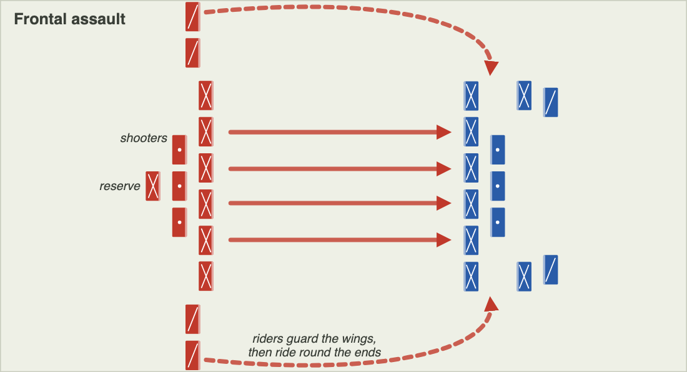

Foot in one or more lines, the best in the middle, shooters behind them, riders on both wings and a fifth of the foot kept back as a reserve. The riders guard the wings until the lines meet, then ride round the ends of the foe's line. It is the plain way to fight and the general's choice when he is the stronger and nothing promises more.

#### Oblique attack

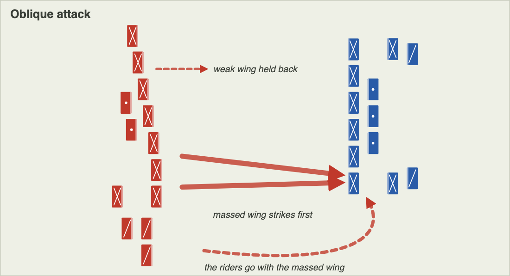

One wing is massed with the best foot, the second line, the reserve and all the riders; the other wing is held back in steps. The strong wing strikes first and breaks one end of the foe's line before the weak wing is engaged. A general picks it when he is no stronger than the foe, or when one wing of the foe is clearly weaker: he masses against that one. It needs at least four battalions of foot.

#### Envelopment

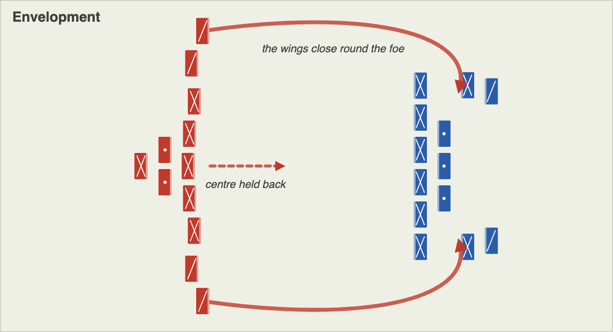

The ends of the line stand forward and the centre back, with riders on both wings, so the wings reach the foe first and close round him. A general picks it when he has clearly more riders than the foe, two battalions of them at least.

#### Wedge

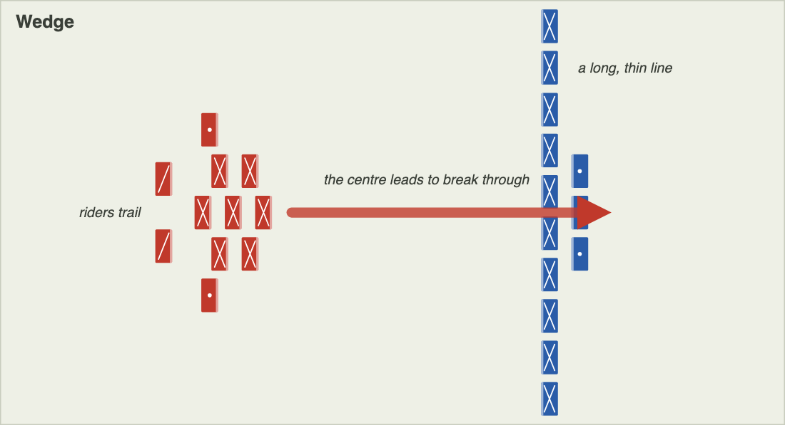

The foot form a deep column in the middle, two lines or more, with the wings trailing behind it, shooters at the ends of the first line and riders kept back. The centre hits first to break through. A general picks it against a foe whose line is longer and thinner than his own, when his own foot is the heavier. It needs at least five battalions of foot.

#### Harassing fire

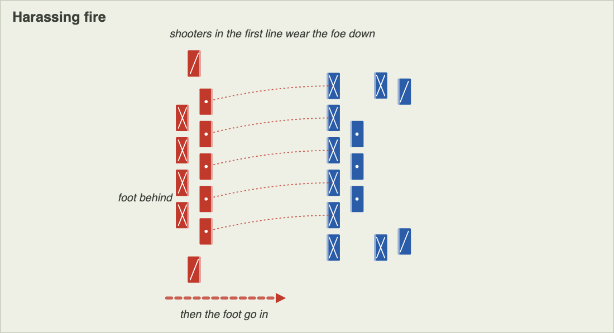

The shooters form the first line and the foot stand behind them, with riders on the wings and no reserve. The side shoots the foe down before it goes in. A general picks it when he has as many battalions of shooters as of foot and is better at shooting than at fighting hand to hand, and against a Wagenburg. Against a foe who comes straight at it the shooters in front are caught at grips.

#### Flying wedge

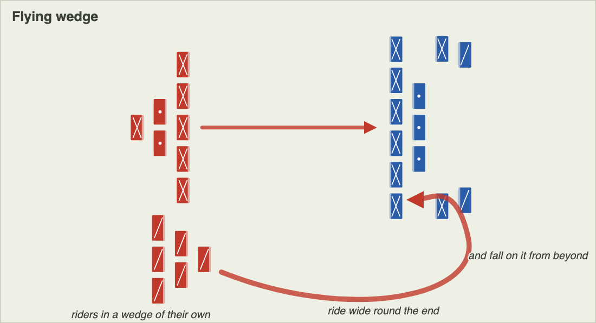

Foot as in a frontal assault, and the riders apart in a wedge of their own beyond one end of the line. When the time comes the wedge rides wide round the end of the foe's line as one body and falls on it from beyond its end once the foot have it engaged, on the wing with the more open ground. A general picks it with at least two battalions of riders that make a fifth of his power.

#### Feigned retreat

Drawn up as a frontal assault. Once the attack has stalled, a few minutes into the fight with as many men lost as taken and the troops still fresh, the whole side falls back as if beaten, once a battle. An attack that goes well never feints. To the foe it looks like a retreat, and he gives chase, leaving his ground: a hill, a ford, his own ditch. The side runs back a short way, then turns on its pursuers, who are caught out of order and lose heart. If the foe will not follow, the side turns back to the attack. Pursuers cut down some of the runners, and a side that truly loses heart on the way runs for good. Only in field battles; a general considers it with at least two battalions of riders that make a third of his power, the more so against a foe on strong ground, and takes it if it ends best when he thinks the battle through.

### Defending in the open

These tactics are for the side that waits for the foe. The general looks for the best ground nearby: high ground, a line whose ends lean on water, woods or a burg, and something the foe has to cross to reach it.

#### Defensive line

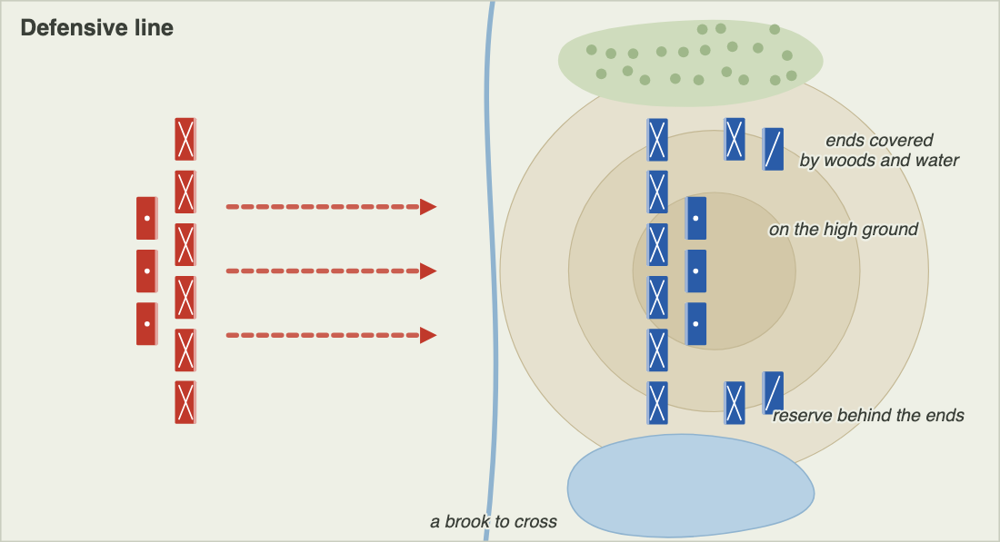

One line on the best ground in reach, following the brow of the slope, with shooters behind it, the reserve behind its two ends to cover the flanks and the riders kept back. It is the usual choice of a defender at fair odds.

#### Refused flanks

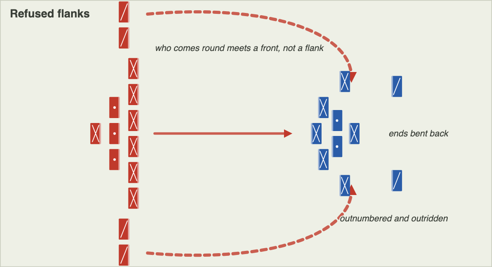

A line with its ends bent back, so a foe who comes round them meets a front, not a flank. A defender picks it when he is outnumbered or has fewer riders than the foe. Many battalions on a narrow field stand in two lines, and the bent ends show only at the front.

#### Defence of a crossing

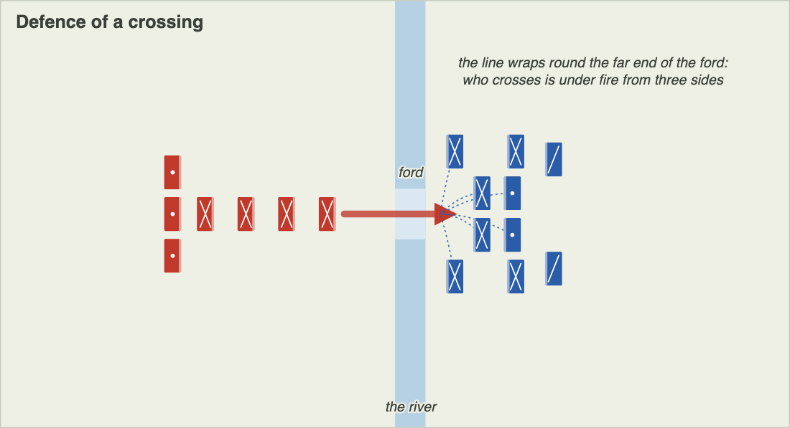

The line stands round the far end of the ford or bridge the attackers have to come by, its ends forward, so whoever crosses is under fire from three sides. The side stays behind the river until the foe runs. A defender always picks it when a river with a ford or a bridge lies between him and the attackers; a brook does not count, it is waded anywhere.

#### Wagenburg

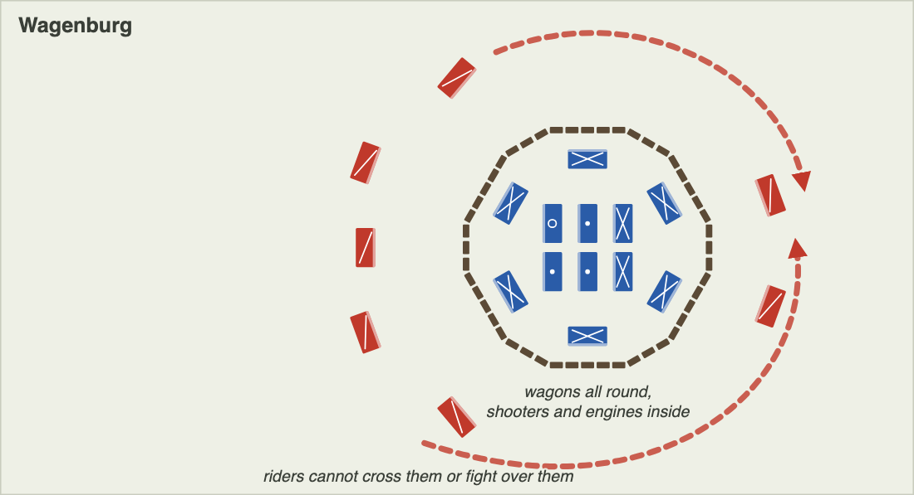

A ring facing out: foot on the ring, shooters and engines in the middle with the riders and the reserve, and the wagons drawn round it from the first moment. It does not move and goes out only to sally. Riders cannot cross wagons or fight over them, so it is the answer to a foe strong in horse: a defender picks it when the foe has twice his riders, riders are two fifths of the foe's power, and the open ground covers neither end of a line. Engines knock the wagons down, and foot can fight the holders over them.

#### Strategic retreat

A general who sees the day lost before the battle begins, by the odds on the ground or by his troops' heart, does not stand to fight: he draws his side up as a defensive line and leaves the field from the first moment. It is no rout and the log does not say the army breaks, but pursuers still fall on those they catch. You can give it to any side drawn up on its ground. To make a side fight anyway, give it another tactic before the start: an attack tactic sends it at the foe, a defence has it stand, and it leaves only once it has lost a quarter of its troops or its heart. An Attack order given before the start keeps it on the field only while the order stands; one given once it is leaving keeps it there for good.

### Ambush

#### Column of march and ambuscades

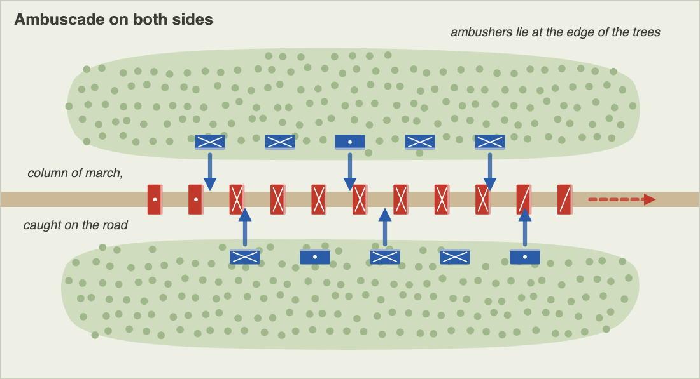

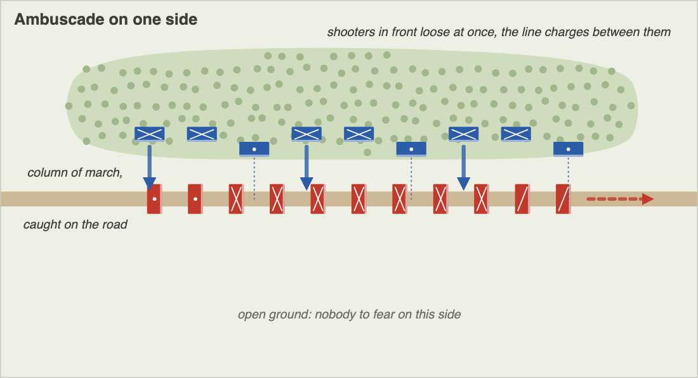

The attackers of an ambush are caught on the march: they stand in a _column of march_ on the road, in as many files as the road allows, and have no plan. The ambushers pick the stretch of the road where the ground serves them best and lie by it under the trees, a javelin's throw from the column (45 m), or 120 m off in the open. Their shooters lie in front, spread along the line, and shoot from the first moment; the line troops lie a step behind the gaps between them and charge through, and riders wait on the wings. They like high ground above the road, and never lie where water, a cliff or the edge of the plan is between them and the column. In an _ambuscade on both sides_ they lie on both sides of the road (first picture); in an _ambuscade on one side_ all of them lie on the better covered side (second picture). Their general weighs the two, unless trees hide them on one side of the road only, or only one side has room for them: then they all lie on that side. With shooters he also weighs holding the line troops back while the shooters work, and falling on the column only once it wavers. Ambushers who shot from cover and are much the weaker slip away once the surprise is spent, unless the column wavers.

### Siege

#### Siege lines and garrison on the walls

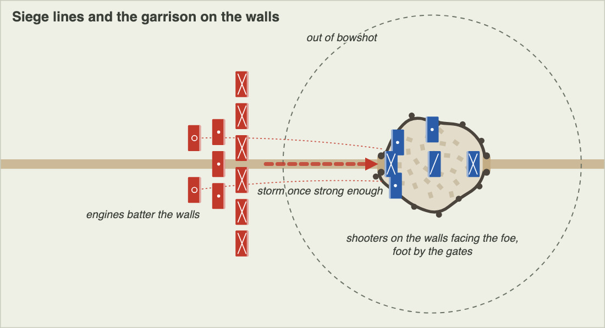

The besiegers form lines out of bowshot of the walls, their engines a row behind the first line, still in range of the walls. They storm when they are strong enough for the walls as they stand, every breach making it easier, bombard while their engines still bring the walls down, and otherwise blockade. The garrison always mans the walls: shooters on the side facing the besiegers, foot by the gates, riders and engines in the middle. Besiegers who are too few to ring the burg in use siege lines.

#### Ring round the walls

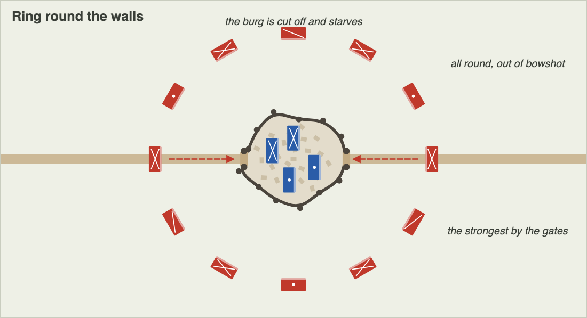

The besiegers stand all round the burg, out of bowshot, the strongest by the gates, ships off the quay and engines behind. While a besieger watches every gate the burg is cut off: the garrison loses heart every round and gives the burg up when it is starved. The general picks the ring with three times the garrison's power and at least six battalions; you can order it with fewer.

### Landing

#### Landing in waves

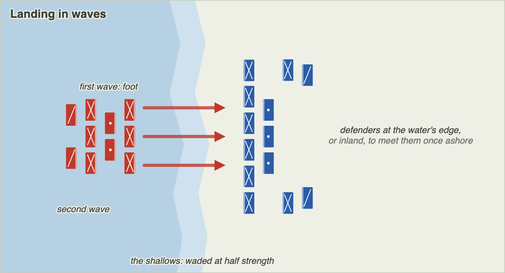

The attackers come over the water in waves, foot first and shooters and riders behind, and wade ashore through the shallows, where they fight at half their strength; nobody fights from a boat. The defenders draw up in a defensive tactic of their own, either at the water's edge or inland to meet the attackers once they have landed. Their general weighs the two.

## Works

A side that holds its ground can build works on the line before its first line: lines on the ground that hinder its foes and shelter it. There are three kinds:

| Kind   | Built                                                                                                                                        | Takes                                                           | Hinders                                                                                                                   | Shelters the holders                   |
| ------ | -------------------------------------------------------------------------------------------------------------------------------------------- | --------------------------------------------------------------- | ------------------------------------------------------------------------------------------------------------------------- | -------------------------------------- |
| Stakes | against a foe strong in riders (a third of its power) when there is no time for wagons, or against any foe when there is no time for a ditch | 2 minutes a battalion                                           | the foe's riders can neither cross them nor fight over them: they stand before them under the shooters' fire, or go round | —                                      |
| Ditch  | against a foe weak in riders, when there is time for it                                                                                      | 8 minutes a battalion                                           | everybody astride it goes at a ford's pace, its own side too                                                              | —                                      |
| Wagons | against a foe whose riders and shooters make a third of its power, when there is time; and by a side in a Wagenburg                          | 80 seconds a stretch, the side's train building three at a time | the foe crosses them nowhere, its riders do not fight over them; foot fight the holders over them                         | blows and shots over them half as hard |

A charge over any work strikes with no impetus. Works shelter only from the front: a foe that comes round the end of a ditch meets none of it. A side's own works never hinder it, but for a ditch.

Each battalion of the first line on foot, line troops or shooters, builds the stretch before its place, as long as itself and the gap to the next, so the stretches join along the line; a smaller battalion builds slower. Wagons are the train's: a wagon line runs before the whole first line and turns back at both ends to a half circle, so a foe going round its end still meets wagons; against a foe strong in riders (a third of its power) it is closed behind the army too, the front first and the back last, but for water, which closes it there; a Wagenburg rings the whole army. A stretch counts only once it is finished, from the next round on: a half-built ditch gives nothing. A battalion stops building when a foe in order comes within a round's march and a charge of it, fights if it has to, and takes the work up where it left it once the foe is gone. While a side builds, its order is ⛏️ _Fortify_ and the formation stands still; going over to the attack it leaves its works behind. A battalion at work says _Building_ when you point at it.

The general orders the works himself when his side holds and the foe will not be upon it before some kind is done: wagons against horse and bows, a ditch against foot, stakes when there is no time for either. In a field battle either side may build, in a siege the besiegers (siege lines), in a landing the defenders; ambushers hide rather than dig, the besieged have their walls, and there is no ground in a naval or an air battle. Once the foe is close enough to be upon the line within a round the battalions stop building and fight, and the general's _Fortify_ order gives way; a Wagenburg goes on being built. Order _Fortify_ by hand to have a side dig in when its general would not. Engines knock wagons down: every engine in range knocks out a wagon of the stretch nearest it, one a round, and two wagons out make a gap the foe gets in by. A general with engines comes at wagons at the pace of his engines, halts once they reach them and stands off till they have knocked two gaps, then goes in by the gaps; he goes in sooner only when the foe comes out of its wagons or when he chose to storm them at once. Ditches and stakes are not knocked down. While a side builds within sight of the foe the battle does not die down; once the works stand and nobody comes, it does.

A side _dug in_ starts the battle behind its works, finished: wagons against a foe strong in riders and shooters, else a ditch, or the wagons of a Wagenburg. Besiegers who ring a burg in are dug in, their lines facing the walls, and so are defenders who hold the water's edge ready for a landing (nothing is built in the water); anywhere else pick _Dug in_ in the side's order list before the start. Works are laid before battalions you moved by hand too, and anew when the troops are drawn up again.

On the plan works are drawn as on old battle plans: a ditch as a brown line with hachures on the foe's side, stakes as a row of thin slanted strokes leaning out to the foe, wagons as wooden walls on wheels end to end, their frames running back. A stretch being built grows along its line, faint till it is finished; wagons knocked out are left as wrecks askew in the gap. Hover over a stretch to see its kind, whose it is, what it does and how far along it is: building, finished but not yet counting, standing, damaged or broken through.

## Battle log

Everything that happens is written to the battle log, a window of its own beside the battle screen: open and close it with the _Battle log_ button at the bottom of _Configure Battle_, drag it aside or make it larger. It opens with the tactic each side is drawn up in, before the battle starts too, and follows any change of it. A line about one side has a mark of its color, red for the attackers and blue for the defenders, and names a battalion by its unit. The log says when a side is dug in before the start, when its works stand and when engines break through its wagons.

## Battle types

#### 🗡️ Field battle

Field battle is a standard type of combat. It starts with 🎯 _skirmish_ phase: the sides close to shooting distance, and shooters and engines do the damage. A general who is better at shooting than at close quarters keeps the skirmish up, for 3 to 10 minutes by his share of the fire, or for as long as it lasts if his army is made for shooting; one who is worse at it closes at once. Then ⚔️ _melee_ battle begins: the lines close and charge. A side that waits takes it when the foe is upon it. Once a general sees the day lost, his side is entering a 🏳️ _retreat_ phase: troops on the run strike at a tenth of their strength. Another side starts to 🐎 _pursue_ the enemy, where riders, the fastest, strike with the most impetus; it does so too when the foe has a quarter of its battalions left in order.

#### 🌊 Naval battle

Naval battle type is auto-selected when both attacker and defender regiments are naval. It starts with a 💣 _shelling_ phase, where ships and engines shoot. A fleet that would do better at close quarters than at shelling, one that carries melee troops, goes for ⚔️ _boarding_. A side that sees the day lost enters a 🏳️ _withdrawal_ phase. The enemy starts a ⛵ _chase_.

#### 🏰 Siege

If the defending regiment is located in a burg with walls, the system automatically selects siege as the battle type. Siege is the most complex type with a number of optional phases and different variants for attackers and defenders.

For attackers siege always starts with a ⏳ _blockade_ phase. This is an inactive phase, where attackers prepare or hold a blockade. No damage dealt until attackers are ready to start a 💣 _bombardment_ or ⚔️ _storm_ the burg. Engines do the work in a bombardment, while storming is risky and does not provide good results if attackers are not dominating in numbers.

Defenders with engines (machinery units, or naval units with a range) bombard from the very first iteration; without them they 🔒 _shelter_ in an inactive phase. When the besiegers' engines are poorly guarded, defenders send a 🚪 _sortie_ at them. Sortie can be pretty successful, so attackers are not safe during the siege.

When attackers initiate storming, besieged army is switching to a 🛡️ _defense_ phase. The walls, the burg and the climb are on the defenders' side, see _Walls_ above. If a storm is not successful and defenders do not 🏳️ _surrender_, attackers get back to a bombardment or blockade phase. Defenders surrender when their morale falls below 15 or nobody is left in order; attackers then start ☠️ _looting_ without significant resistance.

**Blockade**. Besiegers with three times the power of the garrison and at least six battalions ring the burg in: out of bowshot all round it, the strongest battalions by the gates. The burg is _cut off_ while every gate has a besieger near it: troops by a road gate, troops or ships by a river gate, and ships by the quay of a port. Besiegers without ships never cut a port off: the sea keeps it supplied. A garrison cut off goes hungry: it takes heart from nothing, not even from a won fight, loses a point of morale every round, more for units of low _morale_, and gives the burg up when it is down to 20, after some 24 to 32 minutes. Meanwhile the battle does not die down. The besiegers do not storm a burg they have cut off short of the odds; they starve it out. The garrison can try to break out: cut off, it sorties on lower morale, and goes also for a besieger keeping a gate shut when the party outweighs the troops about it. A gate is kept shut by every besieger about as far from it as the ring stands, so a sortie has to clear a stretch of the ring. Once a gate stands open, food comes in, hunger stops, and the garrison takes heart again: that is what a good sortie wins. The log says when the burg is cut off and when supplies reach it again.

Ships keep to the water on a land plan, on the run too: the sea, a lake or a river too deep to wade, never a ford or a brook. Drawn up on land they put out to the nearest such water, and a fleet cannot be added to a battle whose plan has none. Withdrawn or broken, ships leave the field by water; ships on a lake or a river that does not reach the edge of the plan sail out of the fight at once.

If siege is not successful, which is a pretty common case, attacker may decide to 🏳️ _retreat_. Besiegers who draw off before a garrison out in force are not broken: the log says the siege is raised, and so does the result. Defenders start 🐎 _pursue_ the enemy, their riders charging the broken.

#### 🌳 Ambush

Ambush is auto-selected if the defender is clearly the weaker, with less than three quarters of the attackers' power, and stands out of a burg where the ground hides him, in a Tropical seasonal forest, Temperate deciduous forest, Tropical rainforest, Temperate rainforest, Taiga or Wetland biome, in a cell a road or a trail leads through: a column is caught on a road. The plan is laid on that road. The attackers are caught in a column on the road; in an ambush you pick by hand where there is no road, straight on along their way, round the water and bogs in it: in single file, or in as many files as it takes for the column to fit the road on the plan. The ambushers lie on one or both sides of it, measured from the flank of the column, not from the road. It starts with a ⚡ _surprise attack_ of the defenders that causes attackers' 💫 _shock_. The ambushers' shooters shoot at once and the rest fall on the column between them. Their general may instead have the rest keep where they lie while the shooters shoot, shown as the order to skirmish: they all fall on the column once it wavers (morale under 70), once it has come to grips with any of them, or once the surprise is spent; the general plays both ways through and takes the better. The column in shock fights at half its strength for four minutes of fighting (five rounds) from the first shot. While it lasts the attackers' general gives no orders and the battalions of the column fend for themselves: they fight who falls on them and shoot back, but go for nobody, unless you order them to. So an ambush is deadly for the column: ambushers with about three quarters of its strength nearly always break it, with half of it they win about one fight in three, and a band much weaker than that only bleeds it a little. Once shock is over, sides enter a standard ⚔️ _melee_ phase, which usually ends with a 🏳️ _retreat_ of the side that sees the day lost. Other side start a 🐎 _pursue_ where riders strike hardest.

#### 🔱 Landing

Landing is happening when attackers regiment is naval and has land units, while defending regiment is a land one. The battle starts with a ⚓ _landing_ phase, which is quite risky for attackers. Defenders are ready for a 🛡️ _defense_ and can withstand or even force attackers to ⛵ _flee_: their general chooses between holding the water's edge, a battalion's depth from the water along the shore as it winds, so the attackers meet them still wading the shallows out of their boats, and waiting inland. If attackers are fleeing, defenders 🐎 _pursue_ those still ashore and then are ⌛ _waiting_ at inactive phase.

Once every battalion of the attackers is ashore, sides enter a standard ⚔️ _melee_ phase. If landing is successful, morale of defenders is dropping and they have to 🏳️ _retreat_. In this case attackers immediately start to 🐎 _pursue_ the enemy.

#### 💣 Bombardment

Bombardment is auto-selected when a fleet with no land troops aboard attacks a land regiment out of a walled port; a walled port is besieged instead. Ships keep to the water and troops ashore cannot get at them, so nobody comes to grips: the fleet shells whatever is within its range in a 💣 _bombardment_ phase, and the troops hold in 🛡️ _defense_, shooting back with what reaches the ships. Each side weighs only its fire against the enemy's fire: troops with few shooters and engines to answer the ships 🏳️ _retreat_ from the shore and leave it to the fleet, and a fleet facing stronger fire from the shore ⛵ _withdraws_. Like the defenders of a landing, their general chooses between holding the water's edge and waiting inland. A side can be told to hold, skirmish, retreat or surrender.

#### 💨 Air battle

Air battle type is auto-selected in very rare cases, when every unit of both the attacking and the defending regiment has the _aviation_ type. Air battle starts with a 🎯 _maneuvering_ phase, where fliers shoot from afar. Then an active 🐕 _dogfight_ begins, by the rules of a field battle. If a side sees the day lost, it is entering a 🏳️ _retreat_ phase. The enemy starts a 🐎 _pursue_.
